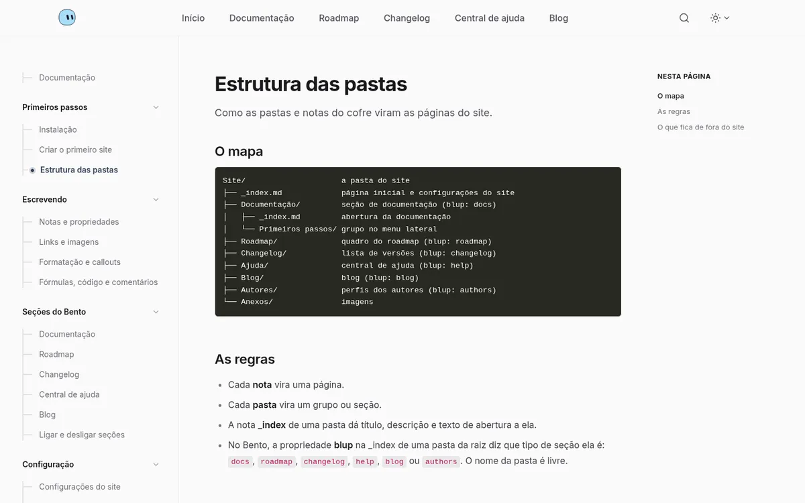

<p align="center">
  <picture>
    <source media="(prefers-color-scheme: dark)" srcset=".github/assets/logo-dark.svg">
    
  </picture>
</p>

<p align="center"><b>Your Obsidian notes become a website.</b><br>Free, fast, offline-friendly. One command to publish.</p>

<p align="center"><a href="README.pt-BR.md">Leia em português</a></p>

<p align="center"></p>

Blup is a command-line tool that turns a folder of your Obsidian vault into a website: a personal blog or a product site with docs, roadmap, changelog and help center. You keep writing in Obsidian. Blup builds the pages, the search, the images, the SEO, and publishes for free on Cloudflare Pages or GitHub Pages.

You don't need to know how to code. Blup asks one question at a time, each with a suggested answer, in English or Portuguese.

## What you get

- **Two themes**, each with a complete example site that teaches you how to use Blup:
  - **Mochi**: a personal blog with a featured post, tags, authors, related posts and a reading bar.
  - **Bento**: a product site with docs, roadmap, changelog, help center and blog. Every part is optional.
- **Write the Obsidian way**: properties, images, links between notes, callouts, math, footnotes, tasks and `%%comments%%` that never reach the site.
- **Built in**: site search, light and dark mode, images resized to WebP, a share image for every page, RSS and sitemap.
- **Password protected posts**, encrypted when the site is built. No server involved.
- **Authors**: one note per person, with photo, role, links and bio.
- **Offline first**: your notes stay on your computer. Sync them with a private GitHub repository when you're back online, and pick up on another computer. No git needed.
- **Free hosting** on Cloudflare Pages (`yoursite.pages.dev`) or GitHub Pages, and your own domain if you want one.
- **Everything is set up from Obsidian or the CLI**: name, menu, logo, favicon, social links and domain are properties of a note, or answers to questions.

| Mochi | Bento |
| --- | --- |
|  |  |

## Install

macOS and Linux:

```sh
curl -fsSL https://raw.githubusercontent.com/gabriellsalesx/blup/main/install.sh | sh
```

Windows (PowerShell):

```powershell
irm https://raw.githubusercontent.com/gabriellsalesx/blup/main/install.ps1 | iex
```

The scripts download the latest release, check its SHA-256 and install it without admin rights.

With Go 1.27 or newer you can also run:

```sh
go install github.com/gabriellsalesx/blup/cmd/blup@latest
```

## Your first site in five minutes

1. Run `blup`. The first time, it asks for the language and opens the new site wizard.
2. Pick your Obsidian vault and the folder that becomes the site (or the whole vault).
3. Pick a theme, give the site a name, and press Enter on the suggestions.
4. Let Blup adjust Obsidian so links work on the web (it keeps a backup of your settings).
5. Open the preview: the site shows up in your browser and updates every time you save a note.
6. When you're happy, run `blup publish` and choose Cloudflare Pages or GitHub Pages.

If the folder is empty, Blup fills it with the example site of the theme you chose: a full tutorial written as ordinary notes. Read it, open the notes in Obsidian to see how each page was made, then edit and replace it with your own content.

Made a mistake? Press **Esc** to go back one question. **Ctrl+C** quits.

## Commands

Running `blup` alone opens a menu with everything. Each action also has a command, in English or Portuguese:

| English | Portuguese | What it does |
| --- | --- | --- |
| `blup new` | `blup novo` | Create a new site |
| `blup preview` | `blup ver` | Live preview in the browser |
| `blup publish` | `blup publicar` | Put the site online |
| `blup customize` | `blup personalizar` | Menu, sections, social links, logo, favicon, author, custom domain, password |
| `blup sync` | `blup sincronizar` | Keep your notes in a private GitHub repository |
| `blup convert` | `blup converter` | Turn `[[wikilinks]]` into standard links |
| `blup build` | `blup gerar` | Build the site into `public/`, no questions asked |
| `blup language` | `blup idioma` | Change Blup's language |
| `blup update` | `blup atualizar` | Update Blup (`--rollback` goes back one version) |

## Writing

Every note in the site folder becomes a page; every subfolder becomes a section. Optional properties at the top of a note control the rest:

| Property | What it does |
| --- | --- |
| `title`, `description` | Page title and the summary shown in lists, on Google and on social networks |
| `date`, `tags`, `image` | Post date, topics, cover (`"[[my-cover.jpg]]"`) |
| `authors` | Who wrote it, like `[Ana, Bruno]` |
| `draft: true` | Only in the preview, never published |
| `hidden: true` | Published, but out of lists and search engines |
| `password` | Locks the post; `password: yes` uses the general password |
| `weight` | Order in menus and docs |

The site settings live in the properties of the `_index` note of the site folder: `site_name`, `site_description`, `logo`, `favicon`, `menu`, `social`, `button_text` and `button_link`. The example site explains each one.

## Your notes and your site

They are kept apart on purpose:

```
you write in Obsidian
        │
        ├── blup sync ─────► PRIVATE repository (only your notes)
        │                      └─ another computer downloads them and keeps writing
        │
        └── blup publish ──► PUBLIC site (only the generated pages)
```

Drafts, private notes and the plain text of password protected posts stay in your notes. The public site only gets what it should show.

## Updates

Once a day, when you open the menu, Blup checks for a new version and always asks before updating. The themes ship inside Blup, so your sites get the new theme on the next preview or publish. `blup update --rollback` restores the previous version.

---

## Development

```sh
go build -o bin/blup ./cmd/blup
./bin/blup        # opens the menu
go test ./...
```

Blup downloads Hugo and Pagefind by itself the first time it needs them (pinned versions, checked with SHA-256).

| Folder | What |
| --- | --- |
| `cmd/blup` | entry point |
| `internal/app` | menu, wizard, preview, publish, customize, sync; `starter/` has the example sites |
| `internal/i18n` | every CLI string (EN/PT) |
| `internal/obsidian` | vaults, Obsidian settings, note properties |
| `internal/scaffold` | generates `hugo.toml` and copies the theme |
| `internal/deploy/github`, `internal/deploy/cfpages` | GitHub Pages and Cloudflare Pages through their APIs, no git or wrangler |
| `internal/notesync` | notes sync with a private repository |
| `internal/lock` | encryption of password protected posts |
| `theme/` | the Hugo theme, embedded in the binary |

### Releasing a version

1. Write the release notes (EN and PT).
2. `git tag v1.2.3 && git push origin v1.2.3`
3. GitHub Actions runs the tests and GoReleaser publishes the binaries and `checksums.txt`.

## License

[MIT](LICENSE). The icons are from [Lucide](https://lucide.dev) (ISC, see `theme/licenses`).
