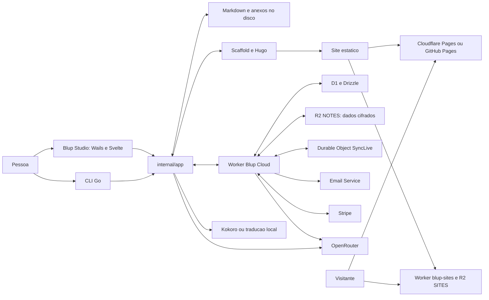
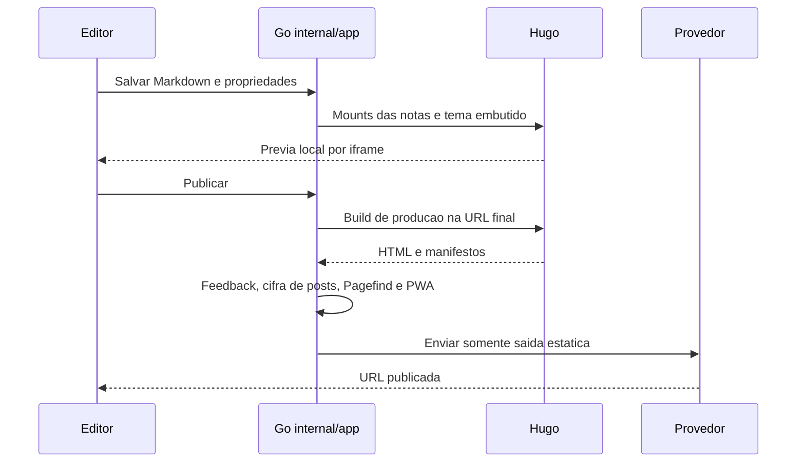
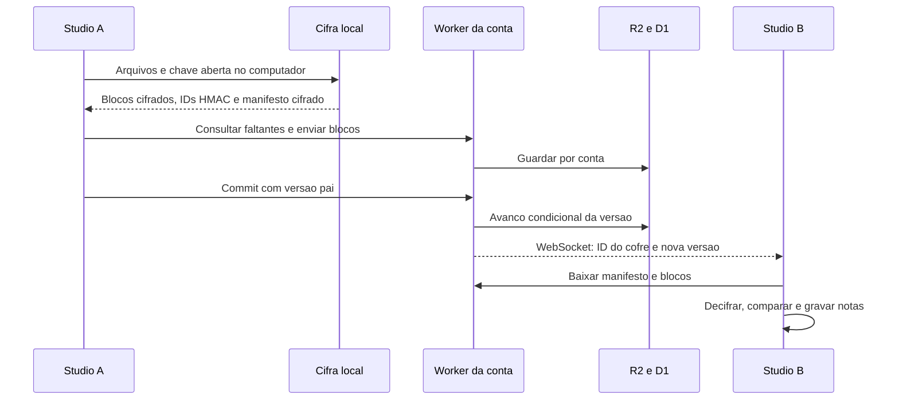
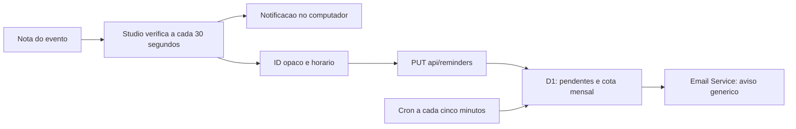
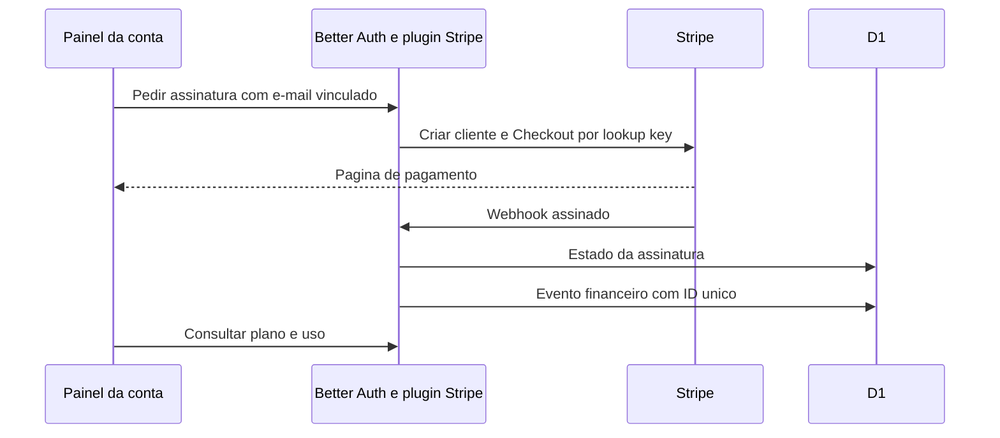
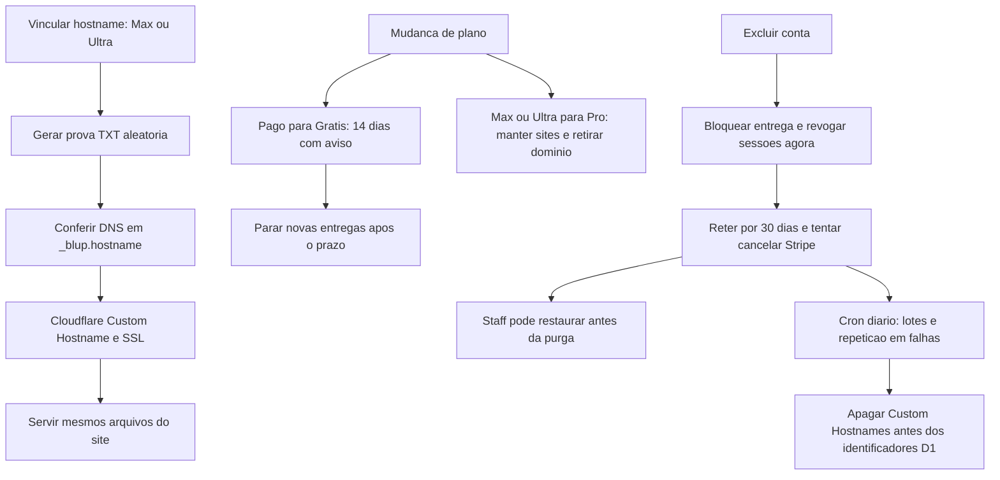

# Arquitetura do Blup

Retrato do código em 02/11/2026. Consulte o [índice da spec](spec/README.md), o [guia de produção](deploy.md) e o [modelo de segurança](seguranca.md). Código e configuração versionados prevalecem sobre mensagens de commit e textos de exemplo.

## Componentes e fronteiras

| Parte | Fonte e responsabilidade |
| --- | --- |
| CLI | [cmd/blup/main.go](../cmd/blup/main.go), [internal/app/app.go](../internal/app/app.go): comandos, perguntas e coordenação Go |
| Studio | [studio/main.go](../studio/main.go), [studio/studio.go](../studio/studio.go), [frontend](../studio/frontend/src/App.svelte): Wails v3, Svelte 5, CodeMirror, bindings Go/TypeScript e eventos |
| Regras locais | `internal/app`, `internal/config`, `internal/obsidian`, `internal/notesync`: persistência, arquivos, criação, sync e provedores |
| Tema | [theme](../theme): Hugo embutido no Go, modelos Mochi, Nori e Bento, CSS, JavaScript e i18n |
| Conta e API | [cloud/worker/index.ts](../cloud/worker/index.ts): Hono, middleware de sessão, validação Zod e APIs |
| Identidade e cobrança | [auth-options.ts](../cloud/worker/auth-options.ts): Better Auth, passkeys, OTP, aparelho, Bearer e plugin Stripe |
| Persistência cloud | [schema](../cloud/worker/db/schema.ts): Drizzle sobre D1; R2 guarda objetos; não há servidor Node persistente |
| Painel cloud | [cloud/vite.config.ts](../cloud/vite.config.ts): SvelteKit com adapter-static e fallback SPA, assets do Worker, Tailwind e Lucide |
| Sites públicos | [sites-entry.ts](../cloud/worker/sites-entry.ts), [serve-site.ts](../cloud/worker/serve-site.ts): outro Worker, sem o login ou os assets do painel |
| Feedback público | [feedback.js](../theme/assets/js/feedback.js) e repositório irmão `blup-api`: issues do GitHub, login e leituras com cache |

Raiz e `studio/` são módulos Go separados, unidos por `replace` local. O Studio usa Wails `v3.1.0` em `studio/go.mod`; o tema é compilado no executável pelo `embed.go`. `cloud/package.json` e seu lockfile definem as versões da aplicação web, incluindo Better Auth `^1.7.14`. Atualizar documentação de uma dependência não significa atualizar automaticamente essa versão ou os imports do projeto.

## Estado e propriedade dos dados

| Local | O que guarda |
| --- | --- |
| Pasta das notas | Markdown, YAML, anexos, arquivos de canvas/desenho/banco e agenda; é a origem editável |
| Diretório técnico do site | `blup.toml`, configurações Hugo, overrides, `public/` e `.blup/` local |
| `<notas>/.blup/site.toml` | Subconjunto portátil das configurações, enviado pelo sync |
| Configuração da máquina | Lista de sites, preferências, credenciais e chave local de sync; não vai no site |
| D1 | Conta, sessões, assinatura, staff, IDs/uso de sync, sites, cota de IA e horários de lembretes |
| R2 `NOTES` | Blocos e manifestos cifrados, referências de blocos para limpeza |
| R2 `SITES` | Arquivos públicos, staging e manifestos; anteriores protegidos temporariamente para limpeza segura |

O arquivo local de notas é legível no disco. A cifra de ponta a ponta é a fronteira do sync Blup Cloud. Sites públicos, chamadas de IA e e-mails não usam essa mesma fronteira. [Segurança](seguranca.md) detalha os dados visíveis em cada fluxo.

## Criar e escrever

`Onboarding.svelte` reúne tema, seções, nome e origem das notas e chama `CreateSite`; `VaultOnboarding.svelte` cria ou associa um cofre `kind = "notes"`, sem publicação. A CLI tem seu próprio assistente. O serviço Go valida o diretório técnico, cria a configuração e escreve exemplos quando aplicável. No Studio, criação não instala mais uma pasta de modelos do Obsidian. Feedback Bento e Podcast de Mochi/Nori são acrescentados depois, por Seções.

O workspace lê corpo e propriedades separadamente, agenda salvamento e observa alterações externas. O editor grava na mesma pasta usada pelo Obsidian ou por agentes no terminal. Renomear e mover corrigem os formatos de links reconhecidos pelo código; conflito de edição não é um merge semântico automático. A lixeira e snapshots ficam fora da pasta publicada. Cofres acrescentam nota do dia, agenda, mapa, backlinks, `.canvas`, `.draw` e `.table`.

A interface troca de idioma sem remontar a aplicação: `i18n-live.svelte.ts` fornece estado reativo e `i18n.ts` atualiza os grupos existentes. `Studio.SetLanguage` salva a escolha e atualiza a bandeja. O idioma do site e o das notas traduzidas são estados separados.

## Prévia e publicação

O scaffold substitui a cópia do tema e as configurações geradas, preservando diretórios de overrides. Hugo monta as notas, sem duplicar a origem editável. Na prévia inclui rascunhos e conteúdo `publish: false`/`private: true`, revelando o corpo protegido com aviso. `PreviewGuard` expõe proxy loopback em porta aleatória, valida Host/Origin e mantém Hugo em outra porta interna. No publish, o pós-processamento Go incorpora anexos locais pequenos no corpo protegido antes de cifrá-lo, retira manifestos internos, poda mídias sem referência, indexa busca e gera PWA. Falha na proteção apaga a saída, inclusive quando há marcadores sem manifesto válido. Somente Hugo não executa todas essas etapas.

Adicionar, remover ou restaurar seções pode exigir reiniciar o processo Hugo da prévia: o watcher pode perder arquivos copiados antes de observar uma pasta nova. `sectionsChanged` trata esse caso; `previewFollows` trata mudança de idiomas/mounts. O Studio aberto não precisa reiniciar.

GitHub Pages recebe blobs/árvores e Cloudflare Pages recebe Direct Upload. Blup Cloud usa a sessão da conta, reserva slug e recebe arquivos pelo hash do conteúdo armazenado, compactando recursos apropriados. O manifesto é ativado no D1 depois dos uploads; um Worker separado resolve os caminhos pelo manifesto e lê R2. O site usa `https://nome.getblup.site/`; Max/Ultra também vinculam um hostname próprio, após prova TXT e validação Cloudflare/SSL. O vínculo não muda a baseURL: URLs absolutas continuam em `getblup.site`. Reservas D1 limitam admissão concorrente, e leases serializam publicação/limpeza, preservando manifestos substituídos por pelo menos dez minutos.

Publicar é uma ação distinta de sincronizar. Um cofre sincronizado não fica público por isso; publicar o site não é backup das notas. [Publicação](spec/publicacao.md) descreve cache, concorrência e limites dos provedores.

## Sincronização cifrada

O motor `notesync` compara base, disco e remoto. O adaptador GitHub trabalha com Git Data API; o adaptador Blup Cloud trabalha com blocos de 4 MiB e manifesto cifrado. A chave mestra é aleatória e fica embrulhada por senha e recuperação. A nuvem não recebe esses segredos em claro. Um commit concorrente causa 409 e nova comparação, preservando cópias em conflitos.

Planos pagos têm debounce de dois segundos, avisos por Durable Object com WebSocket Hibernation e verificação a cada cinco minutos. Grátis usa o botão. O histórico tem prazo e rareamento, e consome a mesma cota. A configuração portátil inclui `translations`, identidade, domínio e cookies; exclui tokens, chave, senha geral, `Deploy` e `Feedback`. O cliente valida a forma do manifesto decifrado, caminhos, tamanhos de até 100 MiB e quantidade de blocos, e limita os bytes ao remontar antes de conferir SHA. Consulte [Blup Cloud](spec/blup-cloud-sync.md) e [notas e sync](spec/notas-e-sync.md).

## Narrar, ouvir e traduzir

`NoteOrigin` decide o idioma pela pasta imediata da nota traduzida. `Studio.Narrate` busca `Prefs.Voices[lang]`; `voiceFor` preserva a escolha explícita OpenRouter/Blup Cloud ou resolve uma voz local compatível. Sem voz local instalada, pede escolher/baixar, sem fallback automático para envio remoto. O texto falável retira sintaxe não narrável, é dividido em partes, vira MP3 e é unido localmente. A interface grava as propriedades de áudio. Nota com senha é recusada pela narração para não criar uma cópia pública falada.

Kokoro gera no computador. Pela chave própria, a requisição vai ao OpenRouter; pelo plano, vai a `/api/ai/audio/speech` e o Worker usa sua credencial do provedor. O modelo escolhido determina a estimativa por caractere; o servidor reserva cota antes da chamada e prefere custo reportado pelo provedor quando disponível; a cota é exibida em percentual. Esses textos precisam estar em claro para síntese remota. O Podcast agrupa narrações elegíveis em página e feed por idioma, com URLs do endereço de publicação, sem inscrição automática em diretórios de podcast.

O Go exige aceite independente para enviar texto ao OpenRouter ou Blup, em `ai-consent.json`. Narração e tradução remota recusam notas com senha. Tradução local usa Firefox Translations em worker da janela. A preferência explícita `translateAI` escolhe `local`, `openrouter` ou `blup`, sem inferir destino por saldo/chave. Tradução remota usa OpenRouter ou `/api/ai/translate`; os textos traduzidos voltam a arquivos na pasta do idioma. Título, corpo, propriedades textuais e exemplos de Feedback seguem o contrato da tradução. O selo de IA é retirado por revisão explícita. Conversas reais do GitHub são compartilhadas, sem tradução automática. O site publicado escolhe uma tradução existente para o idioma do visitante, com preferência manual lembrada e fallback inglês somente se aquela página tiver inglês.

## Agenda e e-mail

Eventos são notas em Agenda/Calendar, com repetição e antecedência. Avisos locais precisam do aplicativo em execução. O Studio pode deixar horários futuros na nuvem, que continua verificando com o app fechado. A fila não recebe título ou anotações; Max permite 50 e Ultra 100 e-mails por mês UTC. A preferência global controla as duas formas de aviso. O servidor reivindica itens por lease, reserva cota mensal e admite até três tentativas; só aceitação do provedor aumenta o contador. Desligar avisos ou sair cancela pendentes com repetição após falha de rede. Não há garantia de entrega ou exatamente uma mensagem por evento em várias instalações; veja [calendário](spec/calendario-e-lembretes.md).

## Cobrança e operação

O plano resulta da assinatura reconhecida, ou cortesia específica do proprietário, e é conferido nas APIs. Stripe cuida do checkout e portal em suas próprias páginas. O código não armazena números de cartão. A staff usa Cloudflare Access, valida JWT novamente e aplica papéis `support`/`admin`; ações ficam no registro de auditoria. Não há impersonação do usuário ou interface de leitura de notas.

O Worker da conta executa limpeza diária às 04:00 UTC, incluindo purga de contas elegíveis após 30 dias. A cada cinco minutos processa lembretes, reservas expiradas, limpeza de sites, cancelamentos financeiros pendentes e avisos de downgrade. Publicação de código, migração D1, objetos R2, configuração de e-mail e lançamento do Studio são operações diferentes. As tarefas e os limites de rollback estão em [deploy](deploy.md).

## Domínio, retenção e mudanças de direitos

[lifecycle.ts](../cloud/worker/lifecycle.ts) centraliza direitos de conta, exclusão lógica e elegibilidade de purga. O Worker público confere essa condição no D1 antes de responder pela Cache API; não conserva o antigo cache de 30 segundos do head. O prazo de 14 dias é exclusivo de pago para Grátis, observado e persistido pelo sistema; voltar ao pago retira o bloqueio. Reduzir de Max/Ultra para Pro conserva sites existentes, com direitos atuais para novas operações e domínio próprio desativado.

A exclusão lógica agenda purga após 30 dias e cancela sessões/lembretes imediatamente. A staff pode restaurar antes de vencer o prazo e antes de começar a purga, sem recriar assinatura cancelada. Falhas de Stripe, Cloudflare ou R2 mantêm estado para repetição; o cron não promete apagar no segundo exato. [Publicação](spec/publicacao.md) e [segurança](seguranca.md) detalham cópias de navegador e dados externos.

## Contratos entre linguagens e release

O painel infere DTOs de `AppType` Hono por `hc`/`InferResponseType`; `worker/export-rpc.mjs` gera um contrato de transporte sem bindings privados do Worker. Zod valida entradas e contratos externos nos pontos consumidos. Wails gera modelos/métodos TS de Go, e os eventos registrados geram payloads tipados para `Events.On`. Arquivos locais/sincronizados recebem normalização e limites próprios. Os wrappers genéricos de GitHub/Cloudflare Pages ainda usam DTOs sem schema semântico estrito; os detalhes e limites de null/opcionais/números estão em [tipagem e contratos](spec/tipagem-e-contratos.md).

A autoatualização CLI verifica Ed25519 dos bytes exatos de `checksums.txt`, depois SHA-256 do pacote, e recusa versão igual/anterior. O gerador `scripts/sign-release` usa chave fora do repositório. Os instaladores iniciais permanecem só com SHA-256. Builds `production` exigem `app.Version` em `x.y.z`; assinatura nativa/notarização e distribuição do Studio têm fluxo separado. Veja [build](spec/testes-e-build.md) e [deploy](deploy.md).

## Referências oficiais consultadas

A separação de módulos segue a [documentação Go](https://go.dev/doc/modules/managing-dependencies); a ponte desktop e distribuição são descritas pelo [Wails v3](https://v3.wails.io/getting-started/installation/). A reatividade segue [Svelte 5](https://svelte.dev/docs/svelte/$state) e o painel estático usa o [adapter-static do SvelteKit](https://svelte.dev/docs/kit/adapter-static). O Worker usa o ambiente documentado por [Hono](https://hono.dev/docs/getting-started/cloudflare-workers), [Drizzle D1](https://orm.drizzle.team/docs/get-started/d1-new), [Zod](https://zod.dev/basics) e [TypeScript](https://www.typescriptlang.org/docs/handbook/intro.html). A configuração concreta da autenticação é a do código, conferida com as referências atuais de [Better Auth](https://better-auth.com/docs/reference/security). Cloudflare e Better Auth também foram consultados pelo MCP Context7 com suas fontes oficiais; este guia não pressupõe que recursos externos já estejam provisionados.

Na rodada 2 também foram conferidos [Hono RPC](https://hono.dev/docs/guides/rpc), [validação Hono](https://hono.dev/docs/guides/validation), [tipagem Better Auth](https://better-auth.com/docs/concepts/typescript), [Ed25519 Go](https://pkg.go.dev/crypto/ed25519), [eventos Wails](https://v3.wails.io/guides/events-reference/) e [tipos SvelteKit](https://svelte.dev/docs/kit/types). MCP Svelte forneceu a documentação de TypeScript/estado; MCP Wails inspecionou o projeto sem executá-lo. Context7 forneceu referências oficiais atuais de Cloudflare for SaaS e Better Auth, complementadas pelos links oficiais de [deploy](deploy.md).
