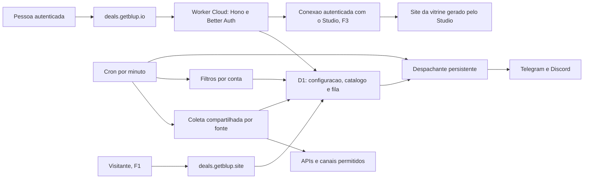

# Blup Deals

Especificação de produto e técnica baseada na nota conectada **Blup Deals- decisões**, aprovada pelo dono. Segue a organização da [spec do Pulse](blup-pulse.md). Contratos de API, tabelas e proteções descritos como propostos orientam a implementação; não são uma afirmação de entrega, homologação de lojas ou liberação comercial. Exemplos usam marcadores, sem credenciais reais.

## Estado da entrega por fases

**F1 validada localmente, com auditoria independente da Lupa após os fechamentos do Prumo e da Confete.** A nota **Blup Deals- F1 contrato**, incluindo seu resultado real do servidor, antecipa links curtos e estatísticas de cliques para a F1 e fixa 100 posts/dia. Os preços estão aprovados pelo dono e os quatro Prices foram criados no Stripe sandbox pelo Maestro. Os gates locais informados estão registrados abaixo; não comprovam deploy, venda ou homologação dos bots/APIs de loja. A pesquisa da Lupa permanece como referência para regras de fontes e custos estimados.

As bases já existentes que podem ser aproveitadas são [API Cloud](../../cloud/worker/index.ts), [autenticação](../../cloud/worker/auth-options.ts), [cobrança](../../cloud/worker/billing-api.ts), [fila Pulse](../../cloud/worker/pulse/outbox.ts), [transportes Pulse](../../cloud/worker/pulse/transports.ts), [cliente RPC Pulse](../../cloud/pulse/src/lib/api.ts), [PanelShell](../../cloud/src/lib/ui/PanelShell.svelte), [SignInForm](../../cloud/src/lib/ui/SignInForm.svelte), [SignInFrame](../../cloud/src/lib/ui/SignInFrame.svelte) e [SetupGuide](../../cloud/pulse/src/lib/SetupGuide.svelte). Reutilizar essas peças exige adaptar seus contratos: um alerta privado Pulse e uma oferta publicada em canal têm conteúdo, permissões e limites diferentes.

### F1: contrato acordado

O contrato abaixo substitui as propostas iniciais de rotas F1 e incorpora o resultado real do servidor. A API fica sob `/api/deals`, com Hono, Zod e RPC tipado em `cloud/src/lib/rpc.d.ts`. Fontes: [montagem](../../cloud/worker/deals/api.ts), [canais/Telegram](../../cloud/worker/deals/channels.ts), [afiliados](../../cloud/worker/deals/affiliates.ts), [ofertas](../../cloud/worker/deals/offers.ts) e [caçadas/estatísticas](../../cloud/worker/deals/hunts.ts). Rotas administrativas usam a sessão Cloud e o dono; webhook Telegram e redirect público têm autorização própria ou são públicos, conforme indicado.

| Método e caminho relativo | Contrato F1 acordado |
| --- | --- |
| `GET /channels` | `{channels:[{id,type,label,active,lastError,createdAt}]}`, tipo `telegram/discord` |
| `POST /channels` | `{type:"discord",webhook}`; valida o webhook como no Pulse; `201 {id,label}` se novo ou `200 {id,label}` se já salvo; acima de dez destinos, `409 QUOTA` |
| `POST /telegram/link` | `{}`; `201 {id,url,expiresAt}` |
| `GET /telegram/link/:link` | `{state,candidate,channelId}`; estado `pending/candidate/expired/confirmed`; candidato `{id,label}` ou `null`, `channelId` string ou `null` |
| `POST /telegram/link/:link/confirm` | `{}`; `201 {id}` ou `200 {id}` se já confirmado; `409 LINK_EXPIRED` ou `409 QUOTA` quando aplicável |
| `POST /telegram/webhook` | Update do bot Deals, fora da sessão; secret no header; candidato é o canal/grupo em que o bot foi adicionado como administrador, não o chat privado |
| `DELETE /channels/:channel` | Remove o destino do dono |
| `POST /channels/:channel/test` | `{}`; tentativa imediata de envio, fora da outbox; `202 {ok,code}`. `ok:false` é falha, mesmo com 202 |
| `GET /affiliates` | `{stores:[{store,configured,hint}]}`; `hint` é string ou `null`; lojas `amazon/mercadolivre/shopee/aliexpress` |
| `PUT /affiliates/:store` | Body por loja: Amazon `{tag}`; Mercado Livre `{word,tool?}`; Shopee `{appId,secret}`; AliExpress `{appKey,appSecret,trackingId}`; `{ok:true}` |
| `DELETE /affiliates/:store` | Remove a configuração da loja do dono |
| `POST /offers/preview` | `{url}`; `{store,title,image,price,currency,link,affiliate,reason?}`; busca só HTTPS público, com timeout, teto de bytes e redirects manuais; usa metadados quando disponíveis |
| `POST /offers` | `{url,channelIds,sendAt?}`; `201 {id,queued}`, ID da oferta e quantidade efetivamente enfileirada; `sendAt` ISO até 30 dias; `409 DUPLICATE` se já estiver em todos os destinos, `429 DAILY_LIMIT` sem cota |
| `GET /offers` | Query opcional `state=queued/sent/failed`; `{posts:[{id,title,image,store,link,state,channelId,sentAt,clicks,lastError}]}`, até 100; sem cursor nesta fase |
| `GET /hunts` | `{hunts:[{id,kind,active,channelIds,filters,createdAt}]}` |
| `POST /hunts` | `{kind,channelIds,filters}`; kind `games_free/games_deals`; filtros opcionais `platforms:string[]`, `minDiscount:number`, `maxPrice:number`; `201 {id}` |
| `PATCH /hunts/:hunt` | `{active?,channelIds?,filters?}` |
| `DELETE /hunts/:hunt` | Remove a caçada do dono |
| `GET /stats` | Query `days=7/30/90`, padrão 7; `{days:[{day,clicks,posts}],top:[{title,clicks}]}`; dias UTC do mais antigo até hoje, com zeros nos vazios e até cinco ofertas no top |

O redirect público acordado é `GET https://deals.getblup.site/r/:code`, fora da sessão: `302` para o link final e incremento agregado de `deals_click_day`, sem guardar IP. A vitrine continua para a conexão Studio na F3.

O detalhe combinado entre servidor e painel fixa `title:string` mesmo sem metadados, usando o domínio como fallback; `image`, `price` e `currency` podem ser `null`. `price` usa centavos e `currency` informa a moeda ISO. Preview identifica `amazon/mercadolivre/shopee/aliexpress/other`; `reason` opcional usa `not_configured/unsupported_store/conversion_failed`. No post, `sentAt` é ISO ou `null` e `lastError` é código de falha ou `null`.

Filtros de jogos: `minDiscount` é inteiro de 0 a 100; `maxPrice` usa centavos de USD. Plataformas aceitas: `pc`, `steam`, `epic`, `gog`, `ubisoft`, `itchio`, `playstation`, `xbox`, `switch`, `android`, `ios`. `games_deals` aceita apenas `pc/steam/epic/gog/ubisoft`; `pc` representa todas as opções de PC. As demais plataformas nesse tipo retornam `INVALID`.

O link Telegram abre o chat privado do bot; este oferece botões para adicionar como administrador a canal ou grupo. O candidato não é esse chat privado: é o destino em que a mesma pessoa do Telegram adicionou o bot com status `administrator`. Isso vale para canal, grupo e supergrupo; no canal, `can_post_messages` precisa vir explicitamente `true`. Membro comum, restrito ou admin sem esse direito no canal não vira candidato. Perder esses direitos desativa o destino vinculado com `DESTINATION_DISABLED`.

Coleta global de GamerPower/CheapShark (a CheapShark foi removida depois, em 04/11/2026) ocorre uma vez por rodada de 30 minutos, com catálogo `deals_offer` e dedupe. O post leva foto quando disponível, título, preços quando conhecidos, link curto e aviso de afiliado quando o post está marcado como afiliado. GamerPower e CheapShark têm crédito com link ativo; CheapShark mantém também seu próprio link principal, sem troca pelo afiliado do usuário. A fila é `deals_post`, com 100 publicações/dia **somadas entre destinos**, intervalo mínimo de dois minutos no mesmo canal e sem repetir a oferta naquele canal. Secrets do bot próprio: `DEALS_TELEGRAM_TOKEN` e `DEALS_TELEGRAM_WEBHOOK_SECRET`, sem valores nos docs. O contrato inicial menciona cupom; a F1 entregue não tem campo ou extração estruturada de cupom.

No painel, F1 cobre destinos Telegram/Discord, cards de Afiliados sem recuperar segredo, fila/enviados/falhas em Ofertas, colar link com prévia e escolha de destinos, caçadas de jogos, gráfico diário e top de cliques. `/start` passa por assunto, canal, IDs opcionais, prévia e ligar; jogos cria as caçadas selecionadas. Lojas e espelhamento ficam para F2 como **Em breve**. As telas e limitações estão na seção 10; schema e migração estão na seção 8.

### Fechamento local e limites da verificação

A Lupa confirmou independentemente **52/52 testes Deals em dois arquivos** e TypeScript do Worker, além dos checks da prévia e da API. O Prumo informou o fechamento completo com **468/468 testes em 39 arquivos**, inclusive execução serial, e check sem erros. A Confete informou check sem erros/avisos, builds Deals/Pulse e autofixer MCP Svelte limpos. A documentação conferiu relatório, nota e código, sem repetir essas suítes. Fontes de regressão: [f1.test.ts](../../cloud/worker/deals/f1.test.ts) e [acesso](../../cloud/worker/deals/access.test.ts).

A auditoria local aplicou `0000..0030` no D1, com `quick_check` sem erro e dados anteriores Pulse preservados. A matriz de interface passou **54/54 verificações**, cobrindo nove rotas, três idiomas e larguras de 1.280 e 390 pixels. Foram conferidos títulos, aba ativa, execução, texto e ausência de transbordamento horizontal. Mobile foi verificado por DOM, métricas e interação; a captura final ficou indisponível, sem avaliação visual por screenshot.

Os fluxos exercitados incluem login por código/sessão compartilhada, plano e cota, canais, afiliados cifrados, prévia e agendamento, caçadas de jogos, links/cliques, isolamento entre contas, entradas inválidas e CORS. As regressões finais cobrem agendamento +3 dias, resposta/host AliExpress, purga e links, orçamento global/429/timer, direitos de administrador Telegram e montagem dos créditos ativos. Os ajustes de título por rota, aviso de afiliado e tradução de `other` também foram conferidos.

**Validação local não é homologação de provedores.** Discord, fontes e metadados usaram fixtures; não houve bot Telegram real nem credenciais reais de loja. Comissão, fotos nos aplicativos reais, domínio/webhook público, capacidade sob carga e concorrência distribuída continuam para homologação. O ambiente local tem exceções operacionais próprias: não assumir que todo o seu tráfego externo esteja bloqueado nem transformar seus endereços, contas ou configurações temporárias em contrato de produção. Permanecem F2/F3 e liberação comercial.

## 1. Produto e público

O Blup Deals ajuda uma pessoa a manter canais de ofertas no Telegram e no Discord. Ela conecta o destino, informa seus identificadores de afiliado quando os tiver, escolhe assuntos e revisa o primeiro post. Depois pode publicar um link manualmente ou ativar caçadas automáticas. O foco é quem está começando, sem acesso a APIs de lojas e sem histórico de vendas.

Uma **oferta** é um produto, promoção ou brinde com origem e data de verificação. Uma **caçada** é uma regra que escolhe ofertas de uma fonte para certos canais. Um **espelho** é uma caçada cuja fonte é um canal acessível pelos meios técnicos definidos na seção 6, sem exigir autorização do dono da origem por decisão do dono do Blup. Um **canal** é o destino confirmado onde o bot pode publicar. Um catálogo global evita buscar a mesma fonte para cada assinante.

O produto inclui jogos, links colados e espelhamento. O Blup ajuda a preparar e distribuir posts; comissão depende de cadastro, aprovação, atribuição e regras da loja. Não prometer renda, aprovação em programa de afiliados, preço disponível até a compra ou comissão em qualquer link. WhatsApp fica fora da Fase 1. O produto usa bots oficiais, sem conta pessoal automatizada ou userbot.

## 2. Planos e limites

Deals é um adicional **somente do Ultra**. O card do Ultra tem o switch **Adicionar Blup Deals**, independente do switch Pulse. Não haverá Deals avulso ou adicional de Grátis, Pro ou Max nesta proposta.

| Variante Ultra | Pulse | Deals |
| --- | --- | --- |
| `ultra` | Não | Não |
| `ultra_pulse` | Sim | Não |
| `ultra_deals` | Não | Sim |
| `ultra_pulse_deals` | Sim | Sim |

As variantes preservam os direitos do Ultra: 10 GiB de notas, arquivos de até 100 MiB, 10 sites, computadores sem limite de quantidade e os demais direitos da [spec Cloud](blup-cloud-sync.md#planos-executados). Posts, fontes e cliques do Deals não são notas sincronizadas nem consomem sites Hugo. Deals não concede Pulse quando o respectivo switch está desligado.

| Limite do catálogo atual | Ultra com Deals |
| --- | --- |
| Canais de destino ativos | 10 no total, somando Telegram e Discord |
| Caçadas sem espelho | 20; F1 permite apenas os dois tipos de jogos |
| Espelhos | 10 previstos para F2; não há criação de espelho na F1 |
| Posts por dia | 100 no total da conta (decisão do dono, 04/11/2026) |
| Histórico | 90 dias |

Os limites estão em [dealsLimits](../../cloud/shared/pulse-plans.ts), incluindo `postsPerDay:100`. A [admissão](../../cloud/worker/deals/store.ts) conta registros por conta e **dia previsto de envio em UTC**, antes de enfileirar. Enviar a mesma oferta a três canais consome até três unidades. O batch confere os inserts anteriores e pode enfileirar só a parte que cabe; a resposta informa `queued`. Retry da mesma linha não cria outra reserva. Linhas com falha continuam na contagem enquanto existirem; não há reembolso automático de cota por falha. O painel mostra uso do dia atual e próxima meia-noite UTC.

A cota limita admissões para o dia previsto, sem acumular saldo ou multiplicar por destino. Não há uma tabela separada de recibos/reservas no modelo F1: a própria `deals_post` faz esse papel. Limites de leitura das fontes e dos bots são adicionais à cota comercial; uma tentativa cujo aceite externo ficou incerto ainda pode ser reenviada, sem garantia de entrega exatamente uma vez.

## 3. Blup, cor e domínios

| Item aprovado | Valor |
| --- | --- |
| Blup do produto | `turma-8`, coral `#ff7a59` |
| Destaque do painel | `--color-blup: #c2410c`, para texto branco com contraste AA |
| Painel privado | `https://deals.getblup.io` |
| Links curtos, F1 | `https://deals.getblup.site` |
| Vitrine, F3 | Gerada e publicada pelo Blup Studio a partir da conexão Deals; sem vitrine externa no Deals |

Reaproveitar o shell, temas claro/escuro, foco de teclado e componentes do Cloud. Interface e mensagens usam `pt/en/es`; os caminhos ficam em inglês. Nomes e textos de ofertas mantêm o idioma da fonte, salvo edição explícita. Ícones funcionais vêm do Lucide; marcas, quando necessárias, usam os arquivos Simple Icons CC0 permitidos pelo projeto. Não desenhar marcas nem usar emoji como ícone de interface.

O coral da personagem e a cor de destaque têm funções diferentes. Conferir também contraste de bordas, estados desabilitados, links e foco, sem usar só a cor para informar falha ou oferta expirada.

## 4. Fontes de ofertas por loja e jogos

As fontes abaixo constam da decisão de produto. A coluna de condição distingue contratos de API pesquisados, validações ainda pendentes e o risco do espelhamento aberto assumido pelo dono. Fonte pública não significa licença irrestrita para republicar seu conteúdo; essa ressalva não cria uma exigência de autorização do dono da origem no Deals.

| Fonte | Uso pretendido e fase | Condição de entrada |
| --- | --- | --- |
| GamerPower | Jogos grátis, brindes e resgates, sem chave; F1 | Uso comercial permitido com hyperlink ativo de atribuição; até 10 requests/s; não revender o catálogo ou declarar os dados como próprios |
| CheapShark | Removida em 04/11/2026 | Só tinha preço em dólar das lojas dos EUA; trocada pela Nuuvem (Rakuten). |
| Amazon | Link manual com a tag da pessoa; automação F3 | Creators API da própria pessoa, com pelo menos 10 vendas qualificadas nos últimos 30 dias; Telegram/Discord não têm aprovação nominal geral confirmada |
| Mercado Livre | Link manual; caçadas de loja F2 | `matt_word` sozinho não tem contrato oficial de geração de afiliado confirmado na pesquisa inicial; APIs exigem autenticação. Não apresentar um parâmetro montado como comissão validada |
| Shopee | Converter link colado na F1; caçada de lojas entregue em 04/11/2026 | API oficial gera até 50 links por lote; a F1 gera um por conversão, com credenciais habilitadas da pessoa; cota depende da conta/região |
| AliExpress | Converter link colado na F1; caçada de lojas entregue em 04/11/2026 | Método oficial gera até 50 links por chamada; a F1 gera um por conversão, com App Key/Secret e Tracking ID habilitados |
| Outra loja | Colar link, F1 | Prévia de URL HTTPS pública, com fallback de título; sem editor manual de título/preço e sem conversão para uma loja sem adaptador |
| Canal Telegram | Espelhamento aberto, F2 | Só canais públicos pela prévia `t.me/s/<canal>`, sem login/userbot; não exige autorização do dono da origem; risco dos termos registrado e assumido pelo dono do Blup |
| Canal Discord | Espelhamento aberto, F2 | Só servidores onde o bot foi adicionado e canais com permissões técnicas de leitura; não exige autorização adicional do dono da origem; risco dos termos assumido pelo dono do Blup |

A exceção da CheapShark (links da própria fonte, sem afiliado do usuário) deixou de existir com a remoção da fonte em 04/11/2026. Fica a regra geral: não usar uma fonte para descobrir uma promoção e trocar o afiliado fora do caminho que ela permite.

### Jogos: atribuição e coleta

GamerPower permite uso comercial gratuito com atribuição por link ativo. Manter esse crédito no post e na futura importação Studio. O limite publicado de 10 requests/s é teto externo, não frequência desejada do coletor. Cobrar pela ferramenta de automação não deve virar venda de dump dos dados sem permissão. [API e termos GamerPower](https://www.gamerpower.com/api-read).

As promoções de jogos pagos vêm da Nuuvem pela Rakuten (seção "Nuuvem"), com o ID de cada cliente.

### Mercado Livre

Busca e recursos públicos exigem access token; autenticação não garante acesso a todo endpoint. Usar OAuth autorizado, sem pedir senha; a rotação do refresh token precisa ser serializada por conta. A geração de afiliado oficialmente descrita usa Gerador de Links/Barra de Afiliados. Etiqueta de campanha não comprova a identidade do afiliado. Até existir contrato de conversão validado, aceitar e preservar o link que a pessoa já gerou oficialmente. [Autenticação dos recursos](https://developers.mercadolivre.com.br/pt_br/desenvolvimento-seguro), [OAuth](https://developers.mercadolivre.com.br/pt_br/mensagens-post-venda/autenticacao-e-autorizacao), [geração de links](https://www.mercadolivre.com.br/l/afiliados-gere-seus-links) e [etiquetas](https://www.mercadolivre.com.br/l/afiliados-crie-etiquetas).

O checklist brasileiro inclui Telegram público e restringe grupos privados e locais não declarados. Discord não aparece como autorização nominal geral nessa relação. Conferir os destinos declarados pela pessoa, sem generalizar a permissão de um canal para todos. [Checklist](https://www.mercadolivre.com.br/l/checklist), [perguntas frequentes](https://www.mercadolivre.com.br/l/primeiros-passos-perguntas-frequentes-para-afiliados).

### Shopee e AliExpress

O Explorer brasileiro da Shopee expõe GraphQL e assinatura SHA-256 com App ID, timestamp, payload e Secret. `generateShortLink` aceita até cinco `subIds`; `generateBatchShortLink`, até 50 links por chamada. Isso comprova o método para conta habilitada, sem comprovar uma cota universal ou acesso imediato de uma conta iniciante. Sem API, a pessoa pode colar seu link já convertido oficialmente. [Explorer](https://open-api.affiliate.shopee.com.br/explorer/v2), [acesso à API](https://affiliate.shopee.com.br/open_api) e [geração manual](https://help.shopee.com.br/portal/10/article/128461-Como-gerar-seus-links-de-Afiliado-ou-ID-de-produto-para-compartilhar).

AliExpress documenta `aliexpress.affiliate.link.generate`, com `app_key`, timestamp, assinatura por App Secret, `tracking_id` e até 50 URLs em `source_values`. O método consta como `chargeable=false`; `access_token` é opcional **nesse método**, sem dispensar credenciais ou aprovação. Preservar o `promotion_link` recebido. O contrato público consultado não fixa requests/s ou cota mensal universal; verificar o console e o uso das chaves por um serviço terceiro. [Método oficial](https://openservice.aliexpress.com/doc/api.htm#/api?cid=3&path=aliexpress.affiliate.link.generate&methodType=GET%2FPOST), [schema oficial](https://openservice.aliexpress.com/handler/share/apidoc/getApi.json?cid=3&path=aliexpress.affiliate.link.generate&methodType=GET%2FPOST).

### Amazon: acesso e canais

A ajuda brasileira de candidatura lista determinadas redes sociais, sem aprovação nominal geral de Telegram/Discord. A permissão contratual para mensagens solicitadas não autoriza automaticamente qualquer canal. Confirmar o destino com o programa antes de anunciar essa integração. Manter identificação publicitária clara e a declaração de Associado exigida, inclusive ao limpar um espelho. Tag tecnicamente montável não comprova que a publicação é elegível. [Candidatura](https://associados.amazon.com.br/help/node/topic/G8TW5AE9XL2VX9VM), [políticas](https://associados.amazon.com.br/help/operating/policies) e [divulgação](https://associados.amazon.com.br/help/node/topic/GPXFHVYZMTGPUMPE).

Automação usa Creators API, sucessora da PA-API 5, com credenciais próprias e ao menos 10 vendas qualificadas em 30 dias. A documentação inicial indica até 1 request/s e 8.640/dia nos primeiros 30 dias, respeitando ambos os tetos; depois ajusta por receita atribuída, até 10 requests/s. `GetItems` aceita até dez ASINs por chamada. Não apresentar uma conta sem vendas como pronta para catálogo automático. [Introdução](https://affiliate-program.amazon.com/creatorsapi/docs/en-us/introduction), [limites](https://affiliate-program.amazon.com/creatorsapi/docs/en-us/concepts/api-rates) e [substituição da PA-API](https://affiliate-program.amazon.com/creatorsapi/docs/en-us/paapiv5-deprecation).

Autenticação usa o fluxo OAuth da Creators API, sem reaproveitar chaves AWS da API antiga. Boas práticas indicam cache de Offers/BrowseNodeInfo por uma hora e outros campos por um dia. Preservar parâmetros dos links devolvidos. Histórico de 90 dias, imagens e encurtamento Blup dependem da licença específica, sem aplicar a retenção geral automaticamente. [Autenticação](https://affiliate-program.amazon.com/creatorsapi/docs/en-us/get-started/using-curl), [cache e links](https://affiliate-program.amazon.com/creatorsapi/docs/en-us/concepts/best-programming-practices).

O catálogo guarda a origem de cada observação, loja, moeda, região, preço, instante de coleta, validade quando informada e link permitido. Um preço riscado só aparece se a fonte o sustentar; menor preço observado significa o menor **na janela coletada**, não um recorde de toda a loja. Ausência de preço é `null`, não zero. Brinde gratuito deve indicar plataforma, requisito e prazo quando conhecidos, sem confundir com teste temporário ou assinatura necessária.

Não combinar preços de moedas, edições, plataformas ou regiões diferentes para calcular desconto. Cupons e frete devem aparecer como condições, sem reduzir silenciosamente o preço. Uma fonte indisponível mostra atraso e suspende suas caçadas; não fabricar ofertas nem apresentar o último preço como recém-verificado.

## 5. Afiliados e colar link

Na F1, Afiliados mostra Configurado ou Não configurado por loja e o hint da configuração salva. ID público de afiliado e segredo de API são campos distintos. Salvar um ID não comprova que a conta pode usar uma API ou receber comissão; falhas de conversão aparecem na prévia do link.

Fluxo acordado da F1 para **Colar link**:

1. O painel envia somente `{url}` a `POST /offers/preview`. O servidor admite HTTPS público e busca metadados com timeout, limite de bytes e redirects manuais validados.
2. A prévia informa loja, título, imagem/preço/moeda opcionais, link final e situação de afiliado. Sem título conhecido, usa o domínio; ausência de preço/imagem permanece `null`.
3. O adaptador aplica a configuração da pessoa conforme a loja. Falta de configuração, loja não suportada ou falha de conversão aparecem como `reason`, sem inventar comissão.
4. A pessoa vê a prévia e escolhe destinos. `POST /offers` recebe `{url,channelIds,sendAt?}`; não recebe título/preço editados nem um ticket de prévia no contrato F1.
5. O servidor prepara a publicação e enfileira após revalidar dono, direito, canais e cota. O resultado de criação não comprova entrega no Telegram/Discord.

A F1 entregue monta Amazon com `tag` e Mercado Livre com `matt_word`/`matt_tool`, conforme o adaptador de links; o sinal de conversão aplicado não comprova elegibilidade ou comissão reconhecida. As ressalvas de programa da seção 4 permanecem. Salvar credencial Shopee/AliExpress permite converter o link colado e criar a caçada de lojas.

O fetch da página aceita HTTPS e valida destino público a cada salto. A imagem extraída precisa ter URL HTTPS, mas essa checagem não é a mesma validação DNS aplicada à página: a foto é carregada pelo navegador/Telegram/Discord, sem proxy ou armazenamento R2 no Blup. Links encurtados passam pela validação do fetch.

O [fetch da prévia](../../cloud/worker/deals/fetch.ts) usa até cinco redirects, timeout de oito segundos e mantém até 512 KiB do corpo. A [extração](../../cloud/worker/deals/page.ts) lê Open Graph, título e Product JSON-LD, sem executar JavaScript. Página comum que recusa robôs pode resultar só no domínio como título, sem preço/foto; encurtador que não resolve ou salto bloqueado retorna erro. As verificações de URL/DNS e a flag pública do Worker são a defesa implementada; os gates locais não comprovam proteção universal de rede/DNS rebinding em produção.

## 6. Espelhamento: funcionamento, limites e cuidados

Espelhamento faz parte do produto aprovado e fica **aberto, sem exigir autorização do dono do canal de origem**, por decisão do dono do Blup. É um tipo de fonte de Caçadas, com origem identificada, destino, filtros e intervalo. O dono assume o risco dos termos do Telegram e do Discord; essa decisão não equivale a uma licença concedida pelas plataformas. Não criar uma sexta aba apenas para espelhos.

### Fluxo proposto

1. A pessoa cadastra a origem: canal público Telegram por `t.me/s` ou canal Discord acessível ao bot instalado no servidor. Não há etapa de autorização do dono da origem.
2. O servidor normaliza a identidade da fonte e cria ou reaproveita uma assinatura global. Dez pessoas usando o mesmo canal não causam dez coletas da mesma página por rodada.
3. O coletor lê só mensagens novas, com cursor persistente, tamanho limitado e sem voltar indefinidamente no histórico.
4. O adaptador extrai campos de oferta e produtos reconhecidos. HTML, embeds e mensagens são dados não confiáveis, nunca componentes executáveis do painel.
5. A caçada filtra as ofertas, remove o texto promocional específico do afiliado anterior e gera o vínculo da própria pessoa **quando o programa permitir**. Mantém a procedência e os avisos obrigatórios; não atribui autoria ao Blup ou ao novo afiliado.
6. A prévia mostra a transformação. Depois de ativada, a caçada usa o mesmo renderizador e fila dos posts manuais, com dedupe e limites por conta/destino.

### Telegram

A origem aprovada é a pré-visualização pública `https://t.me/s/<canal>`, sem sessão, número de telefone, userbot ou acesso a canais privados. A Bot API não oferece uma consulta geral ao histórico de qualquer canal público. O Deals não exige autorização do dono da origem. Ler HTML público não concede licença geral para republicar textos/imagens de terceiros ou remover atribuição: o risco contratual fica registrado e assumido pelo dono do Blup. O coletor preserva os limites técnicos, sem contornar bloqueio ou limite. [Licenciamento de conteúdo](https://telegram.org/tos/content-licensing), [termos de bots](https://telegram.org/tos/bot-developers).

A pesquisa não encontrou cota, SLA ou licença geral de espelhamento comercial por `t.me/s`. A prévia é um recorte, não contrato de histórico completo. Por decisão do dono, a habilitação não fica limitada a canais próprios/autorizados nem depende de confirmação escrita do Telegram. Isso não elimina o risco dos termos ou direitos de terceiros. Proteção de conteúdo continua sendo respeitada.

Mudança de HTML, resposta 403/429, canal removido ou bloqueio técnico da origem pausa a coleta e mostra motivo curto. Não resolver por proxies rotativos, login pessoal ou coleta oculta. Conteúdo sem produto reconhecível fica para revisão, sem copiar automaticamente todo o post.

### Discord

O bot só acessa canais permitidos de um servidor em que foi instalado. Verificar `VIEW_CHANNEL`, `READ_MESSAGE_HISTORY` e `MESSAGE_CONTENT` para texto/embeds/anexos comuns. A restrição de conteúdo alcança REST também: polling não contorna o intent. Adicionar o bot ao servidor não concede todas as permissões. O projeto precisa decidir entre leitura HTTP incremental e Gateway na F2. Não considerar que um webhook de saída recebe mensagens de outros canais. [Messages](https://docs.discord.com/developers/resources/message).

Não exigir autorização adicional do dono do canal de origem para espelhar. Essa abertura foi decidida pelo dono do Blup, que assume o risco dos termos e do conteúdo de terceiros. Instalação do bot, acesso ao servidor e permissões técnicas continuam obrigatórios.

Se houver Gateway, revisar intents, heartbeat, reconexão, retomada e infraestrutura persistente, sem prometer que um cron substitui a conexão. A F1 permanece sem DO. A política anunciada em 11/06/2026 separa dois processos: revisão de intents privilegiados ao alcançar 10.000 usuários únicos com acesso ao app, com revisão anual depois da aprovação; verificação do aplicativo para passar de 100 servidores. A revisão de intent deve ser solicitada no prazo de 90 dias após a notificação indicada pelo Discord. Conferir o estado real no Developer Portal, sem usar a regra antiga de 100 servidores como único limiar de intent. [Gateway](https://docs.discord.com/developers/events/gateway), [mudança dos intents](https://support-dev.discord.com/hc/en-us/articles/40281523410967-Changes-to-Privileged-Intent-Access-for-Discord-Apps) e [verificação do app](https://support-dev.discord.com/hc/en-us/articles/23926564536471-How-Do-I-Get-My-App-Verified).

### Dedupe e repetição

Guardar a identidade da mensagem de origem e uma chave normalizada do produto/oferta. A chave da entrega inclui conta, destino e ocorrência publicável; repetir a coleta não reenfileira a mesma ocorrência. Oferta igual em dois espelhos não produz dois posts no mesmo canal. Mudança real de preço ou novo período de gratuidade pode gerar nova ocorrência conforme a regra da caçada. Não usar só um hash do texto, pois mudar pontuação contornaria o dedupe.

Os dez espelhos são limite por conta, não dez downloads obrigatórios por rodada. O cenário de custos usa cinco minutos, como premissa de dimensionamento, sem autorização de polling nesse intervalo para toda fonte. Intervalos efetivos, limite de mensagens por fonte, janela de repetição e TTL dependem da fonte e da homologação; não publicar uma promessa de tempo real nesta revisão.

## 7. Arquitetura Cloudflare e fronteiras

API proposta em `cloud/worker/deals`, montada em `/api/deals/*` no Worker Cloud. Painel SvelteKit estático em `cloud/deals`, com configuração proposta `cloud/wrangler.deals.jsonc`. Esses caminhos de organização não afirmam que os arquivos já foram criados. Dados em D1 com Drizzle, sem DO ou R2 na F1. A fila persistente inicial é uma tabela D1, não um novo serviço Cloudflare Queues implícito.

Cada fonte global tem uma lease, revisão, cursor e `nextPollAt`. O cron existente `* * * * *` seleciona apenas fontes vencidas, em lotes curtos; coleta uma vez, valida e salva as observações. Não executar uma varredura completa do catálogo a cada minuto. Credenciais privadas de loja pertencem à conta: só compartilhar a coleta entre usuários quando o contrato do provedor permitir; uma chave pessoal não vira chave global do Blup.

O mesmo cron filtra caçadas, cria entregas, despacha lotes e limpa expirados. Cada etapa tem orçamento de trabalho, cursor de continuação e lease independente, sem manter transação D1 aberta durante a rede. Cron atrasado não implica compensar todas as ofertas antigas em uma rajada. São 43.200 rodadas em 30 dias, compartilhadas, sem trigger por cliente/caçada. [Cron Triggers Cloudflare](https://developers.cloudflare.com/workers/configuration/cron-triggers/).

No Workers Paid, cron com intervalo menor que uma hora tem 30 segundos de CPU por invocação e até 15 minutos de duração total; espera de rede não é CPU. O runtime limita conexões de saída simultâneas a seis, memória a 128 MB e subrequests a 10.000 por invocação. Trabalhar abaixo desses tetos, dividindo o orçamento também com Cloud/Pulse, sem tentar consumir tudo em cada rodada. D1 permite até 1.000 consultas individuais por invocação e 100 parâmetros por instrução. Esses são tetos de plataforma, não tamanho recomendado de lote. [Workers limits](https://developers.cloudflare.com/workers/platform/limits/), [D1 limits](https://developers.cloudflare.com/d1/platform/limits/).

Leases e mudanças de cursor/estado usam operações condicionais, versão e recibos. Uma resposta atrasada não sobrescreve a configuração nova da pessoa ou reativa caçada sem plano. Coleta compartilhada não mistura o afiliado de uma conta com o de outra: o catálogo guarda a oferta base e a personalização acontece na entrega.

### Login e CORS

Reutilizar a sessão Cloud, com cookie restrito a `cloud.getblup.io`. O navegador do painel Deals chama a API Cloud com `credentials: include`. A nova variável **proposta** `DEALS_APP_URL` autoriza a origem exata `https://deals.getblup.io` em CORS, checagem de mutações e `trustedOrigins`, como a integração Pulse. Não usar `*` com credenciais nem habilitar cookie no domínio pai apenas para compartilhar login. A integração oficial confirma CORS explícito antes da rota de autenticação e credenciais também no cliente RPC. [Better Auth com Hono](https://better-auth.com/docs/integrations/hono#cors).

`/sign-in` usa SignInFrame/SignInForm com a identidade coral. Passkeys preservam o RP ID comum configurado no Cloud (`getblup.io`); a origem exata Deals precisa integrar a lista permitida do plugin, além do CORS. Não criar outra identidade de passkey por produto. Retorno ao Deals tem destino fixo permitido, sem redirect arbitrário por query. O host público `deals.getblup.site` não recebe credenciais ou CORS administrativo. Fontes: [segurança Better Auth](https://better-auth.com/docs/reference/security), [opções atuais de autenticação](../../cloud/worker/auth-options.ts) e [cliente existente](../../cloud/pulse/src/lib/api.ts).

O painel pode ser estático e carregar dados privados pela API. Rotas dinâmicas como `/hunts/[id]` precisam de fallback/roteamento compatível com `adapter-static`; HTML gerado no build não inclui dados de conta. [SvelteKit adapter-static](https://svelte.dev/docs/kit/adapter-static).

### Vitrine pela conexão Deals e Studio, F3

A atualização da decisão exclui uma vitrine hospedada pelo Deals. O Studio recebe ofertas selecionadas por uma conexão autenticada e monta o site da vitrine com seu pipeline de geração/publicação. `deals.getblup.site` fica para os links curtos. Não criar uma rota pública de catálogo ou vitrine nesse host.

Contrato proposto da conexão: leitura paginada de ofertas permitidas do próprio dono, com título, link final permitido, imagem autorizada, preço/moeda, origem, data de verificação, validade e aviso de afiliado. Nunca exportar chaves de lojas, destinos dos bots, mensagens brutas do espelho ou dados de outras contas. Seleção do que publicar, atualização, tratamento de ofertas vencidas e destino do site precisam de controles no Studio. Uma cópia estática não se atualiza sozinha; não prometer remover ofertas expiradas sem uma nova geração/publicação. Veja o [pipeline atual](scaffold-e-build.md) e o [Studio](studio.md).

Não conceder sites adicionais por ligar Deals. A vitrine segue o destino de publicação escolhido no Studio e as regras desse destino. Template, formato das notas importadas, frequência de atualização e eventual sincronização automática serão definidos na F3.

## 8. Dados: base atual e evolução

A base conferida está em [deals-schema.ts](../../cloud/worker/db/deals-schema.ts), criada por [0028_deals_base.sql](../../cloud/migrations/0028_deals_base.sql) e ampliada por [0029_deals_f1.sql](../../cloud/migrations/0029_deals_f1.sql) e [0030_deals_account.sql](../../cloud/migrations/0030_deals_account.sql). A existência do schema e os gates locais não confirmam aplicação remota.

| Tabela da base atual | Campos e finalidade |
| --- | --- |
| `deals_channel` | Dono, plataforma, nome, destino, guild opcional, ativo, verificação, criação, `plan_disabled` e `retire_at`; índices por dono, destino único por dono/plataforma e expiração |
| `deals_affiliate` | Chave dono + loja; tag, credenciais, nível e datas; a F1 exige proteção dos dados sensíveis e não devolve segredos ao painel |
| `deals_source` | Fonte global com chave canônica única, kind, config, cursor, próxima/última coleta, falhas, claim e lease |
| `deals_hunt` | Dono, nome, kind, fonte, filtros e canais como JSON, intervalo, ativo, última publicação e campos de retirada |
| `deals_offer` | Catálogo global com hash único, loja/ID externo/fonte, título, URL, imagem, preço/antigo/moeda opcionais, primeira/última observação e validade |
| `deals_price` | Chave oferta + instante, preço e moeda; índice de expiração por instante |
| `deals_post` | Outbox por dono, caçada opcional, canal/oferta, código curto único, link final, estado, tentativas, data de tentativa, claim/lease, dia UTC, envio e falha; oferta única por canal |
| `deals_click_day` | Chave post + dia UTC, dono e total de cliques; sem histórico individual de visitantes |
| `deals_account` | Dono como chave, último plano, `read_only_until` e `purge_started`; índice do prazo de leitura para a rotina diária |

A base guarda timestamps em milissegundos e dinheiro em unidade menor da moeda. O contrato público F1 exige datas ISO 8601 em string. `null` é preservado quando preço, imagem ou envio não existem. Filtros/canais lidos de JSON precisam de validação antes do uso, sem confiar só no tipo TypeScript declarado.

A migração F1 `0029` acrescenta `deals_telegram_link` para vínculo/candidato/expiração e `deals_telegram_update` para dedupe de updates; também adiciona `hint` em afiliados, `target_hash`, `next_at` e `last_error` no canal, kind/plataformas/desconto/crédito nas ofertas e o sinal `affiliate` no post. A `0030` cria `deals_account` e seu índice de carência. Destinos e configurações de afiliado são cifrados antes de persistir. Aplicar `0028`, `0029` e `0030` antes deste Worker F1.

O código curto é campo de `deals_post`; não há tabela separada `deals_short_link`. Tampouco há `deals_delivery`, `deals_day`, `deals_credential` ou as tabelas de junção sugeridas no desenho inicial. A fila faz a contagem de cota, e `deals_affiliate.credentials` guarda a configuração cifrada por loja. Uma eventual seleção persistente para exportar ao Studio é evolução F3, sem tabela de vitrine hospedada no Deals.

As migrações seguem o Drizzle e devem ser aplicadas antes do Worker que consulta o novo schema. Medir leituras/escritas e o efeito dos índices, além do tamanho do banco.

### Retenção e retirada

O catálogo tem `historyDays:90`. A [limpeza diária](../../cloud/worker/deals/catalog.ts) remove cliques e preços antigos, posts não enfileirados com criação anterior à janela e ofertas antigas sem referência de post; também limpa vínculos/updates Telegram antigos. Fila vencida pelo dia previsto vira `failed/EXPIRED`. Essa rotina SQL não é prova de execução remota e não altera TTLs exigidos pelas licenças das fontes. A F1 não implementa limites específicos de retenção de conteúdo Amazon, cuja automação continua F3.

### Retirar apenas o plano Deals

O direito continua enquanto a assinatura mantém a variante Deals durante o período pago. Ao observar sua perda, a [regra de acesso](../../cloud/worker/deals/access.ts) inicia **14 dias só leitura** para uma conta com registro Deals: novos envios/configurações retornam `403 PLAN`, as caçadas deixam de alimentar a conta e a fila pendente vira `failed/PLAN`. As leituras privadas do dono continuam disponíveis enquanto os dados existem; a rotina diária faz a retirada ao vencer a janela.

O prazo é gravado na primeira observação da ausência do direito, pelo acesso ou por [dealsLifecycle](../../cloud/worker/deals/purge.ts) no cron diário; visitas posteriores não renovam o mesmo prazo. Não é calculado por um `paid_until` salvo no Deals. O cron também inicia a janela para quem não abre o painel e seleciona até 25 contas vencidas por rodada, reivindicando a purga antes de apagar.

Se o direito voltar antes de começar a purga, o estado de leitura é limpo e os dados ainda existentes são preservados. Isso não recupera dados já apagados nem reenfileira automaticamente posts que viraram `failed/PLAN`. A purga de Deals retira seus dados privados e preserva a conta Cloud e os demais produtos. Uma conta que nunca teve registro Deals não recebe uma nova janela por apenas abrir o painel sem plano.

### Excluir ou bloquear a conta Cloud

Conta excluída ou banida perde acesso administrativo e seus links curtos passam a 404 imediatamente. Na purga definitiva do ciclo Cloud de 30 dias, [purgeAccounts](../../cloud/worker/lifecycle.ts) chama `purgeDealsAccount`. Saem afiliados/credenciais, canais, caçadas, posts, cliques, vínculos Telegram e `deals_account` daquele dono. A antiga pendência de integração está resolvida no código conferido.

O catálogo global permanece. Produtos colados do tipo `product` que só aquela conta publicou são removidos com seus preços; produtos referenciados por outra conta e jogos compartilhados ficam. Recibos técnicos `deals_telegram_update`, sem corpo da mensagem ou vínculo de dono, seguem a limpeza diária própria. Essa retenção é distinta dos 14 dias após retirar apenas Deals e dos 90 dias de histórico.

## 9. API Hono tipada

O [contrato F1 acordado](#f1-contrato-acordado) no estado da entrega substitui a tabela inicial de endpoints propostos. A F1 usa `POST /offers`, `GET /offers`, `POST /telegram/link` e Discord por webhook de canal. Não há, nesse contrato, `POST /offers/publish`, ticket de prévia, `/deliveries`, OAuth Discord ou prefixo `/channels/telegram`.

Todas as rotas privadas usam sessão Cloud e dono. Criar/ativar/enviar exige direito gravável; leituras continuam restritas ao próprio dono e as rotas de remoção de canal, afiliado ou caçada não exigem direito gravável. Não aceitar `userId`, preço Stripe, plano ou limite como autoridade do cliente.

O endpoint de uso é `GET /api/deals/usage`: `{plan,limits,readOnly,readOnlyUntil,used:{channels,hunts,mirrors,postsToday},resetsAt}`. Sem direito Deals, plano/limites são `null` e `readOnly:true`; `readOnlyUntil` é ISO ou `null`, sem acrescentar prazo quando a conta nunca teve Deals. `resetsAt` aponta a próxima meia-noite UTC em ISO. Fontes: [API](../../cloud/worker/deals/api.ts) e [acesso](../../cloud/worker/deals/access.ts).

Usar TypeScript estrito, Zod para body/query/params e respostas de provedores, com JSON de entrada estrito e tamanho limitado. Frontend importa AppType/RPC e infere DTOs, sem duplicá-los manualmente ou converter `unknown` por cast. Middleware global de erro não aparece automaticamente na inferência RPC: tratar o envelope comum também no cliente. [RPC Hono](https://hono.dev/docs/guides/rpc), [validação Hono](https://hono.dev/docs/guides/validation) e [schemas Zod](https://zod.dev/api).

Datas do contrato F1 são strings ISO 8601. Preço é inteiro em unidade menor, com moeda explícita ou `null`; título é string, imagem e envio podem ser `null`. O detalhe acordado entre Prumo e Confete exige `lastError:string|null` em cada post e erros `{code}`. Códigos previstos: `UNAUTHORIZED` 401, `PLAN` 403, `INVALID` 400, `NOT_FOUND` 404, `QUOTA` 409 para quantidade de recursos, `DAILY_LIMIT` 429 para posts/dia, `LINK_EXPIRED` 409, `CHANNEL_UNAVAILABLE` 503, `FETCH_BLOCKED` 400 e `FETCH_FAILED` 502. O resultado real também usa `DUPLICATE` 409 quando uma oferta já está em todos os destinos escolhidos. Não ecoar corpo, URL secreta ou stack.

As rotas de lojas automáticas, fontes de espelho e exportação Studio continuam evoluções F2/F3. Seus bodies, paginação e paths ainda não são contrato implementado; a F1 não deve expor um cadastro que pareça ativar espelhamento ou busca de loja.

### Redirect público e cliques, F1

O contrato fixa `GET https://deals.getblup.site/r/:code`, fora da sessão, com resposta 302 para o link final salvo e soma em `deals_click_day`, sem guardar IP. Não aceitar `?url=` como destino livre. A vitrine permanece gerada pelo Studio na F3, sem rota pública de vitrine no Deals.

Contagem significa acesso ao link, não pessoa única, compra ou comissão. O [redirect](../../cloud/worker/deals/redirect.ts) atende GET/HEAD e não conta HEAD nem User-Agents identificados como robôs/prévias, incluindo Telegram/Discord. Essa heurística não identifica toda automação nem torna o total uma métrica de pessoas únicas. Cada GET contabilizado faz UPSERT no agregado D1 do dia UTC; não depende de flush de memória. Código inválido, post ausente, conta banida/excluída ou destino sem HTTPS retorna 404, sem registrar clique. O redirect não tem cache nem aceita destino livre na query. Retirar apenas Deals não bloqueia o link de imediato: ele pode continuar até a remoção do post, incluindo a purga após a carência.

## 10. Telas e rotas do painel

| Rota | Tela e conteúdo |
| --- | --- |
| `/sign-in` | Login comum com lado coral; retorno fixo permitido |
| `/` | **Ofertas**, F1: fila e posts enviados/com falha, imagem, destino, horário, cliques e acesso a colar link |
| `/hunts` | **Caçadas**: tipos de jogos, filtros/destinos, estado, pausa, edição e remoção |
| `/channels` | **Canais**: destinos confirmados, tipo/estado, teste e remoção |
| `/affiliates` | **Afiliados**: IDs/chaves por loja, instruções, configuração/hint e remoção |
| `/stats` | **Cliques**, F1: gráfico por dia e top de ofertas; períodos de 7, 30 ou 90 dias |
| `/start` | Assistente inicial, com etapa/assunto retomáveis por query |
| `/offers/new` | Colar link, conferir prévia, escolher destinos e enviar/agendar |
| `/hunts/new` | Criar caçada de jogos, loja ou espelho, conforme a fase entregue |
| `/hunts/[id]` | Editar filtros e destinos de uma caçada existente, preservando seu tipo |
| `/channels/new` | Telegram pelo vínculo do bot como administrador; Discord por webhook do canal; sem OAuth Discord no contrato F1 |

São cinco abas. Formulários auxiliares não criam uma navegação paralela de cobrança ou uma aba exclusiva para espelhos. No início, mostrar estados vazios úteis, sem números de exemplo que pareçam dados reais. Recursos de fases futuras ficam identificados como ainda indisponíveis, sem aceitar configuração que nunca será executada.

Sem direito Deals, o painel explica o adicional e leva aos planos Cloud. Idioma usa a preferência comum `pt/en/es`, com troca sem recarregar. Textos de configuração, mensagens de erro e prévias seguem o idioma do painel; textos originais de ofertas não são traduzidos automaticamente. O assistente é a rota `/start`; citar SetupGuide na decisão inicial não significa que o componente Pulse foi incorporado sem alterações.

### Comportamento conferido no painel F1

- [Ofertas](../../cloud/deals/src/routes/+page.svelte) tem abas por `?state=queued/sent/failed`, medidor diário com horário de renovação, foto/loja/canal/data, cliques nas enviadas, motivo nas falhas e link externo. São os posts do dono, não um navegador do catálogo global.
- [Colar link](../../cloud/deals/src/routes/offers/new/+page.svelte) exige nova prévia se a URL mudar, mostra os motivos de ausência de afiliado, permite escolher canais e agendar de agora até 30 dias. O DateTimeField usa o horário do navegador e envia ISO ao servidor.
- [Caçadas](../../cloud/deals/src/routes/hunts/+page.svelte) resume filtros/destinos e permite pausar, editar e apagar. [Criar](../../cloud/deals/src/routes/hunts/new/+page.svelte) e [editar](../../cloud/deals/src/routes/hunts/[id]/+page.svelte) usam HuntForm; o tipo fica fixo na edição. Preço máximo é mostrado em US$ e enviado em centavos. Lojas e Espelhamento aparecem como **Em breve**.
- [Canais](../../cloud/deals/src/routes/channels/+page.svelte) mostra uso, estado, teste e remoção. [Novo canal](../../cloud/deals/src/routes/channels/new/+page.svelte) recebe webhook Discord ou conduz o vínculo Telegram; consulta o estado a cada cinco segundos, confirma o candidato e usa `?next=` interno para voltar ao assistente.
- [Afiliados](../../cloud/deals/src/routes/affiliates/+page.svelte) usa um card por loja com instruções, link do programa, campos, selo Configurado, hint e remoção. Os campos ficam vazios depois de salvar, sem recuperar o segredo.
- [Cliques](../../cloud/deals/src/routes/stats/+page.svelte) usa `?days=7/30/90`, totais, gráfico de colunas com dica por dia e as 5 ofertas mais clicadas, com a imagem do produto (sem paginação; a tabela do gráfico saiu em 05/11/2026, a dica de cada coluna já mostra o dia).

O [cliente](../../cloud/deals/src/lib/api.ts) infere Channel, StoreState, Preview, Post, Hunt e Stats do RPC por `InferResponseType`. O [layout](../../cloud/deals/src/routes/+layout.svelte) prioriza o aviso âmbar de `usage.readOnlyUntil`, com data por extenso no idioma atual, informação de retirada de canais/caçadas/IDs/ofertas e link da assinatura. Sem essa data, trata plano ausente e só leitura genérica; as ações de escrita ficam desabilitadas por `hasPlan`. O texto comunica a data de retirada, cuja execução física cabe à rotina diária descrita na seção 8. Títulos de aba acompanham a rota. Fotos externas são permitidas pela CSP somente em `img-src`, sem liberar scripts externos por isso.

A [prévia visual](../../cloud/deals/src/lib/PostPreview.svelte) usa `deals.getblup.site/r/…`: o código curto real só existe depois que o servidor cria a oferta na fila. O aviso publicitário só aparece quando `affiliate:true`, inclusive no exemplo do assistente; o exemplo fictício continua identificado como tal. É uma representação do post, sem comprovar URL curta, cupom, comissão ou entrega. `other` aparece como Outra loja, Other store ou Otra tienda; nomes das fontes/lojas são preservados.

### Assistente `/start`

1. **Assunto do canal**: escolher jogos ou assunto livre, sem ativar uma fonte indisponível.
2. **Destino**: conectar Telegram/Discord, confirmar o canal e verificar que o bot pode publicar.
3. **IDs de afiliado**: informar por loja ou **Pular**. Pular deixa claro que o post não ganha comissão automaticamente.
4. **Prévia**: escolher uma oferta/link, revisar procedência, preço/condições, destino e identificação de publicidade.
5. **Ligar**: ação explícita que ativa a caçada ou confirma a publicação. Antes desse passo nenhum post de teste ou oferta é enviado sem confirmação própria.

O destino precisa estar confirmado antes de avançar nessa etapa. Abrir o chat privado do bot não equivale a vincular o canal. Discord F1 usa webhook, sem retorno OAuth.

Na [F1 entregue](../../cloud/deals/src/routes/start/+page.svelte), o assunto é Jogos ou Outro. Etapa/assunto podem voltar por `?step=&topic=` ao cadastrar um canal; isso não é persistência integral de todo formulário na conta. IDs dessa tela cobrem Amazon e Mercado Livre e podem ser pulados; Shopee/AliExpress ficam em Afiliados. Jogos mostra um exemplo marcado e permite selecionar grátis/promoções; **Ligar** cria as caçadas selecionadas, com desconto mínimo inicial de 50% nas promoções. Outro leva a colar o primeiro link, sem criar uma caçada de loja automática. A seleção final do assistente não envia o exemplo fictício.

## 11. Coleta, caçadas e entrega

### Jogos e catálogo compartilhado, F1

O [coletor](../../cloud/worker/deals/catalog.ts) mantém duas fontes globais, GamerPower (rodada de 30 minutos) e Nuuvem (catálogo inteiro a cada 3 horas, algumas páginas por minuto), com claim em D1. Cada fonte é lida uma vez por rodada, independentemente do número de caçadas. A primeira leitura só preenche o catálogo. As seguintes atualizam ofertas/preços e alimentam caçadas ativas com novidades. Criar ou editar uma caçada ativa tenta alimentar imediatamente até três ofertas recentes dos últimos três dias que combinem com os filtros.

GamerPower inclui apenas itens ativos do tipo jogo; o post diz só "Grátis". Os filtros dos jogos grátis são as plataformas; os da Nuuvem, o país, o desconto mínimo, o preço máximo em reais (só Brasil) e "Só jogos". A caçada de lojas (Shopee e AliExpress) lê por conta própria, com as chaves de cada cliente; ver a seção dela no fim.

Na conversão AliExpress, Zod aceita código exato `200` numérico ou string e a lista direta de links ou o wrapper aceito pelo adaptador, com um a cinquenta itens e URL limitada. O destino retornado precisa ser HTTPS, sem credenciais/porta, em `aliexpress.com` ou subdomínio real; hosts parecidos são recusados. Esse contrato foi validado com resposta simulada conforme o exemplo oficial, sem credencial real.

O catálogo usa hash da chave da oferta e atualiza observações; o histórico de preço só ganha registro quando o valor muda. Um post de link manual guarda o link final da pessoa, separado da oferta compartilhada. O sinal `affiliate` indica conversão aplicada pelo código, sem comprovar comissão reconhecida pela loja. Amazon troca a tag do link; Mercado Livre troca `matt_word` e `matt_tool` quando informado; Shopee/AliExpress chamam a geração oficial com as credenciais salvas. Faltas/falhas retornam os motivos da prévia. Fontes: [conversões](../../cloud/worker/deals/links.ts) e [ofertas](../../cloud/worker/deals/offers.ts). As ressalvas comerciais da seção 4 continuam valendo.

### Fila, agendamento e falhas

Estados persistidos na F1 são `queued`, `sent` e `failed`. Claim/lease é controle interno da linha, sem criar estado público `leased`. A [admissão](../../cloud/worker/deals/store.ts) usa batch condicionado à cota e canal ativo, e a chave única canal/oferta impede reenfileirar a mesma oferta no canal. A quantidade retornada em `queued` pode ser menor que a seleção quando só parte cabe.

O agendamento manual recebe `sendAt` ISO até 30 dias; o servidor tolera até um minuto no passado e normaliza para agora. A validade usa o **dia previsto UTC**, não a data de criação: uma linha prevista para o dia D ainda cabe na janela até D+2; em D+3, vira `failed` com `EXPIRED`. Essa correção tem regressão de agendamento +3 dias. Reenvios não estendem essa janela, e há no máximo cinco tentativas. Falha definitiva encerra antes desse teto.

O [despachante](../../cloud/worker/deals/dispatch.ts) roda no cron por minuto depois da coleta, com lease global, lote de até 50 pendências e orçamento de 45 segundos de execução do laço. Confere direito Deals e estado do canal, reivindica a linha e envia no máximo uma por canal em cada rodada. O canal mantém intervalo mínimo de **dois minutos**, ampliado se a espera do provedor for maior. Retry persiste novo horário; não usa sleep longo no Worker. O corte de 45 segundos mede a duração da rodada; a checagem de direito e `sent_at` usam o relógio dessa rodada. Uma espera curta por slot é retomada até três vezes, com folga de um milissegundo, para um timer antecipado não pausar indevidamente os demais canais; espera longa deixa a plataforma para a rodada seguinte.

Perder o plano ou encontrar destino desativado encerra a pendência com o código correspondente. Excluir canal remove seus posts ainda na fila e o retira das caçadas; excluir caçada remove as pendências dela. Apenas pausar uma caçada interrompe a alimentação de novas ofertas, sem cancelar as que já estavam na fila. A F1 não oferece endpoint para cancelar individualmente um post.

### Conteúdo e provedores

[Mensagens e transportes](../../cloud/worker/deals/message.ts) geram texto Telegram/HTML ou embed Discord, com título, preço conhecido, preço antigo quando aplicável, desconto, link curto e crédito ativo da fonte: no Telegram na última linha ("Via GamerPower"); no Discord na linha pequena do autor, acima do título ("GamerPower", com link), fora da descrição. Aviso de afiliado é incluído quando o post tem `affiliate:true`; não há campo estruturado de cupom na F1. O idioma vem de `user.language`, com fallback português. A prévia do painel é uma representação, sem executar o envio.

Telegram usa o bot Deals e tenta `sendPhoto` quando há imagem. Se o provedor responder erro 400 para a foto, tenta texto; outros erros seguem o tratamento de falha. Discord usa webhook com `wait=true` e sem menções em massa. Os dois transportes têm timeout de dez segundos e tratam 429/espera. Falha permanente de destino o desativa; resposta perdida pode causar repetição, sem promessa de entrega exatamente uma vez.

| Plataforma | Limites oficiais além da cota Deals |
| --- | --- |
| Telegram | Evitar mais de uma mensagem/s no mesmo chat; grupos, até 20/min; broadcast gratuito em torno de 30 mensagens/s por bot, compartilhadas entre contas |
| Telegram em canal | Bot administrador com `can_post_messages`; texto até 4.096 caracteres ou legenda de foto até 1.024 após processar entidades |
| Discord | Buckets por rota/recurso e limites globais aplicáveis; ler espera/Remaining/Reset-After em vez de fixar uma regra universal para todo webhook |

A outbox reserva também um orçamento global por plataforma no D1, em `pulse_delivery_budget`, com chaves próprias `deals-telegram` e `deals-discord`: Telegram a cada 40 ms, até 25/s, e Discord a cada 100 ms. Reserva condicional impede duas rodadas de adotar o mesmo slot; 429 global persiste a espera e pausa a plataforma inteira. Testes manuais de canal continuam fora da outbox. Esses limites internos não são capacidade medida nos provedores reais. Manter paid broadcasts desligado e medir antes de escalar; 10.000 contas no teto de 100 posts/dia representam média contínua de cerca de 11,6 envios/s, sem rajadas ou testes manuais. Fontes: [Telegram FAQ](https://core.telegram.org/bots/faq), [Bot API](https://core.telegram.org/bots/api), [rate limits Discord](https://docs.discord.com/developers/topics/rate-limits) e [webhooks](https://docs.discord.com/developers/resources/webhook).

### Teste de canal

O teste é imediato, fora da fila e da cota de ofertas. Retorna `202 {ok,code}`. `ok:true` religa o canal e limpa a falha; `ok:false` informa `DESTINATION_DISABLED`, `CHANNEL_UNAVAILABLE`, `RATE_LIMIT` ou `PROVIDER` conforme o caso. O painel só mostra **Teste enviado** no sucesso e atualiza a lista depois da tentativa. HTTP 202 sozinho não é sucesso de entrega.

## 12. Privacidade, permissões e dados sensíveis

Deals não tem cifra de ponta a ponta: o servidor precisa ler filtros, identificadores e ofertas para personalizar e publicar. Telegram, Discord e lojas recebem os campos exigidos por suas integrações. As notas do Studio não são fonte automática de ofertas, e o aceite de IA/Pulse não autoriza usar conteúdo das notas no Deals.

A F1 cifra destinos e configurações de afiliados com AES-GCM usando a secret existente `PULSE_CHANNEL_KEY` de 32 bytes. O contexto AAD é `blup-deals`, separado de `blup-pulse`, com versão, dono, ID e tipo; IV aleatório de 12 bytes por gravação. A leitura devolve estado/rótulo ou hint dos últimos caracteres, nunca a configuração em claro. Não existe `DEALS_CHANNEL_KEY` no contrato entregue. Preservar a chave atual: trocar seu valor sem recifrar rompe a leitura dos dados. Fontes: [armazenamento Deals](../../cloud/worker/deals/store.ts) e [cifra compartilhada](../../cloud/worker/pulse/channel-crypto.ts).

Bots usam credenciais do serviço, guardadas como secrets, e permissões mínimas. Colar um ID de canal não basta para provar controle do destino. No Telegram F1, o vínculo associa a pessoa que abriu o bot ao canal/grupo em que ela o adicionou como administrador. Discord F1 recebe um webhook válido do canal, tratado como segredo, sem fluxo OAuth. Essa confirmação de destino não exige autorização do dono da origem espelhada. Leitura por bot para espelhamento Discord será outro fluxo F2, com permissões próprias.

Tratar HTML, títulos, imagens e mensagens como conteúdo externo: escape de saída, limites, proibição de scripts e menções, nenhum HTML arbitrário no painel/vitrine. Logs usam códigos de erro e IDs internos, sem URLs com credenciais, cabeçalhos de autorização, conteúdo privado ou tokens de OAuth. Não coletar listas de membros nem mensagens privadas para montar uma oferta.

Cliques da F1 usam contagem diária agregada, sem perfil individual, fingerprint de navegador ou cookie de afiliado criado pelo Blup. IP pode ser observado pela infraestrutura para segurança; não o guardar no relatório comercial como identificador de visitante. Identificar claramente links de afiliados e a procedência, conforme as regras de cada programa.

## 13. Switch e cobrança Stripe

**Somente sandbox nesta rodada.** O switch Deals seleciona `ultra_deals` ou `ultra_pulse_deals` no catálogo tipado. O fluxo comum usa uma assinatura e um item recorrente que representam a combinação, como no Pulse, sem segunda assinatura para o mesmo adicional.

| Variante aprovada | Lookup key mensal | Lookup key anual |
| --- | --- | --- |
| Ultra + Deals | `blup_ultra_deals_mensal` | `blup_ultra_deals_anual` |
| Ultra + Pulse + Deals | `blup_ultra_pulse_deals_mensal` | `blup_ultra_pulse_deals_anual` |

Com as cinco variantes pagas existentes, são sete variantes pagas e quatorze lookup keys no total, se essa organização for mantida. Valores/moedas vêm do Price Stripe validado; período sem preço válido permanece indisponível para compra.

### Preços aprovados pelo dono e criados no Stripe sandbox

| Variante | Mensal aprovado | Anual aprovado, cobrado uma vez |
| --- | --- | --- |
| Ultra + Deals | R$ 109,90 | R$ 1.099,00 |
| Ultra + Pulse + Deals | R$ 169,90 | R$ 1.699,00 |

O Maestro confirmou a aprovação do dono e a criação dos quatro Prices no Stripe sandbox, com os lookup keys da tabela anterior. As bases informadas são Ultra a R$ 59,90/mês e Ultra + Pulse a R$ 129,90/mês. O acréscimo do Deals é R$ 50,00/mês sobre Ultra ou R$ 40,00/mês sobre Ultra + Pulse. Anual equivale a dez mensalidades: bases R$ 599,00 e R$ 1.299,00, com acréscimos de R$ 500,00 e R$ 400,00. Aprovação e catálogo sandbox não confirmam catálogo de produção ou liberação de cobrança real.

O [código atual](../../cloud/worker/index.ts) de `/me.plan` preserva `name:"ultra"`, usa `billingName` da variante completa e inclui `deals:{enabled,limits}`. `/plans` representa Pulse e Deals de forma independente. O servidor resolve o direito pela variante de plano, sem confiar no nome recebido do navegador. A cortesia do dono, conferida por identidade verificada, usa `ultra_pulse_deals`; não é um plano grátis público.

As rotas próprias `/api/billing/checkout`, `/preview`, `/confirm` e `/state` usam o catálogo tipado, sem cobrança mutável paralela no plugin Better Auth. Adicionar Deals usa prévia e confirmação com proporcionalidade; a [classificação de cobrança](../../cloud/worker/billing-flow.ts) agenda retirada de Deals/redução para o fim pago. O webhook assinado e a reconciliação do estado atual concedem direitos; página de sucesso não concede acesso. A [spec Pulse](blup-pulse.md#11-switch-e-cobrança-stripe) descreve o mecanismo comum. O ensaio financeiro sandbox e a liberação de produção são verificações separadas dos gates locais da F1.

Não modificar Prices de clientes existentes em massa. Os Prices sandbox já criados usam a variante completa; conferir metadata e testar troca entre as quatro combinações Ultra, pagamento pendente, retirada de só um adicional, cancelamento, retorno e webhook repetido/fora de ordem. Produção continua dependendo de catálogo real validado e liberação comercial do dono.

## 14. Custos e viabilidade

Estimativa da pesquisa da Lupa, com aritmética conferida para 30 dias. É um orçamento do **adicional Deals**, sem o consumo do Ultra/Cloud/Pulse. Os preços foram aprovados posteriormente pelo dono; o consumo continua estimado, sem margem operacional medida. Tarifas em USD, sem impostos ou câmbio, sujeitas a nova conferência antes de vender.

### Tarifas oficiais

Workers Paid/Standard tem base de US$ 5/mês por conta, com 10 milhões de requests e 30 milhões de CPU-ms incluídos. Excedentes: US$ 0,30/milhão de requests e US$ 0,02/milhão de CPU-ms. Fetch de saída não é request de entrada cobrado por unidade, mas usa CPU/limites de execução. [Workers pricing](https://developers.cloudflare.com/workers/platform/pricing/).

D1 Paid inclui 25 bilhões de linhas lidas/mês, 50 milhões escritas/mês e 5 GB totais. Excedentes: US$ 0,001/milhão lido, US$ 1/milhão escrito e US$ 0,75/GB-mês. Índices, atualizações e exclusões também geram escrita; leitura cobra o que a consulta varre, não só a quantidade devolvida. Medir `meta.rows_read` e `meta.rows_written`. Franquias aplicam-se **uma vez à conta**, compartilhadas com os outros produtos. [D1 pricing](https://developers.cloudflare.com/d1/platform/pricing/).

### Cenário por cliente

O limite executado pelo catálogo e contratado para F1 é **100 posts/dia**, ou 3.000 publicações em 30 dias e cerca de 9.000 registros em 90 dias no teto. O cenário histórico abaixo usa 300 envios/dia e permanece como envelope conservador de dimensionamento, três vezes a cota de posts atual. Não é um limite disponível ao assinante nem custo máximo garantido. Coleta, cliques e CPU não caem necessariamente na mesma proporção dos posts; medir a F1 antes de reduzir a estimativa de US$ 1,3025.

| Premissa de cálculo, não cota contratada | Quantidade em 30 dias |
| --- | --- |
| Destinos/caçadas/espelhos | 10 / 20 / 10 |
| Publicações somadas entre destinos | 300/dia, ou 9.000/mês |
| Registros de envio na retenção de 90 dias | Cerca de 27.000 |
| Avaliação de 20 caçadas a cada cinco minutos | 172.800 avaliações |
| Dez espelhos distintos consultados a cada cinco minutos | Até 86.400 leituras de fonte |
| Cliques de exemplo, sem limite aprovado | 3.000/dia, ou 90.000/mês |
| Envelope de requests de entrada, com folga operacional | 150.000 |
| CPU estimada | 3 milhões de ms |
| Linhas D1 lidas/escritas, incluindo índices e manutenção | 10 milhões / 1 milhão |
| Armazenamento D1 em regime estável | 0,25 GB |

Cinco minutos é hipótese de cálculo; não estabelece SLA nem licença de coleta. Uma fonte compartilhada é lida uma vez por rodada, não por seguidor. GamerPower e Nuuvem são custos globais conforme uso permitido. Credenciais de loja privadas não podem ser compartilhadas entre contas apenas para reduzir custo. Imagens não passam por R2 na F1.

| Parcela marginal, depois de esgotar as franquias | Conta ilustrativa |
| --- | --- |
| Requests | 0,15 milhão × US$ 0,30 = US$ 0,045 |
| CPU | 3 milhões de ms × US$ 0,02/milhão = US$ 0,060 |
| D1 leituras | 10 milhões × US$ 0,001/milhão = US$ 0,010 |
| D1 escritas | 1 milhão × US$ 1/milhão = US$ 1,000 |
| D1 armazenamento | 0,25 GB × US$ 0,75 = US$ 0,1875 |
| **Total marginal do cenário** | **US$ 1,3025 por cliente/mês** |

Esse total não é benchmark ou custo máximo. Reserva de orçamento inicial: cerca de US$ 1,30 por cliente, mais rateio da base da conta e os custos excluídos. Amplificação de escrita, catálogo retido, cliques e tentativas precisam de medição no protótipo.

### Franquias e capacidade são coisas diferentes

| Clientes, apenas esse workload hipotético | Total estimado da conta com base/franquias uma vez | Média |
| --- | --- | --- |
| 1 | US$ 5,00/mês | US$ 5,00 |
| 100 | US$ 76,90/mês | US$ 0,769 |
| 1.000 | US$ 1.240,15/mês | US$ 1,24015 |

Essas simulações supõem as franquias ainda livres para esse workload; Cloud/Pulse podem já tê-las consumido. Também supõem capacidade distribuída onde necessário. A 0,25 GB por cliente, 100 clientes representam 25 GB e 1.000 representam 250 GB. **Não cabem em um D1 de 10 GB.** O custo baixo não remove o teto físico por banco. No início, o D1 compartilhado precisa de alertas antes do limite e poda/compactação; crescimento exige distribuição ou outra organização de dados, a validar antes dessa escala. [Limites D1](https://developers.cloudflare.com/d1/platform/limits/).

### Sensibilidade, cliques e importação Studio

A cota atual é de **100 envios totais/dia**, não cem ofertas replicadas livremente em dez canais. O cenário histórico de 300/dia produziria 90.000 envios/mês se fosse multiplicado por dez destinos; essa interpretação fica fora tanto da cota atual quanto do envelope de 9.000 envios/mês da pesquisa. Não multiplicar a cota por canal.

Cada 1.000 cliques/dia adicionais gera 30.000 requests/mês: US$ 0,009 marginal em requests e US$ 0,03 em escrita se houver um UPDATE cobrado por clique, fora CPU/índices. Agregar por dia reduz registros, mas não elimina escritas se cada clique atualiza o contador. Não anunciar poucas escritas sem um mecanismo persistente de agrupamento medido; memória de isolate pode perder incrementos.

A conexão Studio é separada do redirect. Exemplo: uma importação diária com dez chamadas soma 300 requests/mês, equivalentes a US$ 0,00009 de requests excedentes; 300 ofertas lidas por dia somam 9.000 linhas/mês, ou US$ 0,000009 de leitura, antes de índices, CPU e consultas auxiliares. São exemplos de escala, não contrato da futura exportação. Build, domínio e hospedagem da vitrine pertencem ao destino de publicação escolhido no Studio.

### Outbox e custos excluídos

Manter outbox D1 na implementação inicial. Queues é opção futura se atraso, concorrência ou contrapressão justificarem: Paid inclui 1 milhão de operações e cobra US$ 0,40/milhão excedente. Uma mensagem pequena normalmente usa gravar/ler/apagar; 9.000 entregas sem repetição representam 27.000 operações, ou US$ 0,0108 marginal. Não incluir Queues no custo inicial como se já estivesse escolhido. Sua entrega é pelo menos uma vez, e D1 + Queue não se tornam uma gravação atômica; recibos e dedupe continuam necessários. [Preço Queues](https://developers.cloudflare.com/queues/platform/pricing/), [garantias](https://developers.cloudflare.com/queues/reference/delivery-guarantees/).

Ficam fora da estimativa Cloudflare: direitos já usados do Ultra, APIs comerciais, Stripe, impostos, suporte, IA, logs excessivos e proxy de mídia. Deals não acrescenta armazenamento R2 na F1, mas o Ultra continua tendo custo próprio de notas/sites/operações. O cálculo incremental abaixo não trata US$ 1,3025 como custo total de Ultra + Deals.

### Saldo incremental dos preços aprovados

Usar a referência PTAX informada pelo Maestro, **R$ 5,4212 por US$ 1**, sem apresentá-la como cotação do dia: `US$ 1,3025 × 5,4212 = R$ 7,061113`, arredondado a **R$ 7,06/mês**. Com custo Cloudflare em dobro, são R$ 14,12/mês. O cálculo mantém a precisão completa e arredonda apenas os resultados exibidos.

A simulação aplica **4,69% sobre o acréscimo** da assinatura: 3,99% de Payments para cartão nacional mais 0,7% de Billing. A tarifa fixa de R$ 0,39 por transação já existe na cobrança do plano-base e não é somada outra vez ao acréscimo, considerando uma única assinatura/cobrança recorrente. Faturas extras de proporcionalidade podem ter custo próprio. [Tarifas Stripe Brasil](https://stripe.com/br/pricing).

| Acréscimo mensal Deals | Receita adicional | Stripe incremental, 4,69% | Cloudflare | Saldo | Saldo com Cloudflare em dobro |
| --- | --- | --- | --- | --- | --- |
| Sobre Ultra | R$ 50,00 | R$ 2,35 | R$ 7,06 | **R$ 40,59** | **R$ 33,53** |
| Sobre Ultra + Pulse | R$ 40,00 | R$ 1,88 | R$ 7,06 | **R$ 31,06** | **R$ 24,00** |

O anual cobra dez mensalidades, mas presta serviço por doze meses. Por isso o custo anual usa `12 × R$ 7,061113 = R$ 84,733356`; em dobro, R$ 169,47 após arredondamento.

| Acréscimo anual Deals | Receita adicional | Stripe incremental, 4,69% | Cloudflare por 12 meses | Saldo | Saldo com Cloudflare em dobro |
| --- | --- | --- | --- | --- | --- |
| Sobre Ultra | R$ 500,00 | R$ 23,45 | R$ 84,73 | **R$ 391,82** | **R$ 307,08** |
| Sobre Ultra + Pulse | R$ 400,00 | R$ 18,76 | R$ 84,73 | **R$ 296,51** | **R$ 211,77** |

O saldo incremental é positivo nos quatro cenários, inclusive com o dobro do custo Cloudflare. A conta usa os preços aprovados e o envelope histórico de 300 posts/dia, mantendo o custo estimado apesar da cota atual de 100. É uma simulação da contribuição adicional do Deals antes dos demais custos excluídos, sem afirmar lucro total do plano.

## 15. Riscos, fases e critérios de aceite

| Fase aprovada | Escopo | Critério de conclusão proposto |
| --- | --- | --- |
| **F0** | Switch Ultra + Deals, variantes sandbox, app com login, shell, cinco abas/estados vazios, sessão/direito e schema inicial D1 | Login/logout e origem exata; sem acesso de outro dono/plano; nenhum post/coletor real; migração local do zero; combinações de plano tipadas e compra sandbox sem produção |
| **F1** | Destinos Telegram/Discord, afiliados, colar link, jogos automáticos, links curtos e estatísticas de cliques | Prova de controle do destino; prévia fiel; regras de API por fonte (os links CheapShark preservados valiam até a remoção da fonte, em 04/11/2026); dedupe/cota atômicos; 429/retry/resultado incerto; dados externos validados; sem promessa de comissão não comprovada |
| **F2** | Caçadas Shopee/AliExpress/Mercado Livre e espelhamento aberto | Credencial individual e regra por loja; coleta compartilhada; sem autorização do dono da origem; limites técnicos, intervalo e risco dos termos registrados; leitura incremental; revisão/pausa/concorrência; arquitetura Discord definida |
| **F3** | Evolução dos relatórios, conexão Deals com o Studio para gerar a vitrine e Amazon automática | Link curto sem open redirect; exportação autenticada só do dono e sem segredos; publicação da vitrine pelo Studio; agregação explicada; elegibilidade/API Amazon e regras comerciais verificadas |

Aceitar uma fase por testes normais, sem `it.fails`. Cobrir schema estrito, respostas externas ausentes/nulas, dono errado, código de vínculo repetido/expirado, assinatura removida entre fila e envio, mesma oferta em duas fontes, lease vencida durante fetch/envio, virada UTC e limite conjunto da conta. Injetar sentinelas de segredos para verificar ausência em logs, DTOs públicos e mensagens.

Gates da área Cloud quando houver implementação: TypeScript do Worker, Vitest, check e build de todos os painéis afetados, migrações D1 locais vazias e upgrade de banco anterior. Consultar MCP Svelte e rodar autofixer em cada `.svelte` alterado. Esta tarefa altera apenas Markdown e valida links, travessões, padrões de segredo e whitespace; não atribui esses gates de código ao Deals.

Riscos prioritários: disponibilidade/licença das fontes; atribuição de afiliado não comprovada; rajadas ou duplicação de posts; coleta de URL maliciosa; vazamento de credenciais; custo crescente de polling por usuário; ausência de dados de preço suficientes; bot sem permissão; e queda do provedor entre aceite e recibo. Cada fonte pode ficar desligada sem impedir colar link ou usar outra fonte disponível.

## 16. Decisões aprovadas e pendências

### Aprovado na nota

- Produto para afiliados iniciantes, com Telegram e Discord oficiais, sem WhatsApp na F1.
- Adicional exclusivo Ultra; combinações Ultra, Ultra + Pulse, Ultra + Deals e Ultra + Pulse + Deals.
- Espelhamento aberto como fonte dentro de Caçadas, sem exigir autorização do dono da origem; risco dos termos Telegram/Discord registrado e assumido pelo dono do Blup, preservando os limites técnicos.
- ~~CheapShark mantida como fonte~~: removida em 04/11/2026 (ver "Moedas e países"); a Nuuvem ocupa o lugar dela.
- Blup `turma-8`, coral `#ff7a59`, destaque do painel `#c2410c`.
- Painel `deals.getblup.io`; links curtos F1 em `deals.getblup.site`; vitrine gerada no Studio pela conexão Deals, sem vitrine externa no Deals.
- Worker/API Cloud, painel estático próprio, sessão comum, D1, coleta compartilhada e outbox; sem DO/R2 na F1.
- Cinco abas, rotas em inglês, assistente assunto, destino, IDs opcionais, prévia e ligar.
- Entregas em F0 a F3; links curtos e cliques antecipados para a F1 pelo contrato entre servidor e painel; vitrine Studio continua F3.
- Preços aprovados pelo dono e quatro Prices criados pelo Maestro no Stripe sandbox: Ultra + Deals R$ 109,90/mês ou R$ 1.099/ano; Ultra + Pulse + Deals R$ 169,90/mês ou R$ 1.699/ano. Cobrança real não foi liberada por esse registro.
- Cota conjunta de 100 posts/dia, já presente em `dealsLimits`; demais limites do catálogo: 10 canais, 20 caçadas, 10 espelhos e 90 dias de histórico.
- Carência Deals implementada: 14 dias só leitura após observar perda do direito e purga diária dos dados privados; retorno ao plano preserva o que ainda existir antes da purga. Migração `0030`, campo `readOnlyUntil` em `/usage` e integração à purga definitiva da conta Cloud conferidos.

### Falta fechar

- Medir CPU, escrita, armazenamento e operação da F1 na cota atual de 100 posts/dia. A estimativa histórica marginal de US$ 1,3025 não fecha a capacidade de um banco D1.
- Homologar a operação externa, validar o catálogo de produção e obter liberação comercial; preços e catálogo sandbox já foram confirmados pelo Maestro, e os gates locais dos dois agentes estão registrados no estado da entrega.
- Contrato oficial de conversão de afiliado Mercado Livre; elegibilidade e permissão de cada loja para publicar em Telegram/Discord. O simples `matt_word` permanece não confirmado.
- Volume/cadência de coleta das fontes compartilhadas e das buscas da Shopee/AliExpress com contas reais.
- Método de leitura Discord e eventual infraestrutura da F2; planejar revisão de intents no alcance de 10.000 usuários únicos e verificação para mais de 100 servidores, sem confundir os critérios. Não incluir Gateway persistente silenciosamente no custo F1.
- Política futura para aceite externo incerto/reembolso de cota e evolução de TTL/teto do catálogo; a F1 conta as linhas no dia previsto e mantém falhas na cota enquanto existirem.
- Caminho de links curtos, política de contagem HEAD/robôs e limite de cliques; contrato da conexão Deals e Studio, template, atualização e destino da vitrine.
- Registrar/configurar o bot de nome `DEALS_TELEGRAM_BOT`, verificar permissões e destinos reais e planejar rotação/recifra dos segredos.
- Cupom estruturado, que consta do contrato inicial, não está implementado na F1 entregue.

Essas pendências técnicas e comerciais não reabrem a decisão de espelhamento aberto. O risco assumido pelo dono continua registrado sem ser apresentado como autorização das plataformas.

## Vídeo novo (TikTok Shop, sem API)

- O criador cola o link do vídeo do TikTok (`/offers/video`). O servidor aceita `tiktok.com/@autor/video/<id>` e os links curtos `vm.tiktok.com`/`vt.tiktok.com` (seguidos com o fetch seguro só até o endereço do vídeo) e confere pelo oEmbed público do TikTok que o vídeo existe e é público (`embed_product_id` igual ao id).
- O TikTok não diz qual é o produto sem a API: o criador escreve o nome e, se quiser, o preço em reais.
- O post é `kind: "video"`, `store: "tiktok"`, um por vídeo e conta (`VIDEO_ANNOUNCED`). O clique vai para o vídeo, onde o TikTok Shop vende e paga a comissão. O aviso leva `#publi`.
- Telegram: texto com a prévia do próprio vídeo em cima (`link_preview_options.url`). Discord: o embed de sempre, sem imagem.
- A API oficial de afiliados do TikTok Shop (pautas de produto, vitrine, comissões) fica para depois, se o TikTok aprovar o acesso de parceiro.

## Nuuvem (Rakuten Advertising)

- A Nuuvem paga pelo programa Nuuvem Co-op, na Rakuten Advertising (anunciante MID 46796). Na Rakuten, a Nuuvem tem Catálogo de Produtos e Deep Links ligados; Atualizações Aceleradas de Ofertas, não.
- O cliente salva o ID dele da Rakuten (o `id=` de qualquer link dele). O Blup monta o deep link: `https://click.linksynergy.com/deeplink?id=<ID>&mid=46796&murl=<página do jogo>`, tirando marcas de rastreio de outros.
- Um link da Rakuten colado (`click.linksynergy.com` com `murl`) é lido pela página de destino, sem ser aberto, para não contar clique para quem o criou.
- A marca é o ícone oficial do site (`nuuvem.com/favicon-144.png`), sem alteração (não existe no Simple Icons).
- Depois: a caçada "Jogos em promoção na Nuuvem" pela busca de produtos da Rakuten, com a conta do Blup (credenciais só nos segredos do wrangler). O catálogo é atualizado devagar, então a caçada posta só o que entrou ou mudou de preço desde a última leitura.

### Caçada "Promoções da Nuuvem"

- Fonte `nuuvem`: Product Search da Rakuten (`api.linksynergy.com/productsearch/1.0?mid=46796`), com o token da conta do Blup (`/token`, `client_credentials`, escopo = SID). 100 produtos por página, 8 páginas por minuto até a última (o catálogo tem uns 7.400 produtos, uns 74 por volta); uma volta nova a cada 3 horas, contadas do começo da anterior. O cursor (`page`, `started`) fica em `deals_source.cursor`.
- Só entra o que está em promoção (`saleprice` > 0 e menor que `price`, em BRL). A chave é `nuuvem:<sku>:<preço promocional>`: uma promoção nova ou mais barata é oferta nova; a mesma não repete. A oferta vence 2 dias depois da última leitura que a viu.
- As caçadas só recebem quando a volta termina, com o que entrou desde o começo dela, as de maior desconto primeiro (até 3 por volta). A primeira volta só enche o catálogo.
- Cada post sai com o deep link do cliente (o ID dele da Rakuten). Sem o ID salvo, a caçada não pode ser criada (`NUUVEM_NOT_CONFIGURED`) e, se ele tirar depois, não posta.
- "Só jogos" (ligado por padrão) tira créditos e moedas (Points, Crystals, Coins, gift cards, pacotes "Jogo - 500 Coins"), que vêm na mesma categoria.

## Moedas e países (decisão de 04/11/2026)

- **CheapShark removida.** Só dava preço em dólar das lojas dos EUA, que não é o que o brasileiro paga (a Steam cobra preço regional). A migração `0031` apaga as caçadas `games_deals`, o que elas ainda tinham na fila e a fonte `cheapshark`. As ofertas antigas saem com a limpeza de sempre.
- **GamerPower só "Grátis".** O post diz "Grátis", "Free" ou "Gratis", no idioma da conta, sem o "valia US$". O valor continua guardado, mas não aparece.
- **Nuuvem por país.** A caçada escolhe a loja: Brasil, Argentina, Bolívia, Canadá, Chile, Colômbia, Equador, Estados Unidos, México, Peru ou Uruguai (as páginas `/<país>-<idioma>/` do próprio site; o idioma segue o país: `pt` no Brasil, `en` nos EUA e no Canadá, `es` nos outros).
- O catálogo da Rakuten é o do Brasil, em reais. No Brasil o post sai com o preço; nos outros países sai só o desconto ("50% de desconto"), e o link abre a página da Nuuvem do país, com o preço de lá (`deals_post.price_shown = 0`). O preço máximo só existe para o Brasil. Nunca há conversão de moeda.
- Se a Rakuten tiver catálogos da Nuuvem para outros países, cada país passa a ler o seu, com o preço local.

## F2: espelhamento de canais públicos do Telegram (entregue)

- **Fonte:** só a prévia pública `https://t.me/s/<canal>` (pelo fetch seguro, até 1 MB), sem login, sessão, número ou userbot. O canal é aceito como `t.me/nome`, `t.me/s/nome` ou `@nome`; link de convite não serve.
- **Uma leitura por canal:** a fonte é `deals_source` com `id = key = telegram:<nome>`, compartilhada por todas as contas. Até 5 canais por minuto, cada um a cada 10 minutos, só enquanto algum espelho ativo usa o canal. O cursor é o número do último post lido.
- **Primeira leitura** só marca o cursor (nada é postado). Depois entram até 20 posts novos por leitura, com menos de 3 horas.
- **Recusa** (403, 429, canal sumido ou privado): a fonte pausa com espera crescente e o motivo (`CHANNEL_GONE`, `RATE_LIMIT`, `CHANNEL_REFUSED`, `FETCH_FAILED`), mostrado na lista de caçadas. Sem proxy, sem login e sem leitura escondida.
- **Do post ao produto:** o primeiro link de uma loja conhecida (links curtos seguidos com segurança). O título, a imagem e o preço vêm da página da loja quando ela dá; senão, do próprio post (primeira linha e o último "R$"; um "R$" anterior maior vira o "de"). O texto de quem postou nunca é copiado: o post sai do zero no formato do Blup.
- **Link:** sempre o do cliente, pela conversão de cada loja. Se o cliente não tem o ID daquela loja, o post não sai.
- **Repetição:** o mesmo produto (loja, host e caminho) só volta para a mesma conta se ficar mais de 1% mais barato que o menor preço já postado em 30 dias; sem preço, não volta em 7 dias. A fila já impede o mesmo post duas vezes no mesmo canal.
- **Limites:** 10 espelhos por conta (`dealsLimits.mirrors`), um por canal de origem (`MIRROR_EXISTS`), contados à parte das 20 caçadas; os posts entram na cota de 100 por dia.
- **Filtro:** "Lojas que entram" (`filters.stores`); sem nenhuma, todas.
- **API:** `POST /api/deals/hunts/mirror/check {channel}` devolve `{name,title,posts}`; `POST /api/deals/hunts` com `kind:"mirror"` e `channel`; a lista traz `mirror:{channel,title,error}`.

## F2: caçada de lojas Shopee e AliExpress (entregue)

- **Fonte:** a busca oficial de cada loja, com as chaves de API do próprio cliente (as mesmas de Afiliados): Shopee `productOfferV2` (GraphQL assinado, `sortType:2`, mais vendidos, 50 por busca) e AliExpress `aliexpress.affiliate.product.query` (`sort=LAST_VOLUME_DESC`, com o `tracking_id` do cliente). Nada é lido do site das lojas. [Explorer Shopee](https://open-api.affiliate.shopee.com.br/explorer/v2), [método AliExpress](https://open.alitrip.com/docs/api.htm?apiId=45803).
- **Filtros** (`kind:"store_deals"`): `store` (shopee ou aliexpress), `keywords` (1 a 5 buscas), `market` (só AliExpress: o país onde vende), `minDiscount` e `maxPrice` na moeda da caçada, em unidades menores. Sem as chaves da loja, a criação responde `STORE_NOT_CONFIGURED` (409).
- **Leitura:** cada caçada tem a sua `deals_source` (`id = key = shop:<id da caçada>`, `kind` = a loja), lida a cada 30 minutos, até 5 por minuto. Já na primeira leitura posta (é a busca do próprio cliente).
- **O que entra:** só itens com desconto, na moeda pedida, com link e imagem das próprias lojas (hosts conferidos). Shopee informa o desconto, mas não o preço "de": o post mostra o preço e o desconto. AliExpress traz o preço de antes.
- **Link:** o que a API da loja devolve para aquela conta (`offerLink` da Shopee, `promotion_link` do AliExpress), sem mudar.
- **Ordem e repetição:** as de maior desconto primeiro, até 3 por leitura. O mesmo produto (id da loja) só volta se ficar mais de 1% mais barato que o menor preço já postado em 30 dias, a mesma regra do espelhamento (`postedLately`).
- **Erros, na lista de caçadas:** `NOT_CONFIGURED` (chaves apagadas), `STORE_REFUSED` (a loja recusou as chaves, espera crescente de 30 minutos), `FETCH_FAILED`. Apagar a caçada apaga a sua fonte; a limpeza diária remove fontes órfãs.
- **Conta:** entra nas 20 caçadas e na cota de 100 posts por dia.
- **Países e moedas (decisão de 04/11/2026: o Blup é internacional, nada preso ao real):**
  - **Shopee:** um programa e uma API por país. Em Afiliados, a Shopee pede o país da conta (`country`: br, my, sg, th, id, vn, ph, tw; Brasil se não disser). A busca e a conversão de link colado usam a API daquele país (`open-api.affiliate.shopee.<domínio>`), e o preço sai na moeda dele (BRL, MYR, SGD, THB, IDR, VND, PHP, TWD). A lista de países com API saiu de projetos públicos e do Explorer; confirmar com uma conta real.
  - **AliExpress:** um programa para o mundo. A caçada escolhe o país onde vende (`market`, 36 países com bandeira); a busca manda `ship_to_country`, `target_currency` (a moeda do país quando o AliExpress converte para ela, senão USD) e `target_language` (a mais próxima, senão EN). O preço vem com os impostos desse país.
  - **Moeda:** dinheiro em unidades menores de cada moeda (`currencyDigits`, pelo `Intl`): o iene e o won não têm centavos. O post e o painel formatam com a mesma regra; o preço máximo é digitado na moeda da caçada, e a lista de caçadas mostra o valor nela (`currency` em cada caçada).
  - Os países e moedas ficam em `cloud/shared/deals-markets.ts`, usado pelo servidor e pelo painel. Bandeiras: flag-icons 7.6.0 (MIT), sem alteração.
- **Validado localmente** com respostas simuladas no formato da documentação (inclusive uma caçada do AliExpress no Japão, em iene, e uma conta Shopee da Malásia, em ringgit); falta testar com chaves reais de uma conta de afiliado aprovada.

## Configurações de envio (entregue em 04/11/2026)

Página `/settings` do painel, aberta pelo botão "Configurações" em Ofertas. Uma configuração vale para todos os canais da conta (tabela `deals_setting`, migração `0032`, que também cria `deals_post.paced`). Regras compartilhadas entre servidor e painel em [deals-post.ts](../../cloud/shared/deals-post.ts).

- **Ritmo:** na hora, 30 minutos, 1h, 3h, 5h ou 8h. O que as caçadas acham (jogos grátis, Nuuvem, lojas, espelho) entra na fila com `paced=1` e pega o próximo horário livre: um ritmo depois do último horário dado (`pace_last`), nunca antes de agora. Posts da mesma oferta em vários canais dividem o horário. Mudar o ritmo reorganiza a fila na mesma ordem, a partir de um ritmo depois do último post com ritmo enviado. O intervalo mínimo de 2 minutos por canal e o limite de 100 posts por dia continuam.
- **Fila cheia:** achado de caçada que só sairia depois de 2 dias não entra; `dropped_at` marca e Ofertas mostra o aviso por 24 horas.
- **Colar link e Vídeo novo:** "Enviar agora" (fora da fila), "Pôr na fila" (próximo horário livre, até 30 dias; além disso, `QUEUE_FULL`) ou "Agendar".
- **Frase de abertura:** uma por tipo (jogo grátis, Nuuvem, Shopee e AliExpress, link colado e espelho), com padrão no idioma da conta e botões para `{nome}`, `{desconto}` e `{loja}` (cada idioma tem sua grafia; todas valem). Vídeo mantém "Vídeo novo". Frase vazia depois de trocar as palavras volta ao nome.
- **Texto extra:** até 200 caracteres, com liga/desliga, no fim do post antes do #publi. Sem endereços (frases também): links só pelas redes.
- **Redes sociais:** Site, Instagram, TikTok, YouTube, X, Facebook, Threads, WhatsApp, Telegram, Discord, Twitch e Kick (as duas últimas para live), uma de cada, com liga/desliga; o servidor confere se o link é do site da rede (o Site aceita qualquer domínio por nome, nunca IP). No post viram uma linha de nomes clicáveis. Ícones do Simple Icons 16.36.0 e, para o Site, o globo do Lucide; o Kwai não está no Simple Icons e ficou de fora.
- **Ofertas:** a fila mostra quando cada post sai, na ordem de saída; Enviadas e Falharam vêm do mais novo, 20 por página, com o paginador por cursor já usado no staff. Posts enviados ficam 90 dias.
- **Campos em etiquetas (04/11/2026):** as buscas da caçada de lojas e os canais do espelhamento viram etiquetas ao apertar vírgula ou Enter, e saem com um clique. No espelhamento, cada canal é conferido ao entrar, e criar a caçada com vários canais cria um espelho para cada (limite de 10).

## Modelo com emoji, descrição e cupom (entregue em 04/11/2026)

- **Modelo do post** nas Configurações (`deals_setting.style`): "Simples" (título, descrição, preço, cupom, link) ou "Com emoji", no estilo dos grupos de promoção: "🔥 título 📉" (o 📉 só com desconto), a descrição, "💵 Valor", "🧾 Cupom" e "📌 Link" com o endereço curto do Blup (os cliques continuam contados). Migração `0033`.
- **Descrição e cupom** por post (`deals_post.description` até 300 e `coupon` até 60, sem endereços), opcionais no Colar link e no Vídeo novo. Caçadas automáticas não têm descrição.
- **Escrever com IA** (`POST /api/deals/offers/describe`): uma ou duas frases a partir só do nome, da loja e do preço, sem inventar especificações. Usa a mesma cota de IA do Blup Cloud ([ai.ts](../../cloud/worker/ai.ts) `aiText`), reservada pelo modelo mais caro da lista e cobrada pelo custo que o OpenRouter informa, registrada em `ai_usage` com `kind='deals_describe'`. O painel mostra a porcentagem do mês (`GET /api/deals/ai`); plano sem IA não vê o botão.
- **Modelos pelo staff** (`/staff/ai`, só admin, tabela `ai_model_setting`): a lista em ordem vai ao OpenRouter como `models`; o primeiro responde e os outros assumem quando ele falha. Cada ID é conferido no catálogo do OpenRouter e a troca fica no registro do staff. Padrão: `deepseek/deepseek-v4.1-flash`. O Auto Router (`openrouter/auto`) não é usado, porque escolhe o modelo sozinho em vez de seguir a lista. Todo pedido vai com o raciocínio desligado (`reasoning: {effort: "none"}`): com ele ligado, o DeepSeek gastava o limite de tokens pensando e a descrição voltava vazia. Por isso o staff recusa modelos que sempre raciocinam (`reasoning.mandatory` no catálogo, código `REASONING_MODEL`). A exceção é a sugestão de buscas, que pede raciocínio baixo: sem ele o modelo escrevia meias palavras ("pan" no lugar de "panela").
- **Proteção contra desvio** ([ai.ts](../../cloud/worker/deals/ai.ts)): o que a pessoa digita e o que vem de outro canal vai dentro de `<data>`, com a regra de nunca seguir instruções dali (uma tag `data` dentro do texto é removida). Nome que não é produto, ou assunto que não é de produtos, recebe recusa (`OFF_TOPIC`, 422, "A IA só escreve sobre produtos e ofertas"). Sem depender da IA: a descrição precisa ter uma palavra do nome do produto, não pode convidar para grupo, canal, apostas ou link, e não pode ter código de letras e números que o nome não tenha (`Bet777`, `HACK99`); senão é descartada. Na triagem, a oferta só fica se o título tiver uma palavra da busca. Teste real com tentativas de desvio em 05/11/2026: todas barradas.
- **Ainda não feito:** preço no PIX e parcelado (depende de ler as páginas da Amazon e do Mercado Livre).

## IA nas caçadas e nos canais (entregue em 04/11/2026)

Tudo pela cota de IA do plano ([deals/ai.ts](../../cloud/worker/deals/ai.ts)), cada função com a sua lista de modelos em `/staff/ai`. Sem cota ou com falha do modelo, o post segue sem a IA. Migração `0034`.

1. **Nome curto** (Configurações, "IA nos posts das caçadas"): na caçada de lojas e no espelho, a IA dá um nome curto, guardado em `deals_offer.short_title` (um para todos). Nos jogos grátis o "(Epic Games) Giveaway" sai por regra, sem IA.
2. **Filtro de relevância** (caçada de lojas, ligado por padrão): numa só chamada para as 10 maiores ofertas da rodada, a IA diz o que não combina com a busca (`deals_curate`, em JSON).
3. **Descrição automática** (Configurações): uma ou duas frases em cada post das caçadas, com o mesmo pedido do "Escrever com IA".
4. **Leitura do espelho** (no espelhamento, ligado por padrão): cupom que o post traz, descrição com palavras próprias (nunca o texto do outro), nome curto e categoria (`deals_extract`), uma vez por produto em cada leitura do canal.
5. **Categorias** (caçada de lojas e espelho): 16 categorias, guardadas em `deals_offer.category`; com alguma marcada, só elas entram.
6. **Sugestão de buscas** (caçada de lojas): o cliente escreve o assunto do canal e a IA sugere 8 buscas, que entram com um clique (`POST /api/deals/hunts/suggest`).
7. **Idioma do canal** (`deals_channel.language`, na lista de canais): os textos fixos saem no idioma do canal e a IA traduz a frase personalizada, a descrição e o texto extra, uma vez por post para todos os canais daquele idioma.

Sem texto em tempo real (streaming): as respostas são curtas (uma frase, uma lista de buscas) e saem em 1 a 3 segundos; o botão mostra que está trabalhando. As outras funções rodam sozinhas, sem ninguém esperando.

## Canal do WhatsApp pela Ponte (em construção, 05/11/2026)

Decisão do dono: publicar no **Canal** do WhatsApp (newsletter), só Canal, nunca grupo, pelo caminho não oficial. A [API oficial da Meta](https://developers.facebook.com/documentation/business-messaging/whatsapp/embedded-signup/onboarding-business-app-users/) marca Canais como "Not supported". O risco de suspensão do número é avisado na landing page e aceito pelo cliente ao conectar.

A [Ponte](../../cloud/bridge/README.md) é um serviço Go próprio, em módulo separado (`cloud/bridge`), sobre a biblioteca [whatsmeow](https://github.com/tulir/whatsmeow) (MPL-2.0), a mesma que o WAHA usa por baixo; não usa o WAHA. Roda em qualquer servidor (binário estático ou Docker), com configuração só por variáveis de ambiente; numa VPS fica atrás de um Cloudflare Tunnel. Não acessa o D1: o Blup Cloud continua dono de tudo do negócio e fala com ela por pedidos assinados (HMAC com momento e nonce, nos dois sentidos). Ela guarda só as chaves das sessões, em SQLite (Postgres opcional).

- Lista só os Canais em que a sessão é `owner` ou `admin`; grupos não existem para ela.
- Modo segurança: no máximo um post a cada 30 minutos por Canal e 5 minutos entre posts do mesmo número em Canais diferentes, conferido também na Ponte (`429 TOO_SOON`), mesmo que o Blup Cloud peça antes.
- Em "Aparelhos conectados" aparece "Blup Deals", com o ícone de computador (`DESKTOP`), conferido pelo dono num pareamento novo pela própria Ponte em 05/11/2026. O tipo só vai no pareamento: quem conectou antes da troca continua sem ícone até ler um QR novo. Decisão do dono: não se passar por navegador, porque o nome não muda a detecção do WhatsApp e um "Chrome" desconhecido faria o cliente desconectar achando que é invasão.
- O post vai como imagem com legenda (ou texto), com a miniatura JPEG embutida (`JPEGThumbnail`, lado maior de 100 px), a largura e a altura: sem a miniatura o Canal mostrava o post sem a imagem até tocar para baixar (corrigido e conferido no BuildFeed em 05/11/2026). A imagem chega do Blup Cloud, que a baixa com o `safeFetch`; nada é salvo, e a Ponte não busca endereços de fora. Workers não cobra transferência de dados.
- Uma chave por post: o pedido repetido não publica duas vezes.

Teste real em 05/11/2026 com o Canal BuildFeed do dono: QR, lista de Canais (papel dono), imagem com legenda e texto chegaram, com negrito e link clicável; pela Ponte, a sessão voltou sozinha ao subir, o pedido sem assinatura foi recusado e o segundo post logo depois recebeu `429` com 1799 segundos de espera.

No servidor e no painel do Deals (05/11/2026):

- Canais → Ligar um canal → **WhatsApp** (`/channels/new?kind=whatsapp`): o aviso dos riscos e a chave "Entendo os riscos e quero conectar" vêm antes do QR (`POST /api/deals/whatsapp/session` exige `acceptRisk: true`). O QR só aparece ao tocar em "Gerar QR code" e fica parado na tela com a contagem do tempo que falta; quando acaba, ele embaça e aparece "Gerar novo QR code", que começa uma conexão nova (`fresh: true`), porque só o primeiro QR de uma conexão vale um minuto e os seguintes, 20 segundos. O estado é consultado a cada 3 segundos, para ver a conexão acontecer. Lido o QR, a Ponte fica em `linking` até o WhatsApp terminar de entrar (só então `connected`, e os Canais já podem ser lidos); nesse meio a tela mostra "Conectando ao WhatsApp", com o Blup Deals animado da Aquarela (`whatsapp-connecting.svg`, só CSS, parado com movimento reduzido) e uma barra em duas etapas: entrando no WhatsApp e buscando os Canais. A leitura dos Canais tenta quatro vezes antes de mostrar o erro com "Atualizar". Conectado, lista só os Canais em que o número é dono ou administrador (`GET /api/deals/whatsapp/channels`); o nome do Canal vem do WhatsApp, nunca do pedido.
- Uma conexão por conta (`deals_whatsapp`, migração `0035`, com o momento do aceite do risco); cada Canal é um `deals_channel` com `platform='whatsapp'` e `session_id`, o ID do Canal selado como os outros destinos.
- Envio pela fila: 30 minutos entre posts de um Canal (`WHATSAPP_INTERVAL`); enquanto o WhatsApp não está conectado, os posts esperam (até os dois dias de validade), sem falhar. O "cedo demais" da Ponte (`429 TOO_SOON`) é uma vez, não uma falha: o post espera e a tentativa não conta. `403 NOT_ADMIN` desliga o Canal. O texto usa as marcas do WhatsApp (`*negrito*`, `~riscado~`, endereços como texto, que o WhatsApp torna clicáveis), e a imagem só vai se for JPEG ou PNG de até 5 MB, baixada pelo `safeImage` (a mesma proteção do `safeFetch`).
- Avisos da Ponte em `POST /api/deals/whatsapp/callback`, fora da sessão, assinados com `DEALS_BRIDGE_CALLBACK_SECRET` e dentro de cinco minutos: desconectado pelo celular, suspenso, aberto em outro lugar ou versão velha marcam os Canais com `WHATSAPP_<ESTADO>`, e a lista de Canais mostra o motivo e "Reconectar WhatsApp". Um QR novo troca o nome da sessão na Ponte (a antiga é apagada lá) e mantém os mesmos Canais.
- Desconectar (`DELETE /api/deals/whatsapp/session`) tira o Blup Deals dos aparelhos conectados e deixa os Canais esperando. Apagar a conta (`purgeDealsAccount`) desconecta na Ponte antes de apagar os dados.
- Configuração: `DEALS_BRIDGE_URL` (https, ou `127.0.0.1` só para testes locais), `DEALS_BRIDGE_SECRET` e `DEALS_BRIDGE_CALLBACK_SECRET`, com 32 caracteres ou mais. Sem eles, a tela diz que o WhatsApp ainda não está disponível.
- Testes: `worker/deals/whatsapp.test.ts` (12), com uma Ponte falsa que confere cada assinatura, e um exemplo fixo de assinatura igual nos testes do Go e do TypeScript.

Falta: o teste de ponta a ponta pelo painel com o WhatsApp do dono, publicar a Ponte num servidor e o aviso de riscos na landing page.
