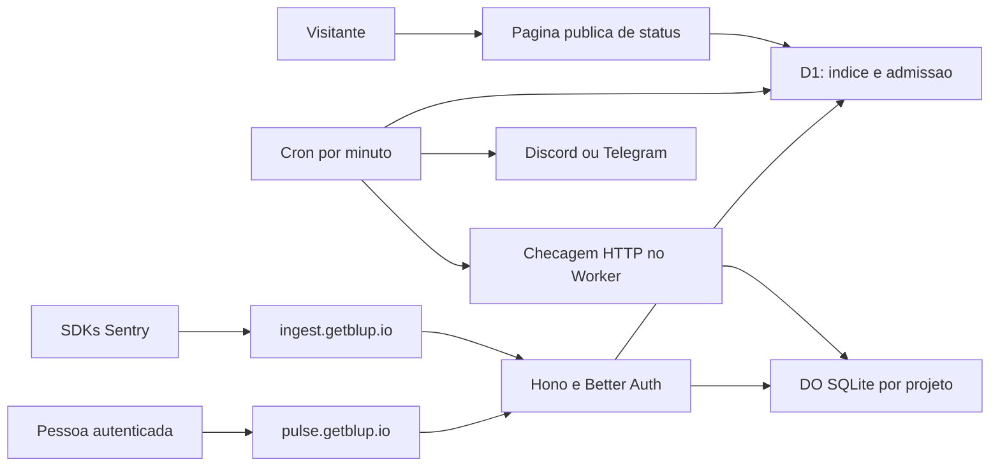

# Blup Pulse

Especificação de produto e técnica, pesquisada e atualizada em 02/11/2026. Nome, preços e decisões comerciais refletem a atualização aprovada pelo dono. As Fases 1 a 4 têm código conferido e gates locais informados no fechamento, incluindo bootstrap e integridade do banco local. O ensaio em conta remota vazia e a homologação de infraestrutura permanecem pendentes. Este documento não afirma publicação, contratação liberada ou homologação de provedores externos. Recursos sem entrega confirmada continuam como oferta-alvo. Exemplos usam marcadores, sem credenciais reais.

## Estado da entrega por fases

**Fases 1 a 4 com gates locais fechados; staging pendente.** Os contratos desta seção foram conferidos no código e nos handoffs da Lupa. Nenhum desses handoffs confirma deploy, venda ou integração de aceite no Studio.

### Núcleo da Fase 1

Fontes atuais: [API](../../cloud/worker/pulse/api.ts), [ingestão](../../cloud/worker/pulse/ingest.ts), [protocolo](../../cloud/worker/pulse/protocol.ts), [dados tratados](../../cloud/worker/pulse/event.ts), [SQLite](../../cloud/worker/pulse/project-store.ts), [DO](../../cloud/worker/pulse/project.ts), [admissão](../../cloud/worker/pulse/quota.ts), [limites](../../cloud/worker/pulse/limits.ts), [schema D1](../../cloud/worker/db/pulse-schema.ts) e [painel](../../cloud/pulse/src/routes/+page.svelte).

| Núcleo entregue | Comportamento local atual |
| --- | --- |
| Conta e acesso | Usa sessão Cloud, autorização por dono e direito Pulse; cortesia do dono equivale a Ultra + Pulse; perda de direito entra em leitura por 14 dias |
| Projetos | Criar, listar, renomear/pausar e excluir; plataformas aceitas `javascript`, `node`, `go`, `other`; nome de 1 a 80 caracteres |
| DSN | `https://<chave48hex>@ingest.getblup.io/<iddecimal>`; 24 bytes aleatórios viram 48 hexadecimais; D1 guarda hash/prefixo; valor completo só na emissão; rotação revoga as chaves anteriores |
| Ingestão | Envelope/store, chave por header/query/envelope, gzip/deflate e cotas; aceita `application/x-sentry-envelope`, `application/json`, `text/plain` ou Content-Type ausente, com 415 nos demais |
| DO por projeto | Persistência SQLite, deduplicação, fingerprint próprio, estados de problemas, até 100 amostras e contadores diários; retenção de 30/90 dias |
| Cota conjunta | D1 usa `pulse_month` e `pulse_grant`; concessões de até 32 unidades são consumidas no DO, sem transformar a cota da conta em uma cota independente por projeto |
| Tratamento de dados | Projeção fechada do evento: descarta usuário, IP, cookies, cabeçalhos, corpos e query strings, extra, tags, variáveis locais e anexos; guarda, tratados, o código em volta dos quadros do app (até 5 linhas de cada lado, 200 caracteres por linha, nos 10 quadros mais perto do erro), a rota sem parâmetros com ids como `:id`, nome e versão principal de navegador, sistema e runtime, e as últimas 30 ações (tipo e mensagem tratada; de chamadas HTTP e trocas de página só método, rota e status) |
| Interface | Projetos, copiar/rotacionar DSN, listar problemas, resolver/ignorar/reabrir, amostras e uso; painel estático separado em `cloud/pulse`, com tipos inferidos do RPC Cloud |

O tratamento de texto não comprova ausência de todo dado pessoal possível em mensagem livre. O aceite e o filtro específico do Studio ainda precisam ser implementados antes de enviar erros do aplicativo automaticamente. As consultas já filtram a retenção; a limpeza física usa alarmes e lotes. O agendamento preserva um alarme anterior em vez de adiá-lo a cada evento. A Lupa confirmou a regressão de dois ingests separados por 30 minutos no gate da Fase 2; essa correção não integra o retrato histórico dos 292 testes da Fase 1.

### Rotas atuais da Fase 1

Todas as rotas abaixo estão no Worker Cloud, sob `/api/pulse`, com sessão e dono. Escritas de configuração/estado exigem direito gravável; exclusão de projeto e revogação de chave continuam disponíveis ao dono como operações de retirada.

| Método e caminho relativo | Contrato atual |
| --- | --- |
| `GET /usage` | `{plan, limits, readOnly, readOnlyUntil, month, accepted, reserved, bytes}`; plano/limites/prazo podem ser `null`; Fase 4 acrescenta `selectionRequired` e `resources` |
| `GET /projects` | `{projects}` com até 10 projetos; sem cursor nesta fase |
| `POST /projects` | JSON estrito `{name, platform}`; `201 {id, name, platform, key}`; limite de projetos retorna `409 {code: "QUOTA"}` |
| `PATCH /projects/:project` | JSON estrito com `name` e/ou `active`; retorna `{ok:true}` |
| `DELETE /projects/:project` | Desativa no D1 e pede purga do DO; retorna `{ok:true}` |
| `GET /projects/:project/keys` | `{keys}` com até 20 entradas `{id, prefix, revokedAt}`; sem devolver DSN completo |
| `POST /projects/:project/keys` | Rotação; `201 {id, prefix, dsn}` |
| `DELETE /projects/:project/keys/:key` | Revogação; `{ok:true}` |
| `GET /projects/:project/issues` | Filtros `state`, `environment`, `release`, `q`, `before`, `beforeId` e `limit`; `limit` de 1 a 50, padrão 30; retorna `{issues}`; o par `before/beforeId` preserva empates na paginação |
| `PATCH /projects/:project/issues/:issue` | JSON estrito `{state}`, em `open/resolved/ignored`; `{ok:true}` ou 404 |
| `GET /projects/:project/issues/:issue/events` | `{events}` com até 50 amostras recentes; ainda sem cursor ou parâmetro de paginação |
| `GET /projects/:project/issue-facets` | `{environments, releases}`: os ambientes e versões vistos nos problemas do histórico guardado, para os filtros da lista |

`project` é string decimal positiva segura como inteiro JavaScript; `issue` é o hash hexadecimal do grupo. `createdAt` de projeto e `readOnlyUntil` saem em ISO UTC. `firstAt`, `lastAt`, `receivedAt` e `revokedAt` usam números em milissegundos na Fase 1, com `null` quando previsto. A tabela de API da seção 9 descreve a evolução-alvo; por exemplo, ainda não existe uma rota GET separada de detalhe do problema.

### Login, banco e validação local

Sem sessão, o painel leva a `https://cloud.getblup.io/sign-in?next=/account/pulse`. Após o login comum, a página Cloud `/account/pulse` redireciona para o endereço fixo `https://pulse.getblup.io/`, sem aceitar uma URL externa fornecida na query. O cookie permanece restrito ao host Cloud; o cliente Pulse chama a API com credenciais e CORS exato. Fontes: [cliente Pulse](../../cloud/pulse/src/lib/api.ts), [retorno fixo](../../cloud/src/routes/%28panel%29/account/pulse/+page.svelte) e [roteamento/CORS](../../cloud/worker/index.ts).

A migração [0015_pulse_nucleo.sql](../../cloud/migrations/0015_pulse_nucleo.sql), gerada pelo Drizzle, cria `pulse_account`, `pulse_project`, `pulse_key`, `pulse_month` e `pulse_grant`. O DO usa `meta`, `grant_slot`, `issue`, `seen`, `sample`, `issue_day`, `burst` e `pending_alert`. O binding é `PULSE_PROJECT`, classe `PulseProject`, com migração Workers `v2-pulse`, separada do SQL D1. Aplique `0015` antes do Worker que consulta essas tabelas.

A Lupa informou: 292/292 testes, check/build Cloud e Pulse aprovados e D1 local do zero com `0000..0015`. SDKs oficiais Node `11.10.0` e Go `0.50.0` foram testados localmente; quatro eventos, entre exceções e mensagens, foram persistidos sem as sentinelas pessoais inseridas no ensaio. Os [scripts de SDK](../../cloud/scripts/pulse-sdk/check.mjs) e a [fixture Go](../../cloud/scripts/pulse-sdk/main.go.fixture) documentam o recorte. O ensaio Node desativa integrações padrão, client reports, logs e tracing; isso não homologa todos os defaults, plataformas ou recursos dos SDKs. Esses testes foram executados pela área Cloud, não repetidos por esta documentação.

### Fase 2: monitores, páginas e incidentes

Fontes: [rotas de monitores](../../cloud/worker/pulse/monitors.ts), [checagem HTTP](../../cloud/worker/pulse/monitor-http.ts), [agendamento](../../cloud/worker/pulse/scheduler.ts), [histórico SQLite](../../cloud/worker/pulse/monitor-store.ts), [páginas/incidentes](../../cloud/worker/pulse/pages.ts), [projeção pública e HTML](../../cloud/worker/pulse/public.ts) e [limpeza](../../cloud/worker/pulse/cleanup.ts).

As rotas privadas abaixo usam a sessão Cloud e verificam o dono. Criar, editar, publicar e registrar incidentes exigem direito gravável; exclusão continua permitida ao dono. IDs de monitor/página/incidente usam `opaqueId`; o vínculo com projeto usa o identificador decimal da Fase 1. Bodies são estritos e validados por Zod.

| Método e caminho relativo a `/api/pulse` | Contrato local da Fase 2 |
| --- | --- |
| `GET /monitors` | `{monitors}`, até 50, com `id, projectId, name, url, intervalMinutes, active, state, lastAt`; `lastAt` em ISO UTC ou `null` |
| `POST /monitors` | `{projectId, name, url, intervalMinutes}`; nome até 80, URL até 2.048 caracteres, intervalo inteiro entre o mínimo do plano e 1.440 minutos; `201 {id}` |
| `PATCH /monitors/:monitor` | Um ou mais de `name, url, intervalMinutes, active`; reinicia estado em `unknown`, limpa a última checagem e incrementa a revisão; `{ok:true}` |
| `DELETE /monitors/:monitor` | Remove a configuração; `{ok:true}` ou 404 |
| `GET /monitors/:monitor/checks` | `{checks, days}`; até 100 checagens dos últimos 7 dias e até 90 resumos diários, respeitando os 30/90 dias do plano; sem cursor |
| `GET /pages` | `{pages}`, até 3, com `id, title, slug, published, language, components`; cada componente privado usa `{monitorId, name}` |
| `POST /pages` | `{title, slug, language, components}`; título até 100, idioma `pt/en/es`, até 50 componentes distintos do mesmo dono; cria despublicada; `201 {id, slug}` |
| `PATCH /pages/:page` | Um ou mais de `title, language, components, published`; o slug não muda; `{ok:true}` |
| `DELETE /pages/:page` | Despublica e remove componentes/incidentes/atualizações; com domínio vinculado, fica despublicada e responde `409 DOMAIN_EXISTS` até retirar o vínculo |
| `GET /pages/:page/incidents` | `{incidents}`, até 50 dentro da retenção; `id, title, state, impact, createdAt, updatedAt`; datas privadas em milissegundos |
| `POST /pages/:page/incidents` | `{title, body, state, publishedAt, services}`; título até 120, texto até 2.000, máximo de 200 incidentes por página; `publishedAt` (ISO) vai do início do histórico guardado até agora; `services` diz como cada serviço da página fica (`none`, `downtime`, `degraded`, `resolved`), só serviços da própria página; o `impact` sai do pior serviço; cria a primeira atualização na data publicada; `201 {id}` |
| `PATCH /pages/:page/incidents/:incident` | `{title}` estrito; troca o título; incidente de outra página ou conta retorna 404 |
| `DELETE /pages/:page/incidents/:incident` | Exclui o incidente com as atualizações e o estado dos serviços; incidente de outra página ou conta retorna 404 |
| `GET /pages/:page/incidents/:incident/updates` | Atualizações de um incidente da página, da mais nova para a mais antiga, até 100, dentro do histórico guardado; incidente de outra página ou conta retorna 404 |
| `POST /pages/:page/incidents/:incident/updates` | `{body, state, services}`, até 100 atualizações por incidente; troca o estado dos serviços e recalcula o `impact`; atualiza estado/prazo do incidente, sem renovar os textos anteriores; `201 {ok:true}` |
| `GET /public/:slug` | Sem sessão; projeção pública fechada ou `404 NOT_FOUND`; sem direito gravável retorna `200 {unavailable:true}` |

O slug tem de 3 a 40 caracteres minúsculos, números e hífens internos, é único e não aceita nomes reservados. Os estados de incidente são `investigating`, `identified`, `monitoring`, `resolved`; os impactos são `operational`, `degraded`, `partial_outage`, `major_outage`. Limite de quantidade retorna `409 QUOTA`, slug ocupado retorna `409 SLUG_TAKEN` e intervalo abaixo do plano retorna `403 PLAN`. As checagens privadas usam milissegundos em `scheduledAt`/`checkedAt`; resumos privados usam número de dia UTC e contagens `up/down/unknown`, além de `durationMs` acumulado.

O painel tem [Monitores](../../cloud/pulse/src/routes/monitors/+page.svelte), para criar, pausar/retomar, excluir e consultar histórico, e [Páginas](../../cloud/pulse/src/routes/status-pages/+page.svelte), para selecionar monitores, definir seus nomes públicos, editar, publicar/despublicar e escrever incidentes/atualizações. O idioma da página é salvo a partir da escolha atual do painel. Os tipos de transporte vêm do RPC Hono.

### Publicação e cache da Fase 2

`https://pulse.getblup.site/<slug>/` serve HTML escapado, sem JavaScript, com atualização da página a cada 60 segundos; `/<slug>/status.json` serve o JSON. O caminho sem barra final redireciona para o caminho com barra. Ambos aceitam GET/HEAD, usam ETag do corpo e respondem 304 para `If-None-Match` igual. O navegador recebe `public, max-age=0, must-revalidate`. A rota API `/public/:slug` entrega o mesmo DTO, mas não implementa esse ETag/304.

O DTO disponível tem `unavailable:false`, `title`, `slug`, `language`, `components` e `incidents`. Componente público contém somente `name, state, lastCheckedAt, days`; cada dia tem `date, up, down, unknown`. Incidente público contém somente `title, state, impact, createdAt, updatedAt, updates`; cada atualização tem `body, state, createdAt`. Datas públicas usam ISO UTC, e `lastCheckedAt` pode ser `null`. Há até 50 componentes, 20 incidentes e 20 atualizações por incidente. Não são expostos IDs privados, URL monitorada, DSN, dono, payload de erro ou stack trace. Os nomes/textos públicos escolhidos pela pessoa continuam sendo informação publicada por ela.

O gateway relê publicação, conta e direito gravável antes de cada consulta ao cache. Só a projeção pública validada fica na Cache API por até 15 segundos. Um componente sem observação recente, após duas vezes o intervalo efetivo, aparece como `unknown`. Página inexistente/despublicada retorna 404; no host público, conta/plano indisponível retorna `503 UNAVAILABLE` com `Retry-After: 60`, mesmo que exista cache anterior. O binding `PULSE_PUBLIC_LIMIT` limita pedidos públicos a 300 por minuto por IP no escopo do limitador Workers; excesso retorna 429 e `Retry-After: 60`.

### Banco, retenção e gates da Fase 2

A migração [0016_pulse_monitores_paginas.sql](../../cloud/migrations/0016_pulse_monitores_paginas.sql) cria monitores, páginas, componentes, incidentes/atualizações, estrutura de domínio e índices de agendamento/limpeza. A [0017_pulse_expiracao_incidentes.sql](../../cloud/migrations/0017_pulse_expiracao_incidentes.sql) acrescenta prazos e índices de expiração de incidentes e atualizações. Ambas foram geradas pelo Drizzle e devem anteceder o Worker correspondente. A Fase 2 criou a estrutura; o contrato local de domínio Ultra + Pulse está descrito na Fase 4, ainda com homologação de infraestrutura pendente.

O DO acrescenta `monitor_state`, `monitor_check` e `monitor_day`. Duas falhas confirmam `down` e dois sucessos confirmam `up`; atraso/lacuna reinicia a sequência, sem inventar sucesso ou falha. A seleção/retenção e o agendamento estão detalhados na seção 7. As consultas filtram expirados; limpeza física é em lotes, com reconciliação pelo cron. O fim dos 14 dias de leitura reivindica a purga da conta Pulse; a exclusão da conta Cloud integra essa purga ao prazo de 30 dias. A retirada inclui objetos, monitores, chaves, páginas, incidentes e vínculos de domínio; falha externa pode exigir nova execução.

A Lupa informou para esta fase: 303/303 testes, check Cloud/Pulse com zero erros e avisos e builds aprovados, incluindo a regressão de preservação do alarme. Esta documentação conferiu os contratos no código e não repetiu esses gates. O handoff confirma `0016`/`0017` geradas; isso não comprova aplicação remota.

### Fase 3: canais e avisos

Fontes: [canais e vínculos de projeto](../../cloud/worker/pulse/channels.ts), [Telegram](../../cloud/worker/pulse/telegram.ts), [proteção dos destinos](../../cloud/worker/pulse/channel-crypto.ts), [fila/despachante](../../cloud/worker/pulse/outbox.ts), [transportes](../../cloud/worker/pulse/transports.ts), [testes simulados](../../cloud/worker/pulse/alerts.test.ts) e [tela Avisos](../../cloud/pulse/src/routes/alerts/+page.svelte).

As rotas privadas exigem sessão/dono; criar, vincular, confirmar e testar exigem direito gravável. Remover canal continua disponível ao dono. O DSN só autoriza ingestão de eventos, sem acesso administrativo a canais ou projetos.

| Método e caminho relativo a `/api/pulse` | Contrato local da Fase 3 |
| --- | --- |
| `GET /channels` | `{channels, bindings}`; até 20 canais com `id, type, label, active, lastError`, sem devolver destino; vínculos `{projectId, channelId}`; listas vazias sem direito de leitura |
| `POST /channels` | JSON estrito `{projectId, type:"discord", webhook}`; o canal nasce ligado ao projeto, no lugar do Discord que ele tinha, no mesmo batch; projeto inexistente, pausado ou de outra conta retorna 404; webhook é string HTTPS validada; `201 {id, label}`; cota por tipo equivale ao número de projetos do plano |
| `DELETE /channels/:channel` | Remove canal, vínculos, cooldowns e entregas na fila; `{ok:true}` ou 404 |
| `POST /channels/:channel/test` | JSON estrito `{}`; `202 {queued:true}`; no máximo um teste por minuto por canal, com 429 e `Retry-After: 60` no excesso |
| `POST /monitors/:monitor/test` | JSON estrito `{}`; envia um aviso de teste com o nome do monitor a cada destino ativo do projeto; `202 {queued:n}`, `409 NO_CHANNELS` sem destino, 429 e `Retry-After: 60` quando todos os destinos já testaram no último minuto |
| `POST /telegram/link` | JSON estrito `{}`; `201 {id, url, expiresAt}`; cria código de 48 caracteres hexadecimais com dez minutos de validade e substitui o registro de vínculo anterior da conta |
| `GET /telegram/link/:link` | `{id, state, expiresAt, candidate, channelId}`; `candidate` é `{id, label}` ou `null`, `channelId` é string ou `null`; `expiresAt` em ISO UTC |
| `POST /telegram/link/:link/confirm` | JSON estrito `{projectId}`; liga o canal ao projeto, no lugar do Telegram que ele tinha, e cria canal a partir do chat candidato: `201 {id}`; repetição confirmada retorna `200 {id}`; inválido/expirado retorna `409 LINK_EXPIRED` |
| `POST /telegram/webhook` | Registrado antes do middleware de sessão; autentica por `X-Telegram-Bot-Api-Secret-Token`, valida update, deduplica `update_id` e aceita `/start` apenas de pessoa em seu próprio chat privado; `{ok:true}` nos updates ignorados/aceitos |

Vínculos Telegram passam por `pending`, `candidate` e `confirmed`; a consulta apresenta `expired` após o prazo. O código só fica como hash no D1. O painel consulta o vínculo a cada cinco segundos, interrompe ao sair de `pending` ou ao deixar a tela e exige confirmação autenticada do chat candidato. Conhecer o código não ativa o canal sozinho. Discord usa apenas os hosts/caminhos de webhook aceitos; destino inválido é recusado, sem executar fetch arbitrário.

A migração [0018_pulse_avisos.sql](../../cloud/migrations/0018_pulse_avisos.sql), gerada pelo Drizzle, acrescenta `pulse_channel`, `pulse_project_channel`, `pulse_outbox`, `pulse_cooldown`, `pulse_delivery_budget`, `pulse_telegram_link`, `pulse_telegram_update` e índices de reconciliação/expiração. Deve vir antes do Worker desta fase. Os secrets necessários são `PULSE_CHANNEL_KEY`, com 32 bytes em base64, `PULSE_TELEGRAM_TOKEN` e `PULSE_TELEGRAM_WEBHOOK_SECRET`, somente no Worker Cloud. A cifra e a entrega estão detalhadas na seção 8.

A tela Avisos cadastra Discord, abre o vínculo Telegram, mostra o candidato para confirmação, lista rótulos/estado/erro genérico, enfileira testes, exclui canais e escolhe Discord/Telegram por projeto. Não recupera URLs de webhook. Os testes e toasts informam enfileiramento, sem prometer entrega já concluída.

A Lupa informou 309/309 testes em 31 arquivos, `tsc`, check Cloud/Pulse com zero erros/avisos e builds aprovados para a Fase 3. Os provedores externos foram somente simulados; não há confirmação de bot configurado ou de mensagem entregue por Discord/Telegram reais. Estes gates são da área Cloud e não foram repetidos nesta documentação. Registrar o bot e configurar seu webhook são tarefas operacionais antes de liberar os avisos.

### Fase 4: contratos e gates locais, infraestrutura pendente

Fontes: [planos](../../cloud/worker/plans.ts), [tipos compartilhados](../../cloud/shared/pulse-plans.ts), [API de cobrança](../../cloud/worker/billing-api.ts), [prévia e operações Stripe](../../cloud/worker/billing-flow.ts), [reconciliador assinado](../../cloud/worker/billing.ts), [seleção de recursos](../../cloud/worker/pulse/entitlements.ts), [domínios Pulse](../../cloud/worker/pulse/domains.ts), [retirada do provedor](../../cloud/worker/pulse/domain-lifecycle.ts) e [namespace de hostname](../../cloud/worker/hostname-claim.ts).

| Contrato | Comportamento conferido |
| --- | --- |
| `GET /api/me` | `plan.name` continua `free/pro/max/ultra`; `plan.billingName` identifica a variante completa; `plan.billingInterval` é `month/year/null`; `plan.pulse` contém `{enabled, limits}`, com limites `null` sem Pulse; `plan.limits` continua com os direitos do plano-base |
| `GET /api/plans` | Seis variantes `free, pro, max, ultra, max_pulse, ultra_pulse`; cada uma inclui `basePlan` e `pulse` além dos campos anteriores; dez lookup keys pagos, com preços buscados no Stripe |
| `/api/billing/*` | Checkout/portal próprios e mudança por prévia/confirmar, consulta de estado e retirada de intenção futura/checkout; contratos detalhados na seção 11 |
| `GET /api/pulse/usage` | Acrescenta `selectionRequired` e `resources:{projects, monitors, pages}`; listas de IDs/nomes, com `projectId` nos monitores, para escolha autenticada do que fica |
| `PUT /api/pulse/selection` | JSON estrito `{projects, monitors, pages}`, listas distintas de IDs dentro do limite; monitor mantido exige manter seu projeto; substitui a escolha e observa os direitos atuais; `{ok:true}` |
| `GET/POST/DELETE /api/pulse/pages/:page/domain` | Dono da página; POST estrito `{hostname}` só em Ultra + Pulse elegível, GET retorna `DomainInfo` ou `null`, DELETE retorna `{ok:true}`; regras na seção 7 |

A migração [0019_pulse_cobranca_dominios.sql](../../cloud/migrations/0019_pulse_cobranca_dominios.sql), gerada com drizzle-kit, cria `billing_checkout`, `pulse_billing_ticket`, `pulse_selection` e `hostname_claim`. Acrescenta `paid_until`/`resource_plan` à conta Pulse e `plan_disabled`/`retire_at` a projetos, monitores e páginas, com índices. Aplicar a sequência `0000..0019` antes do novo Worker, respeitando a atualização incompatível de `0012` descrita no deploy. Arquivo gerado não comprova aplicação remota.

Na redução com excesso, a confirmação recebe os recursos mantidos. Os demais ficam privados e sem novas escritas/checagens/publicação por 14 dias, depois são elegíveis à purga em lotes. Mudança externa sem seleção pode exigir escolha pelo painel; não se escolhe silenciosamente qual recurso manter. Voltar ao plano maior antes do prazo recupera recursos ainda existentes quando todos cabem. Retirar Pulse inteiro mantém o período pago, depois abre leitura privada por 14 dias; `paid_until` ancora esse prazo, sem reiniciá-lo quando a pessoa volta ao painel. A retenção dos eventos continua vencendo durante a carência.

O handoff informa regressões normais para alarme contínuo, rotação concorrente de DSN, margem do banco e paginação com empate. Node `11.10.0` e Go `0.50.0` persistiram quatro eventos em teste local; isso não homologa plataformas extras ou provedores externos. No fechamento, a Lupa informou `tsc`, 335/335 testes Vitest em 34 arquivos, checks Cloud/Pulse com zero erros/avisos, builds dos dois painéis, `go vet`/testes da raiz e do Studio e frontend Studio zero erros/avisos. As 20 migrações `0000..0019` aplicaram em D1 local vazio; leitura direta do SQLite em modo somente leitura confirmou integridade e ausência de violações de chaves estrangeiras. `PRAGMA integrity_check` via D1 recusado com `SQLITE_AUTH` não foi falha das migrações. Dois testes cobrem configuração/handler do bootstrap e os dry-runs de bootstrap, Sites e Cloud completo passaram. Esses gates são da área Cloud e não foram repetidos nesta documentação; não houve edição de código posterior aos gates segundo o handoff. A integração de aceite/filtro do Studio, a operação real de DNS/Stripe/bot e a liberação comercial permanecem pendentes. A premissa de rede dos monitores continua exigindo homologação em staging, sem Go/sockets e sem afirmar proteção universal contra DNS rebinding com base nos erros 1000/1002.

A validação complementar de relógio informada pela Lupa passou com 339/339 testes, check zero erros/avisos e builds Cloud/Pulse aprovados. A hipótese incorreta estava no teste, sem bug no `MonitorStore` ou mudança de API. Os testes fixam `Date`; o cenário original usa meio-dia UTC e as regressões cobrem viradas de dia/mês/ano e separação da cota entre dezembro e janeiro. Fontes: [monitores](../../cloud/worker/pulse/monitors.test.ts), [admissão/cota](../../cloud/worker/pulse/security.test.ts) e [cotas Cloud](../../cloud/worker/quota-security.test.ts). Isso não confirma staging ou operação de provedores reais.

O primeiro deploy em conta vazia tem dependência circular de bindings: Sites precisa do namespace `PulseProject` do Cloud, enquanto Cloud completo precisa do entrypoint `CachedSite` de Sites. A ordem documentada é bootstrap Cloud só com exports/namespaces, sem `SITE_CACHE`, rotas públicas ou cron; depois Sites com binding remoto, Cloud completo e painel Pulse. Os arquivos concretos são [wrangler.bootstrap.jsonc](../../cloud/wrangler.bootstrap.jsonc) e [bootstrap.ts](../../cloud/worker/bootstrap.ts): nome `blup-cloud-production`, exports `SyncLive/PulseProject`, tags `v1/v2-pulse`, sem assets, D1 ou outros serviços, com handler 503. Os [testes locais](../../cloud/scripts/bootstrap.test.ts) e dry-runs passaram. Usar somente em instalação vazia; sobre instalação ativa substituiria o aplicativo. O ensaio remoto de conta vazia é bloqueio de staging, sem comprovação de que Sites antes de Cloud funcione. Ver [bootstrap no checklist](../deploy-checklist.md#9-ensaiar-o-bootstrap-e-publicar-os-workers).

O banco do projeto recusa nova admissão com `429 CAPACITY` antes do teto, preservando margem de 1 MiB. A listagem de problemas ordena por `lastAt` e ID descendentes e aceita `beforeId` junto com `before`, evitando perder grupos com o mesmo instante. São comportamentos locais conferidos em [project-store.ts](../../cloud/worker/pulse/project-store.ts); não equivalem a teste de escala ou custo real.

## 1. Produto e MVP

O Blup Pulse reúne erros de aplicações, monitores HTTP, páginas públicas de status e avisos por Discord e Telegram. Serve também para acompanhar Studio, Cloud, sites e futuros aplicativos móveis do próprio Blup.

O primeiro lançamento oferece quatro telas em `pulse.getblup.io`: Projetos, Monitores, Página de status e Avisos. Usa o mesmo login Better Auth e o backend Hono do Blup Cloud. A identidade visual usa o Blup verde-menta `turma-2` e favicon verde, reaproveitando os assets existentes.

A integração de erros usa SDKs oficiais do Sentry com um DSN do Blup. A promessa inicial é compatibilidade com envio de erros nas versões homologadas. Não significa reproduzir toda a plataforma Sentry, seus algoritmos de agrupamento ou sua API administrativa. Tracing, performance, replay, profiling, source maps, arquivos de símbolos, minidumps e anexos ficam fora do MVP. Também ficam fora avisos por e-mail/SMS, SDK próprio, equipes e consultas arbitrárias de logs.

## 2. Planos e limites

O Pulse não é vendido sozinho. O switch **+ Blup Pulse** escolhe uma variante completa do plano, com uma única assinatura por pessoa.

| Recurso | Max + Pulse | Ultra + Pulse |
| --- | --- | --- |
| Nome interno | `max_pulse` | `ultra_pulse` |
| Preço mensal aprovado, BRL | R$ 49,90 | R$ 129,90 |
| Preço anual aprovado, BRL | R$ 499 | R$ 1.299 |
| Direitos do Blup Cloud | Todos do Max | Todos do Ultra |
| Projetos | 3 | 10 |
| Erros aceitos por mês, total da conta | 50.000 | 250.000 |
| Retenção máxima de eventos e contadores | 30 dias | 90 dias |
| Monitores, total da conta | 10 | 50 |
| Menor intervalo de checagem | 5 minutos | 2 minutos |
| Páginas públicas de status | 1 | 3 |
| Domínio próprio nas páginas de status | Não | Incluído, contrato local da Fase 4 |
| Avisos | Discord, Telegram, Slack e webhook | Discord, Telegram, Slack e webhook |

As cotas do Pulse e o mês civil UTC seguem a proposta mantida pelo dono. O anual custa o equivalente a dez mensalidades, cobrado uma vez por ano. Grátis, Pro, Max e Ultra sem o switch não incluem Pulse. Max continua com 5 GiB de notas, arquivos de até 50 MiB, 3 sites, 3 computadores, histórico de 365 dias, tempo real, domínio próprio, IA 2x e 50 lembretes por e-mail. Ultra continua com 10 GiB, arquivos de até 100 MiB e 10 sites, além dos demais direitos atuais. A [spec Cloud](blup-cloud-sync.md#planos-executados) detalha esses direitos.

O armazenamento de eventos é separado da cota de notas e sites. Página de status não consome um site Hugo do plano. O contrato usa mês civil UTC, sem acumular saldo, sem cobrança automática por excedente e sem zerar uso ao trocar de plano ou recriar projeto. Um novo `event_id` aceito consome uma unidade, mesmo quando pertence a um problema já conhecido. Reenvio com o mesmo ID, dentro da janela de deduplicação, não consome outra unidade.

### Proteções técnicas propostas

| Proteção | Proposta inicial |
| --- | --- |
| Evento após descompressão, antes de tratar dados | Até 200 KiB, ou 204.800 bytes |
| Envelope inteiro | Até 1 MiB recebido e 1 MiB descomprimido |
| Itens por envelope | Até 100, com no máximo um `event` |
| Linha de cabeçalho do envelope/item | Até 8 KiB |
| Estrutura JSON | Até 32 níveis; strings/listas e quantidade de chaves limitadas |
| Ocorrências completas por problema | No máximo as últimas 100, já tratadas para privacidade |
| Banco por projeto, incluindo índices | Proposta: 256 MiB no Max + Pulse; 1 GiB no Ultra + Pulse |
| Pico de erros por projeto | Proposta: 60/minuto no Max + Pulse; 300/minuto no Ultra + Pulse |
| Pico de ingestão por IP | Fusível adicional, configurável e independente da cota paga |
| Histórico de checagens detalhadas | 7 dias; depois só resumo diário dentro da retenção do plano |

Esses são limites do Blup, menores que os do Sentry. Precisam constar nos exemplos de integração e passar na matriz de SDKs. Ao alcançar o teto de armazenamento, remover primeiro payloads antigos, preservando contadores dentro do prazo. Se não houver espaço seguro para novos índices/contadores, recusar a admissão e informar capacidade esgotada. Não prometer 100 amostras ou todos os eventos completos quando o teto por projeto já foi alcançado.

## 3. Arquitetura e fronteiras



A organização prevista pela Lupa mantém API em `cloud/worker/pulse` e painel estático próprio em `cloud/pulse`. O mesmo backend não exige servir o mesmo HTML nos três hosts. O roteamento por hostname precisa separar painel Pulse, painel Cloud e ingestão. O host de ingestão não serve páginas de login nem aceita cookies como autorização. Assets e fallback SPA devem corresponder ao painel pedido, sem capturar as rotas Sentry ou devolver `index.html` em uma falha de API.

D1 guarda identidade, configuração, índices de agendamento e metadados de admissão/entrega. Não recebe o JSON bruto dos erros ou stack traces. Cada projeto tem um Durable Object SQLite, identificado por mapeamento do servidor, que serializa eventos, agrupamento, deduplicação, limites locais e histórico de checagens. Não criar um DO por ocorrência nem por problema.

As esperas de rede dos monitores ocorrem no Worker, fora do DO. O resultado chega ao objeto em lote por projeto. Isso evita manter o DO ativo durante cada timeout HTTP. Alarmes cuidam de expiração e trabalho curto; notificações externas usam uma fila persistente de metadados e o despachante do cron.

SQLite em DO tem teto de 10 GB por objeto no Workers Paid; os tetos propostos do produto ficam abaixo disso. Usar uma nova classe SQLite e uma migração Workers `new_sqlite_classes`, sem alterar a classe `SyncLive`. O schema interno de cada objeto tem versão própria e migrações idempotentes. [Limites oficiais de DO](https://developers.cloudflare.com/durable-objects/platform/limits/), [API SQLite](https://developers.cloudflare.com/durable-objects/api/sqlite-storage-api/).

### Login entre subdomínios

O alinhamento de implementação da Lupa mantém o login central em `cloud.getblup.io`, com cookie restrito a esse host. O painel `pulse.getblup.io` chama a API Cloud com `credentials: "include"`; o navegador envia o cookie ao host Cloud de destino, sem precisar de cookie no domínio pai. Configurar as duas origens exatas em `trustedOrigins`, preservando `HttpOnly`, `Secure` e SameSite apropriado. A configuração está em [auth-options.ts](../../cloud/worker/auth-options.ts) e exige validação por fase antes de ser tratada como entregue.

A API deve responder ao painel Pulse com CORS de origem exata e `Access-Control-Allow-Credentials: true`, nunca origem `*`. As passkeys continuam sendo criadas/usadas na origem Cloud, preservando o `rpID`. Retornos de login para Pulse exigem destino explicitamente permitido, sem aceitar redirects arbitrários. Sair, revogar sessão, bloquear e excluir a conta devem valer nos dois painéis.

Não habilitar `crossSubDomainCookies` para esta integração nem criar um segundo cookie de sessão em Pulse. O host de ingestão continua sem autenticação por cookie, e as páginas públicas ficam em `pulse.getblup.site/<nome>`, separadas do domínio da conta. Testar login central, requisições autenticadas entre origens e logout, incluindo bloqueio de origem não autorizada. [Cookies Better Auth](https://better-auth.com/docs/concepts/cookies), [segurança](https://better-auth.com/docs/reference/security), [passkeys](https://better-auth.com/docs/plugins/passkey).

## 4. Ingestão compatível com Sentry

### DSN e autenticação

Formato da Fase 1, com marcadores: (a chave é formada por 48 caracteres hexadecimais)

```text
https://<chave48hex>@ingest.getblup.io/<iddecimal>
```

O identificador público é uma string decimal positiva, única, limitada a um intervalo compatível com os SDKs homologados. Não usar UUID na posição que SDKs possam exigir como ID numérico. A chave aleatória identifica a permissão de ingestão de um projeto, pode ser revogada/rotacionada e não autoriza ler problemas ou administrar a conta. Não incluir parte secreta no DSN.

Aceitar as três formas documentadas: `X-Sentry-Auth: Sentry sentry_version=7, sentry_key=<CHAVE_PUBLICA>`, parâmetros de query equivalentes e `dsn` no cabeçalho do envelope. Se houver mais de uma, conferir que chave, projeto e destino combinam. Chave ausente, desativada ou incompatível retorna 403, sem revelar se outro projeto existe. O protocolo é versão 7; o campo legado `sentry_secret` não concede poder adicional. [Autenticação Sentry](https://develop.sentry.dev/sdk/foundations/transport/authentication/).

O DSN de um navegador é público por natureza. Ele permite que outra pessoa tente enviar eventos e gastar a cota do projeto. Uma lista de origens ajuda o navegador, mas não autentica clientes nativos e não impede um atacante de forjar `Origin`. A defesa real combina revogação de chave, limites e admissão no servidor. Antes de admitir eventos, consultar o vínculo ativo e o direito da conta no D1; cache ou estado antigo no DO não pode autorizar projeto revogado, conta bloqueada ou assinatura encerrada. Falha nessa consulta não libera ingestão por padrão.

### Endpoints e parser

| Método e caminho em `ingest.getblup.io` | Corpo e resultado |
| --- | --- |
| `OPTIONS /api/:project/envelope/` e `/store/` | Preflight sem exigir sessão da conta |
| `POST /api/:project/envelope/` | Envelope Sentry; sucesso `200` com `{id}` para um evento aceito |
| `POST /api/:project/store/` | Um evento JSON, com o mesmo tratamento e agrupamento |

Envelope é uma sequência de bytes: uma linha JSON de cabeçalho e itens com cabeçalho próprio e payload. O parser deve respeitar `length` em bytes, consumir exatamente o payload e tolerar a ausência da última quebra de linha. Sem `length`, seguir a delimitação por linha definida pelo protocolo. Não usar `split("\n")` para interpretar payload binário, nem tratar envelope como um único JSON. Conferir IDs do envelope/evento e comprimento real, incluindo UTF-8 multibyte. Aceitar ID hexadecimal de 32 caracteres ou UUID com separadores, normalizando para 32; se ambos os locais omitirem o ID, gerar um. IDs presentes e conflitantes retornam 400. [Formato de envelopes](https://develop.sentry.dev/sdk/foundations/envelopes/).

Aceitar `application/x-sentry-envelope` ou ausência de Content-Type. Para compatibilidade do navegador, aceitar também os Content-Types simples documentados, como `text/plain`, sem trocar a interpretação dos bytes por um parser de formulário. `store` aceita o evento JSON, inclusive quando transportado comprimido. Variantes legadas fora dessa matriz só entram depois de uma fixture oficial e um teste de compatibilidade.

| Tipo de item | MVP |
| --- | --- |
| `event` de erro/mensagem | Aceitar campos reconhecidos e validar antes de persistir |
| `session`, `sessions`, `client_report` | Consumir e ignorar; não entram na cota de erros |
| `transaction`, `span`, perfis e métricas | Consumir e ignorar; sem performance ou tracing |
| `replay_event`, `replay_recording` | Consumir e ignorar; nunca armazenar gravações |
| `attachment`, inclusive payload nativo | Consumir e ignorar; sem anexos/minidumps |
| `user_report`, `feedback`, `check_in`, logs e tipos futuros | Ignorar se o enquadramento for válido; não criar recurso implícito |

Tipos de item não são as mesmas categorias usadas nos headers de rate limit. Dentro de `event`, o MVP aceita `type` ausente, `default` ou `error`; outros tipos de telemetria não viram erros só por estarem nesse item. Um envelope só com itens ignorados recebe `200 {}` depois de validado e limitado em bytes, sem incrementar contadores. Item ignorado continua sujeito ao teto do envelope. Enquadramento inválido retorna 400; não responder sucesso para bytes que não foram interpretados com segurança. A API não faz download de source maps, anexos ou URLs presentes no evento. [Tipos e restrições dos itens](https://develop.sentry.dev/sdk/foundations/envelopes/envelope-items/).

### Compressão, CORS e respostas

Suportar primeiro corpo sem compressão, `Content-Encoding: gzip` e `deflate` com estrutura zlib. A descompressão tem limite de saída e prazo antes de montar JSON. Medir bytes recebidos e descomprimidos mesmo sem `Content-Length`. Compressão desconhecida retorna 415; stream inválido retorna 400; excedente retorna 413. Não usar o tamanho comprimido como teto do evento.

O Sentry também documenta `br` e `zstd`. Workers oferece gzip/deflate nas Compression Streams e Brotli em `node:zlib`; isso não comprova suporte a todo decoder/SDK no ambiente escolhido. Se alguma versão homologada emitir outra compressão por padrão, suportá-la com API disponível ou retirar essa versão da promessa de trocar só o DSN. Não acrescentar biblioteca de compressão pouco conhecida para encobrir a diferença. [Compressão Sentry](https://develop.sentry.dev/sdk/foundations/transport/compression/), [Web APIs Workers](https://developers.cloudflare.com/workers/runtime-apis/web-standards/), [zlib Workers](https://developers.cloudflare.com/workers/runtime-apis/nodejs/zlib/).

Na ingestão pública, CORS pode permitir `*` sem credenciais. Expor `Retry-After`, `X-Sentry-Rate-Limits` e `X-Sentry-Error`; permitir os headers usados pelos SDKs, incluindo `Content-Type`, `Content-Encoding` e `X-Sentry-Auth`. Aplicar esses headers também em erros e 429. Separar essa política do CORS autenticado do painel.

| HTTP | Significado |
| --- | --- |
| 200 | Evento persistido, duplicado já conhecido ou apenas itens deliberadamente ignorados |
| 400 | Envelope, JSON, metadados ou autenticação em formato inválido |
| 403 | Chave inválida/revogada ou projeto sem direito de ingestão |
| 413 | Tamanho excedido |
| 415 | Compressão/formato não suportado |
| 429 | Pico, cota mensal ou capacidade de admissão esgotada; incluir espera |
| 503 | Falha transitória antes da confirmação de armazenamento |

Sucesso de erro devolve ID hexadecimal normalizado. Só confirmar depois da transação SQLite; se a resposta se perder, deduplicar o reenvio por projeto e `event_id`. JSON de falha pode incluir `detail` e `X-Sentry-Error` sanitizados, sem ecoar corpo, DSN ou detalhes internos. Os SDKs não garantem reenviar todo evento após falha; não anunciar entrega garantida. [Transporte e respostas Sentry](https://develop.sentry.dev/sdk/foundations/transport/).

### Rate limit que os SDKs entendem

Usar segundos em `Retry-After`, calculados até a liberação do pico ou o próximo mês UTC. Emitir também `X-Sentry-Rate-Limits`, por exemplo:

```http
HTTP/1.1 429 Too Many Requests
Retry-After: 60
X-Sentry-Rate-Limits: 60:error;default:project:blup_burst
```

O formato é `espera:categorias:escopo:motivo`, podendo ter campos adicionais. Categorias vazias significam todas; usar `error;default` para a cota de erros, preservando o entendimento de SDKs que classificam mensagens como `default`. SDKs dão preferência a `X-Sentry-Rate-Limits`; se ele não existir, usam `Retry-After` no 429. O header também pode antecipar bloqueio numa resposta 200. Validar o comportamento por SDK, sem confundir esses headers com os limites da API administrativa do Sentry. [Rate limiting de ingestão](https://develop.sentry.dev/sdk/foundations/transport/rate-limiting/).

Workers Rate Limiting é um fusível rápido, aproximado e por localização Cloudflare. Não serve como contador exato da assinatura. O DO aplica o pico global do projeto e sua admissão local. A cota mensal total precisa de coordenação entre projetos. [Limitação oficial da API de rate limit](https://developers.cloudflare.com/workers/runtime-apis/bindings/rate-limit/).

Proposta para evitar um UPDATE D1 por evento: reservar pequenos lotes, inicialmente 32 unidades, do orçamento mensal da conta. D1 grava concessões idempotentes por projeto/mês, com soma nunca superior ao plano; cada DO importa uma concessão uma só vez e consome os slots em transação com o evento. Lotes ainda não consumidos permanecem reservados até o fim do mês, inclusive se o projeto for apagado. Mostrar aceitos e reservados separadamente. Não liberar uma concessão após timeout sem comprovar que o DO não a adotou. Isso evita duplicar saldo em falhas entre D1 e DO.

## 5. Agrupamento e ciclo dos problemas

O campo Sentry `fingerprint` é uma lista de strings. Valores iguais agrupam ocorrências; `{{ default }}` insere a identidade calculada pelo servidor. O Blup deve aceitar esse mecanismo, mas seu agrupamento padrão será próprio e versionado. Não prometer que os mesmos eventos gerarão os mesmos grupos do serviço Sentry. [Fingerprinting oficial](https://docs.sentry.io/platforms/javascript/enriching-events/fingerprinting/).

Proposta `groupingVersion = 1`:

1. Tratar dados sensíveis antes de construir qualquer chave ou título.
2. Calcular uma base com plataforma, tipo da exceção e frames relevantes normalizados; sem stack, usar mensagem normalizada e limitada. Retirar caminhos pessoais, IDs variáveis e parâmetros de URL.
3. Com fingerprint explícito, preservar ordem e fronteiras dos elementos, expandindo `{{ default }}` com essa base. Limitar a 32 elementos e 256 caracteres por elemento.
4. Aplicar SHA-256 a uma representação canônica que inclua a versão do algoritmo. O DO do projeto separa os grupos entre clientes; ambiente e release são filtros, sem dividir o grupo por padrão.

O problema guarda primeiro/último recebimento, contagem, severidade, título tratado, ambientes/releases resumidos e estado `open`, `resolved` ou `ignored`. Resolver não apaga eventos. Um evento novo reabre um resolvido e pode gerar aviso de regressão; um ID duplicado não reabre. Ignorar mantém contadores, mas suprime avisos até a pessoa reabrir. Não fazer merge automático entre versões do algoritmo.

As últimas 100 ocorrências completas são o evento permitido pela política de privacidade, não uma cópia crua do pedido. Ocorrências adicionais continuam contando; amostras mais antigas saem. Preservar IDs de deduplicação dentro da retenção mesmo quando o payload foi descartado. Essa combinação é limitada também pelo espaço do projeto.

## 6. Modelo de dados proposto

Os schemas D1/SQLite e as migrações `0015..0019` das Fases 1 a 4 estão listados no estado da entrega; homologação de infraestrutura continua pendente. As tabelas abaixo preservam o desenho-alvo dos demais recursos e podem ter nomes diferentes dos atuais. Migrações posteriores precisam ser geradas e revisadas sem alterar o histórico existente.

| D1 geral | Campos e índices principais |
| --- | --- |
| `pulse_project` | ID público decimal, `owner_id`, nome, plataforma, ID interno do DO, ativo, versão de configuração, datas; índice por dono |
| `pulse_project_key` | Projeto, hash da chave, prefixo para exibição, ativo/revogado, datas; chave única e vínculo ao projeto |
| `pulse_usage_month`, `pulse_quota_grant` | Conta/mês, limite, reservado; concessões por projeto com ID único e quantidade; admissão condicional |
| `pulse_monitor` | Dono, projeto, nome público separado, URL privada, intervalo, ativo, próximo horário, claim e estado atual; índice por vencimento |
| `pulse_page`, `pulse_page_component` | Dono, slug único, título, componentes, projetos/monitores autorizados, visibilidade e domínio |
| `pulse_incident`, `pulse_incident_update` | Página, texto público, estado, impacto e datas; índice por página/data |
| `pulse_channel` | Dono, tipo, dados de destino protegidos, configuração, estado e último erro sanitizado |
| `pulse_project_channel`, `pulse_outbox` | Vínculos e IDs de problema/monitor; deduplicação, próximo envio, tentativas e estado; índice da fila |
| `pulse_cooldown`, `pulse_delivery_budget` | Supressão temporária por referência e orçamento compartilhado de envio |
| `pulse_telegram_link` | Hash do código, dono, expiração, chat candidato, consumido; sem token do bot |
| `pulse_page_domain` | Página, hostname, prova de posse, estado/SSL e identificador do provedor; unicidade de hostname verificado |

Destinos Discord/Telegram usam AES-GCM com chave de serviço em Worker secret, nonce aleatório e dados associados ao dono/canal/tipo. O envelope tem versão de formato, sem seletor de versão da chave; os detalhes e limites de rotação estão na seção 8. O servidor pode decifrar para enviar; isso não é cifra de ponta a ponta. Token do bot Telegram e segredo do webhook são secrets globais. DSNs são públicos para envio; D1 guarda hash/prefixo e mostra o valor completo apenas na criação/rotação.

| SQLite de cada DO de projeto | Conteúdo |
| --- | --- |
| `meta` | Versão do schema, configuração, período e revisões aplicadas |
| `quota_grant`, `usage_month` | Concessões importadas e consumo local |
| `issue` | Fingerprint, versão, estado, título tratado, primeiro/último evento e contagem |
| `event_seen` | `event_id` único, grupo e recebimento, para deduplicar sem reter todo payload |
| `event_sample` | Grupo, evento tratado, tamanho e expiração; índice por grupo/data e por expiração |
| `issue_day` | Contadores diários, sem corpo do evento |
| `monitor_check` | Monitor, horário previsto/real, resultado e duração; índice por monitor/data |
| `monitor_day` | Sucessos, falhas, desconhecidos e resumo de latência por dia |
| `pending_alert` | Transições a entregar ao índice de avisos, com ID idempotente |

Contador, deduplicação, grupo e amostra entram na mesma transação SQLite. Não há transação distribuída entre D1 e DO: criação/exclusão usam estados intermediários recuperáveis e concessões idempotentes. Só habilitar ingestão depois do vínculo completo. Exclusão revoga primeiro no D1, depois apaga o objeto e os vínculos com retomada após falha.

### Retenção e limpeza

Usar o horário de recebimento no servidor para expiração, sem permitir que um timestamp futuro do SDK estenda o prazo. Amostras, IDs, contadores, incidentes e resumos operacionais têm expiração compatível com 30/90 dias; não manter histórico de ocorrências em contadores eternos. A contagem exibida representa a janela vigente e desconta os buckets diários expirados. Configuração ativa de projeto/monitor é outra classe de dado, mantida enquanto o recurso existir.

Recibos de admissão e total mensal no D1 são contabilidade técnica sem corpo do erro, com janela separada de 95 dias arredondada ao mês UTC. Não são amostras de eventos de 30/90 dias; sobrevivem à retirada de Pulse para não reiniciar a cota na recontratação e são removidos na purga definitiva da conta. Ver [retirada e excesso](#retirada-de-pulse-e-excesso).

Checagens completas expiram em 7 dias, depois de contabilizadas no resumo diário. O DO agenda limpeza em uma hora e preserva um alarme anterior na ingestão; depois da limpeza, agenda um minuto enquanto houver lote vencido de eventos, checagens ou resumos/estados de monitor a retirar, e uma hora nos demais casos. A poda de checagens detalhadas remove até 500 por execução. Há apenas um alarme por DO e ele pode executar mais de uma vez, então o trabalho é idempotente. A manutenção pelo cron revisita projetos para recuperar limpeza interrompida. [Implementação](../../cloud/worker/pulse/project.ts), [alarmes oficiais](https://developers.cloudflare.com/durable-objects/api/alarms/).

IDs de deduplicação e estados de problemas são consultados dentro do corte de retenção, independentemente da purga física: um ID já vencido não bloqueia evento novo e um estado antigo não mantém o grupo ignorado/resolvido indefinidamente. A rotação de DSN usa batch atômico, para a concorrência não manter duas chaves novas ativas. Guardas SQL de direitos impedem uma leitura antiga de plano de sobrescrever upgrade ou restaurar recursos retirados por downgrade.

Expirados deixam de aparecer nas consultas imediatamente. Atraso na remoção física é uma falha operacional a medir e corrigir, não uma extensão comercial da retenção. O teto de 90 dias não autoriza restaurar dados vencidos por backup: após restauração, reaplicar expiração antes de servir. O dono precisa fechar como o teto será apresentado diante de backups/recuperação do provedor; não afirmar destruição instantânea de todas as cópias.

## 7. Monitores HTTP e páginas de status

O monitor entregue na Fase 2 usa `GET` HTTP ou HTTPS nas portas padrão, com nome, projeto, URL, intervalo do plano e ativo/pausado. Resposta 2xx é sucesso; erro DNS/TLS, timeout e demais status são falha. Segue até três redirecionamentos 301/302/303/307/308, validando URL e DNS novamente em cada destino; redirecionamento sem Location ou além desse limite é falha. Não aceita cookies, Authorization, headers arbitrários ou corpo de pedido. Cancela imediatamente o corpo de resposta, sem carregá-lo em memória nem guardá-lo no histórico.

O prazo total é de 10 segundos, compartilhado entre consultas DNS e redirecionamentos. A URL tem até 2.048 caracteres e rejeita credenciais, fragmento, porta fora do padrão, controles, espaços e barra invertida. A aplicação bloqueia nomes locais/reservados e IPs privados/reservados, aceitando IP literal público. Para nomes, consulta A/AAAA por DNS-over-HTTPS Cloudflare e rejeita respostas fora das faixas públicas. Esse teste anterior à conexão não fixa o endereço que o `fetch()` resolverá depois. Fontes: [validação e execução](../../cloud/worker/pulse/monitor-http.ts) e [Fetch no Workers](https://developers.cloudflare.com/workers/runtime-apis/fetch/).

A estratégia implementada, conforme o alinhamento do Maestro, usa o `fetch()` público do Workers com `global_fetch_strictly_public` em [wrangler.jsonc](../../cloud/wrangler.jsonc), além da validação e dos limites acima. A flag documenta roteamento como pedido da Internet, inclusive na própria zona; os erros 1000/1002 descrevem restrições do proxy/DNS Cloudflare. Essas referências não demonstram todos os bloqueios de rede do `fetch()` nem uma proteção universal contra DNS rebinding. A fronteira de rede da plataforma é uma premissa operacional, sem prova no workerd local. Ensaiar em homologação com destinos controlados e DNS mutável, sem atingir terceiros ou redes internas reais. Não associar bindings de rede privada/VPC a esse caminho. [Flag de fetch público](https://developers.cloudflare.com/workers/configuration/compatibility-flags/#global-fetch-strictly-public), [erro 1000](https://developers.cloudflare.com/support/troubleshooting/http-status-codes/cloudflare-1xxx-errors/error-1000/), [erro 1002](https://developers.cloudflare.com/support/troubleshooting/http-status-codes/cloudflare-1xxx-errors/error-1002/).

Contas comuns não podem monitorar `getblup.io`, `getblup.site`, `workers.dev` nem seus subdomínios. O dono operacional, reconhecido pelo e-mail verificado configurado no servidor, pode monitorar páginas públicas Blup; continuam proibidos `workers.dev`, `ingest.getblup.io` e caminhos `/api` ou `/api/...`. A mesma regra vale em cada redirecionamento. Essa exceção não autoriza acesso privado nem entrega credenciais de conta ao monitor.

O cron `* * * * *` seleciona até 100 monitores vencidos, em grupos de cinco e por até 45 segundos; Max fica elegível a cada cinco minutos e Ultra a cada dois. Os horários são UTC. Uma lease global e claims por monitor de 55 segundos evitam duplicação; revisão do monitor invalida resultados da configuração anterior. A nova execução é marcada após a checagem, sem recuperar toda a fila de horários perdidos nem prometer execução no segundo exato. Monitores sem direito gravável não são consultados. [Agendador](../../cloud/worker/pulse/scheduler.ts), [Cron Triggers](https://developers.cloudflare.com/workers/configuration/cron-triggers/).

O estado começa `unknown`, passa a `down` após duas falhas consecutivas e a `up` após dois sucessos. Resultado bloqueado ou execução atrasada por mais de duas vezes o intervalo fica `unknown`; lacunas interrompem a sequência de confirmações. A publicação também apresenta como `unknown` uma última observação que ficou antiga. As transições confirmadas geram metadados em `pending_alert`, consumidos pela fila de avisos da Fase 3. Não há promessa de múltiplas regiões ou SLA. Os resumos contam observações `up/down/unknown`; não preenchem todos os minutos sem execução nem equivalem a uma medição contínua de disponibilidade.

A página pública mostra componentes escolhidos, estado atual, resumos diários e incidentes escritos manualmente. Estados do incidente: `investigating`, `identified`, `monitoring`, `resolved`; impacto público: operacional, degradado, interrupção parcial ou indisponível. Erros privados nunca viram incidentes públicos automaticamente. URL monitorada, DSN, stack trace, nomes privados e credenciais não entram no HTML/JSON público.

O endereço local é `https://pulse.getblup.site/<nome>/`, com nome único por página e sem cookie da conta. O contrato público e seu cache estão no estado da entrega. A Fase 4 acrescenta domínio próprio de página somente para Ultra + Pulse, sem consumir site Hugo. A zona base é `getblup.site`; reservar `pulse.getblup.site` para esse serviço, sem oferecê-lo como slug de site Hugo.

`GET/POST/DELETE /api/pulse/pages/:page/domain` validam página e dono. O POST é estrito `{hostname}` e exige direito gravável, domínio incluído no plano e página retida. GET retorna `DomainInfo` ou `null`, com `hostname, status, disableAt, ssl, records`; `disableAt` é `null` nesse fluxo, e os registros são TXT/CNAME. DELETE retorna `{ok:true}`. Outro hostname já vinculado exige primeiro remover o anterior (`409 DOMAIN_EXISTS`). GET continua disponível após downgrade enquanto houver direito de leitura; DELETE permanece disponível ao dono. A API usa o [validador/provedor compartilhado](../../cloud/worker/domain-provider.ts).

O TXT aleatório em `_blup.<hostname>` é obrigatório antes da criação/consulta do Custom Hostname Cloudflare. Prova pendente não reserva o hostname. Após provar posse, `hostname_claim` reivindica atomicamente o mesmo namespace dos sites Hugo; hostname já adotado por outro site/página retorna `409 DOMAIN_TAKEN`. Só serve com prova, status ativo, SSL ativo, publicação, página retida e direito Ultra + Pulse conferidos. No domínio próprio, os caminhos públicos são `/` e `/status.json`; a página padrão continua disponível se ainda couber no plano. O Custom Hostname solicita `early_hints: on`, sem provar resposta 103 real no teste local.

Ao perder o direito de domínio Pulse, o gateway para de servir nesse host, sem a carência adicional de domínio de 14 dias usada pelos sites Hugo. A retirada marca `disabled` antes de apagar no provedor e preserva `provider_id` até a exclusão externa concluir; o cron repete falhas. Reativar exige novo POST e nova prova. A homologação de DNS/TLS/Cloudflare for SaaS continua pendente. Fontes: [domínios](../../cloud/worker/pulse/domains.ts), [retirada](../../cloud/worker/pulse/domain-lifecycle.ts), [entrega pública](../../cloud/worker/pulse/public.ts) e [validação oficial SaaS](https://developers.cloudflare.com/cloudflare-for-platforms/cloudflare-for-saas/domain-support/hostname-validation/).

## 8. Avisos Discord e Telegram

Entregues localmente na Fase 3. Os disparos automáticos são novo problema, regressão e transição confirmada de monitor para `up/down`. Cada projeto pode ter um Discord e um chat Telegram. Incidentes manuais não disparam avisos nesta fase. O cooldown é de 15 minutos por canal, tipo de sinal e referência de problema/monitor, sem enviar uma mensagem por ocorrência.

O DO mantém sinais em `pending_alert`; `flushAlerts` passa referências idempotentes para `pulse_outbox` no D1. A fila guarda conta, projeto, canal, referência, tipo, prazos, tentativa e claim, sem copiar o evento bruto ou o destino decifrado. O cron de minuto executa checagens, reconciliação dos sinais e despacho. O despachante seleciona até 50 entradas por rodada, usa lease global de 55 segundos e claim por entrega, e trabalha por até 45 segundos. Antes de enviar, revalida direito da conta, canal ativo, vínculo do projeto e estado atual do recurso. Desvincular ou perder direito impede novas tentativas válidas.

Cada aviso tem até cinco tentativas de envio e validade de 24 horas desde o sinal. Falhas transitórias usam espera exponencial com jitter e respeitam a espera maior do provedor; entradas vencidas, sem direito ou desatualizadas são descartadas. Excluir o canal remove sua fila. A mensagem leva identificação Blup Pulse, tipo traduzido no idioma salvo da conta, título tratado do problema ou nome tratado do monitor e link fixo do painel. Não inclui URL monitorada, stack trace ou evento cru. Uma aceitação remota seguida de perda da confirmação local pode produzir duplicata; não há garantia de entrega exatamente uma vez ou de leitura.

### Proteção do destino

URL de webhook Discord e ID do chat Telegram ficam em `pulse_channel.target` com AES-GCM, IV aleatório de 12 bytes e envelope versão 1. O AAD associa produto/versão, dono, ID do canal e tipo; copiar a cifra para outro vínculo falha na autenticação. `PULSE_CHANNEL_KEY` é um secret de 32 bytes codificados em base64. O servidor pode decifrar para enviar; isso não é cifra de ponta a ponta. A API de listagem retorna rótulo e estado, sem recuperar a URL de webhook ou o destino cifrado.

Rótulos e vínculos ficam legíveis no D1. Durante o vínculo Telegram, o ID/rótulo do chat candidato também ficam legíveis até a limpeza do vínculo expirado. O código de início fica somente como hash. Token do bot e secret do webhook são secrets globais separados. O envelope atual não tem seletor de múltiplas chaves: trocar `PULSE_CHANNEL_KEY` sem recifrar os destinos impede sua leitura, portanto preservar a chave entre publicações e planejar qualquer rotação.

### Discord

O cadastro aceita HTTPS em `discord.com` ou `discordapp.com`, com caminho oficial de webhook e sem query, fragmento, porta alternativa ou credenciais na URL. Normaliza o envio para `discord.com`. A resposta de cadastro só traz ID e rótulo, formado pelo sufixo do ID do webhook. A tela não mostra a URL novamente.

O envio usa `wait=true`, texto de até 2.000 caracteres e `allowed_mentions: {parse: []}`, sem anexos. O cliente valida o ID de mensagem da resposta. No 429, usa `retry_after` ou `Retry-After`, inclusive valores fracionários, e propaga a espera global quando informada. Em sucesso com `X-RateLimit-Remaining: 0`, espera `X-RateLimit-Reset-After` no canal. O cliente atual não agrupa canais por `X-RateLimit-Bucket`; mantém orçamento global e espera por canal. Respostas 401/403/404 desativam o canal. Os limites do provedor podem variar; não prometer uma taxa fixa universal. [Execute Webhook](https://docs.discord.com/developers/resources/webhook#execute-webhook), [rate limits Discord](https://docs.discord.com/developers/topics/rate-limits).

### Telegram

A pessoa inicia a conversa por `https://t.me/BlupPulseBot?start=<CODIGO>`. O código atual tem 48 caracteres hexadecimais e dez minutos de validade. O nome adotado é `@BlupPulseBot`, mas a entrega local não confirma sua criação ou configuração no BotFather. O webhook exige `X-Telegram-Bot-Api-Secret-Token`, valida o update e deduplica `update_id`. Aceita `/start` somente em chat privado, de pessoa real com `from.id` igual a `chat.id`; grupos, canais e bots são ignorados. O candidato precisa ser confirmado com a sessão do dono no painel. IDs de chat usados nesta fase são strings decimais positivas e inteiros seguros; não há suporte a IDs negativos de grupos. [Deep linking](https://core.telegram.org/bots/features#deep-linking), [webhook oficial](https://core.telegram.org/bots/api#setwebhook).

O envio usa `sendMessage`, texto simples de até 4.096 caracteres, sem `parse_mode`, sem broadcast pago e com prévia de links desativada. Valida `ok`, `message_id` e parâmetros de erro. No 429, respeita `parameters.retry_after`; erros 400/403/404 do protocolo desativam o canal. O orçamento D1 é compartilhado entre contas: espaçamento mínimo interno de 40 ms no bot e 1.100 ms por chat, com espera adicional conforme resposta. Esses espaçamentos são controles do cliente, não promessa de capacidade do provedor. [Bot API](https://core.telegram.org/bots/api#sendmessage), [limites oficiais](https://core.telegram.org/bots/faq#my-bot-is-hitting-limits-how-do-i-avoid-this).

Os transportes usam timeout de dez segundos, não seguem redirects e limitam a resposta do provedor a 64 KiB. O banco recebe códigos de falha, sem persistir a resposta textual privada do provedor. Os testes locais simulam os dois serviços. Homologar registro/webhook do bot e recebimento em destinos controlados antes de anunciar avisos operacionais; nenhum desses envios externos foi executado por esta documentação.

## 9. API Hono tipada

As subseções das Fases 1 a 3 listam as rotas já entregues e seus formatos reais. A tabela abaixo descreve a API-alvo completa sob `/api/pulse`, incluindo recursos das próximas fases. Todas exigem sessão, dono e direito do plano, exceto leitura pública e webhooks com sua autenticação própria. IDs, query, body e cursores passam por Zod, com JSON de configuração estrito. O parser binário Sentry é separado do middleware JSON geral de 96 KiB do Cloud; precisa dos limites próprios desta spec. Metadados extras de SDK desconhecidos podem ser descartados com segurança, sem exigir que SDKs só emitam campos que o painel conhece.

Exportar rotas encadeadas como `PulseAppType`/parte de `AppType` e usar `hc` com respostas inferidas no painel. Reaproveitar a geração RPC existente, sem repetir DTOs manualmente. Exceções do transporte Sentry têm o formato compatível da seção 4; a API do painel mantém erro JSON com `code` estável e mensagem traduzida no cliente. [RPC Hono](https://hono.dev/docs/guides/rpc), [contratos do projeto](tipagem-e-contratos.md).

| Método e rota | Contrato resumido |
| --- | --- |
| `GET /api/pulse/usage` | Limites, aceitos/reservados do mês, espaço, recursos e datas; números finitos e inteiros quando aplicável |
| `GET/POST /api/pulse/projects` | Lista paginada; criação estrita `{name, platform}` e DSN na resposta de criação |
| `PATCH/DELETE /api/pulse/projects/:project` | Nome/ativo; exclusão revoga ingestão antes da purga |
| `POST /api/pulse/projects/:project/keys` | Rotaciona ou cria chave; valor completo só na emissão |
| `DELETE /api/pulse/projects/:project/keys/:key` | Revoga chave do projeto |
| `GET /api/pulse/projects/:project/issues` | Filtros `state`, `environment`, `release`, `q`, cursor e limite máximo 50 |
| `GET /api/pulse/projects/:project/issue-facets` | Ambientes e versões vistos, para os filtros |
| `GET/PATCH /api/pulse/projects/:project/issues/:issue` | Detalhe; alteração estrita `{state}` |
| `GET /api/pulse/projects/:project/issues/:issue/events` | Amostras paginadas dentro da retenção |
| `GET/POST /api/pulse/monitors` | Lista; criação `{projectId, name, url, intervalMinutes}` |
| `PATCH/DELETE /api/pulse/monitors/:monitor` | Configuração permitida e pausa; índice recuperável |
| `GET /api/pulse/monitors/:monitor/checks` | `{checks, days}` com limites de quantidade/retenção; sem cursor na Fase 2 |
| `GET/POST /api/pulse/pages` | Lista; criação `{title, slug, language, components:[{monitorId, name}]}` com recursos do mesmo dono |
| `PATCH/DELETE /api/pulse/pages/:page` | Configuração, publicação/retirada e componentes; sem GET de detalhe separado na Fase 2 |
| `GET/POST /api/pulse/pages/:page/incidents` | Histórico limitado e criação de incidente manual |
| `POST /api/pulse/pages/:page/incidents/:incident/updates` | Atualização pública de texto e estado |
| `GET/POST/DELETE /api/pulse/pages/:page/domain` | Contrato local da Fase 4: POST `{hostname}`, GET `DomainInfo/null`, DELETE `{ok:true}` |
| `GET/POST /api/pulse/channels` | Lista rótulos/estado sem destino; cadastro estrito `{projectId, type:"discord"|"slack", webhook}` ou `{projectId, type:"webhook", url}` (devolve o segredo uma vez) |
| `DELETE /api/pulse/channels/:channel` | Desliga canal e cancela pendências ainda não enviadas |
| `POST /api/pulse/channels/:channel/test` | JSON estrito `{}` (teste simples) ou `{projectId, kinds}` (exemplos); `202 {queued, sendsAt, testAgainAt}`, limitado a um teste/minuto/canal |
| `POST /api/pulse/monitors/:monitor/test` | JSON estrito `{}`; `202 {queued:n}`, mesmo limite por destino do teste de canal |
| `POST /api/pulse/telegram/link` | JSON estrito `{}`; emite `{id, url, expiresAt}` com dez minutos de validade |
| `GET /api/pulse/telegram/link/:link` | `{id, state, expiresAt, candidate, channelId}`, sem expor código novamente |
| `POST /api/pulse/telegram/link/:link/confirm` | JSON estrito `{projectId}`; liga ao projeto, confirma candidato e retorna `{id}` do canal |
| `POST /api/pulse/telegram/webhook` | Update do Telegram autenticado por secret, sem sessão do painel |
| `GET /api/pulse/public/:slug` | Só DTO público, usado em `pulse.getblup.site/:slug` |

Na API-alvo, padronizar datas em ISO UTC; as Fases 1 e 2 ainda têm os timestamps numéricos privados descritos no estado da entrega. Ausência explícita usa `null`, listas vazias usam `[]`. Um recurso de outra conta responde como não encontrado. Reservar slugs, limitar nomes/textos, validar cada vínculo de componentes/canais e usar idempotência nas operações que podem ser repetidas. Não aceitar owner, plano, limite ou nome de DO fornecidos pelo cliente como autoridade.

## 10. Telas do painel

| Tela | Conteúdo do MVP |
| --- | --- |
| Projetos | Uso/cota, criar projeto, copiar DSN, rotacionar/revogar chave e exemplos de SDK homologado; lista de problemas, filtros, amostras tratadas e resolver/ignorar |
| Monitores | URL privada, intervalo, estado, última checagem, lacunas e histórico; criar, pausar e apagar |
| Página de status | Título, endereço, componentes e incidentes; Fase 4 acrescenta domínio Ultra + Pulse e seleção dos recursos mantidos, com homologação pendente |
| Avisos, Fase 3 local | Cadastro Discord sem recuperar URL, vínculo/confirmar Telegram, canais por projeto, teste enfileirado e estado/erro genérico |

Sem Pulse na assinatura, mostrar explicação e link para a página de planos Cloud; não criar uma segunda área de cobrança. Reaproveitar idioma da conta/navegador, temas claro/escuro e componentes acessíveis do Cloud. Nenhum erro privado aparece na página pública sem ação explícita. O teste de canal nunca é disparado ao apenas abrir a tela.

## 11. Switch e cobrança Stripe

O código local da Fase 4 usa seis variantes, com uma assinatura e um item recorrente por conta. O switch **+ Blup Pulse** seleciona `max_pulse` ou `ultra_pulse`, sem criar segunda assinatura. Totais aprovados: R$ 49,90/mês ou R$ 499/ano no Max + Pulse; R$ 129,90/mês ou R$ 1.299/ano no Ultra + Pulse. A cobrança efetiva usa Prices do Stripe, sem valor/moeda fixos em `plans.ts`. Cadastro e operação reais do catálogo ainda precisam ser conferidos antes de vender.

| Variante paga | Lookup key mensal | Lookup key anual |
| --- | --- | --- |
| Pro | `blup_pro_mensal` | `blup_pro_anual` |
| Max | `blup_max_mensal` | `blup_max_anual` |
| Ultra | `blup_ultra_mensal` | `blup_ultra_anual` |
| Max + Pulse | `blup_max_pulse_mensal` | `blup_max_pulse_anual` |
| Ultra + Pulse | `blup_ultra_pulse_mensal` | `blup_ultra_pulse_anual` |

São dez lookup keys para cinco variantes pagas. `metadata.blup_plan` no Product ou Price deve identificar a variante completa, inclusive nos Prices antigos após transferência de lookup key. `stripe:setup` só confere o catálogo. Período sem preço válido retorna `503 PRICING_UNAVAILABLE`. O armazenamento, sites e IA das variantes continuam sendo os do plano-base.

### Rotas próprias de cobrança

Todas ficam sob `/api/billing`, com sessão/dono e bodies Zod estritos quando previstos. A cortesia do dono não cria assinatura cobrada. A API valida os URLs de retorno do Stripe por HTTPS/host conhecido; o cliente não fornece preço, Customer ou assinatura como autoridade.

| Método e caminho | Contrato local |
| --- | --- |
| `POST /checkout` | `{plan, annual}`, com variante paga e booleano; cria/reutiliza intenção de até 30 minutos e retorna `{url}`; exige e-mail verificado; assinatura existente exige o fluxo de prévia |
| `POST /portal` | `{}`; `{url}` para meios de pagamento, recibos e cancelamento ao fim do período; configuração que permita editar a assinatura ou cancelar imediatamente é recusada |
| `POST /preview` | `{plan, annual}`, incluindo `free` para cancelar; `{ticket, expiresAt, quote}`; ticket válido por dez minutos |
| `POST /confirm` | `{ticket, keep?}`; `keep` usa `{projects, monitors, pages}`; retorna `{state, effectiveAt, paymentUrl}`; estado `pending/scheduled/restored/awaiting_webhook`, data ISO UTC e URL de pagamento anulável |
| `GET /state` | `{paymentUrl, change, checkout}`; `change` é `{plan, effectiveAt}` ou `null`; `checkout` é `{plan, url, expiresAt}` ou `null` |
| `DELETE /pending` | Desfaz schedule futuro criado pelo Blup ou cancelamento ao fim do período; `{ok:true}`; não apaga uma mudança financeira já efetiva |
| `DELETE /checkout` | Expira a sessão de Checkout ainda aberta e remove a intenção local; `{ok:true}` |

A prévia informa `mode`, `target`, `annual`, `currency`, `amountDue`, `total`, `credit`, `debit`, `recurringAmount`, `effectiveAt`, período e itens/preços, `prorationDate`, `selectionRequired`, `resources` e `limits`. Valores monetários são inteiros nas unidades menores da moeda Stripe; `total` pode ter sinal. O cliente mostra crédito/débito, recorrência, vencimento e seleção antes de confirmar. Não apresentar a prévia como fatura paga. [Prévia oficial](https://docs.stripe.com/api/invoices/create_preview).

### Aplicação, pendência e agendamento

O fluxo toma leases por assinatura e conta, consulta a assinatura atual e usa fingerprint/ticket para detectar prévia vencida ou estado alterado. A confirmação reconfere valores e recursos; repetir um ticket já processado retorna o resultado salvo, com chaves idempotentes nas chamadas Stripe. A troca imediata substitui o item existente, usa o mesmo `proration_date` da prévia, `proration_behavior=always_invoice` e `payment_behavior=pending_if_incomplete`. Pagamento pendente não concede o novo plano. `paymentUrl` pode levar à fatura que exige ação. [Pending updates](https://docs.stripe.com/billing/subscriptions/pending-updates).

Redução do plano-base, retirada de Pulse e anual para mensal são agendadas para o fim do período já pago por Subscription Schedule. Troca para Grátis cancela ao fim do período; restaurar a assinatura atual retira esse cancelamento. A escolha de recursos excedentes é gravada na confirmação, com aplicação quando o novo direito efetivamente chegar. Mudança de plano não reinicia o consumo mensal. [Schedules](https://docs.stripe.com/billing/subscriptions/subscription-schedules).

Fatura atual não paga impede trocar preço e conceder crédito proporcional, mas não impede cancelar ao fim do período. Assinatura com vários itens, descontos, quantidade diferente de um ou ajustes de imposto fora do contrato é recusada com `BILLING_UNSUPPORTED`, em vez de descartar essas condições. O portal padrão deve manter atualização de assinatura desabilitada e cancelamento `at_period_end` quando habilitado. O checkout impede iniciar assinatura paralela ou intenção incompatível ainda aberta.

As rotas mutáveis do plugin Better Auth para upgrade, portal, cancelar/restaurar, webhook e success ficam desabilitadas. O reconciliador próprio em `/api/auth/stripe/webhook`, com assinatura e consulta atual sob lease, continua sendo o único escritor do plano da assinatura no D1. A resposta de confirmação e a página de sucesso não concedem direitos. Fontes: [configuração de autenticação](../../cloud/worker/auth-options.ts), [API](../../cloud/worker/billing-api.ts) e [reconciliador](../../cloud/worker/billing.ts).

### Retirada de Pulse e excesso

Sem Pulse após o fim pago, monitores, ingestão, avisos e publicação param. A leitura privada dura 14 dias, ancorada no fim pago salvo, sem prolongar prazo por visitas posteriores; se já venceu, uma primeira visita tardia não abre outra carência. Retenção de eventos continua vencendo. No downgrade Ultra + Pulse para Max + Pulse, a pessoa seleciona o que fica; excedentes ficam privados por 14 dias e entram na purga em lotes. `PUT /api/pulse/selection` atende seleção necessária após mudança externa. Retorno ao plano maior só recupera recursos ainda existentes e que caibam, sem ressuscitar expirados.

Recibos técnicos de admissão (`pulse_grant`) e totais mensais (`pulse_month`) não contêm o corpo do erro e sobrevivem à retirada/purga do produto Pulse para impedir zerar a cota ao recontratar. A limpeza usa o mês UTC de `agora - 95 dias` como corte, em lotes; o arredondamento por mês pode manter registros por mais de 95 dias. Essa janela é separada da retenção de eventos de 30/90 dias. A purga definitiva da conta Cloud também remove esses recibos.

A carência Pulse é independente dos 30 dias da conta Cloud excluída. Exclusão da conta bloqueia imediatamente e inclui DOs, canais e domínios na purga. A cortesia do dono resolve para Ultra + Pulse, dentro dos mesmos limites de recursos e sem assinatura financeira.

## 12. Privacidade e aceite no Studio

Eventos do Pulse não são notas sincronizadas com cifra de ponta a ponta. O servidor precisa ler erro, frames tratados, versão e contadores para agrupar e avisar; Discord/Telegram recebem o resumo que for enviado. Separar essa explicação do [modelo de segurança do sync](../seguranca.md).

No Studio, o envio fica desligado por padrão. Exigir aceite específico, revogável, antes de iniciar SDK, instalar capturadores automáticos ou enviar qualquer evento. Não reaproveitar o aceite de IA. O monitoramento operacional do backend Cloud é outro fluxo, descrito na política de privacidade institucional.

O Studio usa lista fechada de campos: código estável de falha, componente, versão/build, sistema operacional e frames que não contenham caminhos pessoais. Não transmitir corpo/título de notas, nomes de arquivos/cofres, anexos, texto selecionado, prompts, terminal, URLs privadas, credenciais ou mensagens de erro que possam carregar esses valores. Não anexar minidump, screenshot, log ou estado inteiro do aplicativo. No Go, transformar falhas em códigos antes de capturá-las; `beforeSend` e filtro de breadcrumbs são defesa adicional, não autorização para enviar o erro cru.

Na ingestão geral, remover cookies, Authorization, tokens, senhas, query strings sensíveis, IP, dados de usuário e corpos HTTP por padrão. Limitar e tratar recursivamente contexto, breadcrumbs, tags e mensagens. Remover caminhos pessoais de stack e nunca buscar código remoto. SDK configurado com envio padrão de PII desligado ainda exige revisão dos demais campos; scrubbing genérico não detecta todo segredo em texto livre. Testes do Studio devem injetar notas/segredos sentinela e comprovar ausência antes da rede e depois do armazenamento. [Dados coletados em React Native](https://docs.sentry.io/platforms/react-native/data-management/data-collected/), [Flutter](https://docs.sentry.io/platforms/dart/guides/flutter/data-management/data-collected/).

Não registrar bodies de ingestão, URLs de webhook ou token do bot nos logs do Worker. A infraestrutura ainda pode observar IP e metadados de acesso; minimizar retenção e separar métricas agregadas de payload. Não enviar erros internos do próprio pipeline de ingestão para ele de forma recursiva.

## 13. SDKs e critérios de compatibilidade

No lançamento, a promessa comercial cobre sites, servidores e aplicativo de computador. Integração com celular aparece como **em teste**, sem promessa de suporte móvel homologado. A Fase 1 tem ensaio local confirmado de Node `11.10.0` e Go `0.50.0`, no recorte descrito na subseção de entrega. Browser, defaults completos, versões anteriores e mobile continuam sujeitos à matriz abaixo; não extrapolar quatro eventos locais para compatibilidade geral.

| SDK oficial | Primeiro teste | Limite da promessa |
| --- | --- | --- |
| [JavaScript browser](https://docs.sentry.io/platforms/javascript/) | `captureException`, mensagem, erro não tratado, CORS, fetch/Beacon e headers de bloqueio | Stack de bundle minificado continua minificada, sem source maps |
| [Node.js](https://docs.sentry.io/platforms/javascript/guides/node/) | Exceção, rejeição, mensagem, gzip e flush no encerramento | Sem tracing, logs ou perfis como produto implícito |
| [Go](https://docs.sentry.io/platforms/go/) | Erro/panic recuperado, mensagem, flush e filtragem antes do envio | Não prometer capturar todo encerramento fatal ou falha nativa |
| [React Native](https://docs.sentry.io/platforms/react-native/), em teste | Erro JavaScript em Android/iOS reais ou simulados e transporte offline | Sem symbolication nativa, source maps, anexos ou minidumps; provar o caminho JSON antes de anunciar |
| [Flutter](https://docs.sentry.io/platforms/dart/guides/flutter/), em teste | Exceção Dart e transporte em Android/iOS, inclusive após reconexão | Sem símbolos/obfuscação resolvidos ou processamento de crash nativo fora do JSON suportado |

No conjunto comum, testar fingerprint explícito e `{{ default }}`, `event_id` repetido, autenticação por header/query/envelope, itens extras ignorados, comprimentos binários, UTF-8, evento acima de 200 KiB, envelope acima do teto, gzip/deflate corrompido e bomba de descompressão. Confirmar com tráfego capturado localmente que 429 e os dois headers fazem o SDK suspender a categoria, inclusive no navegador.

Matriz também deve testar SDK sem tracing/replay e com defaults reais: ignorar um item não pode corromper o erro do mesmo envelope. Ferramentas de build que tentam enviar source maps/símbolos para APIs administrativas do Sentry não se tornam compatíveis por trocar o DSN; desabilitar esses uploads e explicar o limite. Não mostrar um selo geral de suporte mobile antes desses testes.

## 14. Custos e margem estimados

Modelo de 30 dias, com todas as cotas usadas. Os preços de venda abaixo foram aprovados em BRL; as despesas de infraestrutura são estimadas em USD. Os limites incluídos são da conta Cloudflare inteira, compartilhados com Blup Cloud. A simulação não é medição de produção.

Tarifas oficiais consultadas: Workers Paid tem base de US$5/mês, 10 milhões de requests e 30 milhões de ms de CPU incluídos; excedentes de US$0,30/milhão de requests e US$0,02/milhão de ms. Subrequests HTTP de checagem não são requests de entrada cobradas por unidade, mas continuam consumindo CPU e limites de execução. [Workers pricing](https://developers.cloudflare.com/workers/platform/pricing/).

DO Paid inclui 1 milhão de requests, 400.000 GB-s, 25 bilhões de linhas lidas, 50 milhões escritas e 5 GB-mês; excedentes de US$0,15/milhão de requests, US$12,50/milhão de GB-s, US$0,001/milhão de leituras, US$1/milhão de escritas e US$0,20/GB-mês. D1 tem franquias próprias de 25 bilhões de leituras, 50 milhões de escritas e 5 GB; excedentes SQL equivalentes, com armazenamento D1 a US$0,75/GB-mês. Índices e exclusões também pesam nas escritas. [DO pricing](https://developers.cloudflare.com/durable-objects/platform/pricing/), [D1 pricing](https://developers.cloudflare.com/d1/platform/pricing/).

Premissas: um evento por envelope; concessões de 32 unidades, duas escritas D1 por concessão; duas escritas D1 e três SQLite por checagem; oito escritas SQLite por erro, incluindo manutenção média. Resultados são agrupados por projeto/horário, sem chamar um DO por monitor individual. Essas quantidades precisam ser medidas, incluindo índices e poda.

```text
checagens = monitores * 30 * 24 * 60 / intervalo_em_minutos
requests_DO = erros + projetos * 30 * 24 * 60 / intervalo_em_minutos
escritas_D1 = 2 * checagens + 2 * teto(erros / 32)
escritas_DO = 8 * erros + 3 * checagens
custo_USD = (0,30 * erros + 0,15 * requests_DO + escritas_D1 + escritas_DO) / 1.000.000
```

| Carga em 30 dias por conta | Max + Pulse | Ultra + Pulse |
| --- | --- | --- |
| Intervalo mínimo | 5 minutos | 2 minutos |
| Erros recebidos | 50.000 | 250.000 |
| Checagens HTTP | 86.400 | 1.080.000 |
| Requests DO aproximadas, sem painel/alarmes | 75.920 | 466.000 |
| Escritas D1 aproximadas | 175.926 | 2.175.626 |
| Escritas SQLite DO aproximadas | 659.200 | 5.240.000 |
| Custo variável de requests e escritas, sem descontar franquias | US$0,86 | US$7,56 |

O cron continua executando a cada minuto; só seleciona os monitores Ultra vencidos a cada dois minutos. O custo bruto modelado do Ultra é US$7,560526, e o do Max, US$0,861514. Não estão incluídos CPU, armazenamento, leituras, alarmes, avisos, acessos públicos ou extras do painel. Os primeiros clientes podem caber nas franquias compartilhadas; a escala consome excedentes.

### Conversão e tarifas de pagamento

Usar como referência a PTAX de venda de 30/10/2026, R$ 5,4212 por US$1, consultada em 02/11/2026. Ela converte o subtotal modelado para R$ 4,67 no Max e R$ 40,99 no Ultra por mês. A cotação efetiva do pagamento Cloudflare, impostos sobre a operação e spread podem diferir. [Consulta oficial PTAX](https://olinda.bcb.gov.br/olinda/servico/PTAX/versao/v1/odata/CotacaoDolarDia%28dataCotacao=@dataCotacao%29?%40dataCotacao=%2710-30-2026%27&%24format=json).

Para a simulação Stripe, assumir cartão nacional com tarifa padrão de 3,99% + R$ 0,39 por pagamento e Billing por consumo de 0,7% do volume, totalizando 4,69% mais o valor fixo. No anual, há um pagamento e o fixo é distribuído por 12 meses. Contrato comercial, cartão internacional ou outro método alteram essa conta. [Payments Brasil](https://stripe.com/br/pricing), [Billing Brasil](https://stripe.com/br/billing/pricing).

| Pacote e cobrança | Receita equivalente/mês | Stripe estimado/mês | Requests/escritas Pulse/mês | Saldo parcial/mês |
| --- | --- | --- | --- | --- |
| Max + Pulse mensal | R$ 49,90 | R$ 2,73 | R$ 4,67 | R$ 42,50 |
| Max + Pulse anual, R$ 499 pagos por ano | R$ 41,58 | R$ 1,98 | R$ 4,67 | R$ 34,93 |
| Ultra + Pulse mensal | R$ 129,90 | R$ 6,48 | R$ 40,99 | R$ 82,43 |
| Ultra + Pulse anual, R$ 1.299 pagos por ano | R$ 108,25 | R$ 5,11 | R$ 40,99 | R$ 62,15 |

Esse saldo ainda precisa pagar o plano-base inteiro, os custos Pulse não modelados, impostos e operação. O anual equivale a dez mensalidades, com receita distribuída pelos 12 meses de serviço. Os valores exibidos foram arredondados depois do cálculo.

### Margem incremental do adicional

Para isolar a contribuição do Pulse, a referência de preço-base usada é a do catálogo institucional conferido nesta revisão: Max R$ 29,90/mês ou R$ 299/ano; Ultra R$ 59,90/mês ou R$ 599/ano. Recalcular se os preços-base efetivos do Stripe mudarem. Como há uma única assinatura, a parcela fixa de R$ 0,39 já existe no pagamento do plano-base; o acréscimo de tarifa vem dos 4,69% sobre a diferença de preço.

| Cobrança | Receita adicional/mês | Tarifa adicional/mês | Requests/escritas Pulse/mês | Contribuição parcial do Pulse/mês |
| --- | --- | --- | --- | --- |
| Max mensal | R$ 20,00 | R$ 0,94 | R$ 4,67 | R$ 14,39 |
| Max anual | R$ 16,67 | R$ 0,78 | R$ 4,67 | R$ 11,21 |
| Ultra mensal | R$ 70,00 | R$ 3,28 | R$ 40,99 | R$ 25,73 |
| Ultra anual | R$ 58,33 | R$ 2,74 | R$ 40,99 | R$ 14,61 |

A contribuição parcial incremental corresponde a cerca de 72,0%/67,3% do acréscimo de receita Max mensal/anual e 36,8%/25,0% no Ultra. Ainda faltam CPU, espaço, avisos, páginas públicas e operação. Em cenário de câmbio a R$6 por dólar, sem mudar as outras premissas, os saldos incrementais caem para R$13,89/R$10,72 no Max e R$21,35/R$10,23 no Ultra. Essa sensibilidade serve para acompanhar a margem aprovada, sem criar novos preços por conta própria.

Com eventos únicos de 5 KiB e retenção completa, o corpo sozinho representa cerca de 0,256 GB no Max e 3,84 GB no Ultra após três meses de carga, antes dos índices. No pior caso de 200 KiB, o Ultra poderia receber 153,6 GB em 90 dias se nada fosse podado. As últimas 100 amostras por problema não evitam isso quando cada evento cria um grupo diferente. Tetos por projeto, retenção e poda são obrigatórios.

Com os tetos de banco mantidos na proposta, o total máximo é 768 MiB no Max e 10 GiB no Ultra, antes de recuperação/backups do provedor. Medir os itens ausentes antes de ampliar o piloto. Definir alertas de orçamento, limite de contas, volume da fila e corte operacional para abuso. Discord/Telegram comuns não exigem broadcasts pagos; manter recursos pagos do bot desativados. A carga varia com o número de dias do mês; custos e tarifas reais substituem a simulação.

## 15. Riscos e fases

| Gravidade | Risco | Condição de liberação |
| --- | --- | --- |
| Alto | Conteúdo de notas/credenciais escapar em erro, contexto ou breadcrumb | Aceite separado e teste de ausência de sentinelas antes da rede; tratamento no servidor |
| Alto | Monitores usados para SSRF ou atingir serviços internos | Preservar saída pública e validações; ensaiar a premissa de rede em homologação, sem afirmar garantia universal no teste local |
| Alto | Variante Stripe cair no Grátis, cobrar duas assinaturas ou liberar antes do pagamento | Migração conjunta dos enums/reconciliador, lease por conta e testes de proporcionalidade/pendência |
| Alto | Chave pública ser usada para drenar cota ou criar grupos sem limite | Fusíveis, pico no DO, admissão mensal e teto físico por projeto |
| Médio | CORS ou retorno de login permitir uso indevido da sessão central | Cookie restrito ao host Cloud, origens exatas e testes de sessão/logout/CSRF |
| Médio | Falso alerta por atraso do cron ou mensagem duplicada | Estado desconhecido, confirmação por sequência, deduplicação e limites de retentativa |
| Médio | Promessa ampla de mobile/compressão sem suporte real | Matriz de SDKs com defaults e limites visíveis |
| Médio | Retenção nominal esconder atraso de limpeza ou backups | Expiração nas consultas, alarmes, reconciliação e política de recuperação explícita |

Fase 0: preparar o catálogo e os hosts aprovados, fechar apenas os detalhes operacionais pendentes e produzir fixtures dos SDKs; ensaiar custo/SSRF sem dados reais.

Fase 1 entregue localmente: núcleo de ingestão, projetos/chaves, problemas/amostras/uso, DO/D1 e quotas, painel Projetos separado e login central. Migração `0015` e ensaios Node/Go foram conferidos localmente. Não inclui a entrega comercial completa do MVP.

Fase 2 entregue localmente: monitores/checagens, páginas públicas, incidentes/atualizações, DTO fechado, cache curto e purga integrada. Migrações `0016`/`0017` geradas; 303/303 testes e check/build Cloud/Pulse aprovados conforme handoff da Lupa.

Fase 3 entregue localmente: canais Discord/Telegram, vínculo por código com confirmação, fila de referências, cooldown e retentativas. Migração `0018` gerada; 309/309 testes em 31 arquivos, `tsc`, check Cloud/Pulse zero erros/avisos e builds aprovados conforme handoff da Lupa. Provedores externos somente simulados.

Fase 4 com código local conferido, gates de tipos/testes/check/build informados e homologação de infraestrutura pendente: variantes completas, cobrança própria com prévia/confirmar, seleção de recursos e domínio de página Ultra + Pulse; migração `0019` gerada. Ainda não há confirmação de deploy, venda ou operação externa homologada. Integração de aceite/filtro no Studio continua pendente. Browser e demais versões de SDK precisam de homologação; React Native/Flutter continuam como em teste. O domínio próprio faz parte da oferta Ultra e deve ter disponibilidade real informada antes de cobrar por ele.

Performance, tracing, replay e source maps não entram automaticamente numa fase posterior: exigem nova decisão de produto, orçamento e spec.

Antes de produção, exigir testes de concorrência de quotas/concessões, deduplicação com resposta perdida, poda e exclusão retomável, alarme repetido, cron sobreposto, fila com 429, vínculo Telegram roubado/expirado, isolamento entre donos e ausência de dados privados no DTO público. Cobrança só em sandbox, provedores de aviso simulados nos testes. Rodar os gates de Cloud e dos módulos Go afetados; esta entrega documental não executa uma homologação inexistente.

## 16. Decisões aprovadas e pendências restantes

As definições abaixo incorporam a atualização do dono e o alinhamento técnico de implementação da Lupa.

| Assunto | Definição fechada |
| --- | --- |
| Produto e planos | Blup Pulse; variantes `max_pulse` e `ultra_pulse`, sempre com todos os direitos do plano-base e uma assinatura por pessoa |
| Hosts | Painel `pulse.getblup.io`, ingestão `ingest.getblup.io`, páginas públicas `pulse.getblup.site/<nome>`; Ultra com domínio próprio via Cloudflare for SaaS |
| Preços | Max + Pulse R$ 49,90/mês ou R$ 499/ano; Ultra + Pulse R$ 129,90/mês ou R$ 1.299/ano; anual equivalente a dez mensalidades |
| Monitoramento | Max a cada 5 minutos; Ultra a cada 2; marcar indisponível após 2 falhas consecutivas |
| Desligamento | Direito mantido até o fim do período pago; depois 14 dias só para leitura e apagamento, sem renovar retenção de eventos |
| Cortesia | O dono recebe Pulse com os limites de Ultra + Pulse |
| Telegram | Nome adotado `@BlupPulseBot`, sujeito à criação/configuração operacional |
| Celular | No lançamento, em teste; promessa comercial cobre sites, servidores e aplicativo de computador |
| Outras definições | Cotas e limites técnicos mantidos como propostos, mês civil UTC, retenção de 30/90 dias e aceite/privacidade do Studio |
| Login e organização | Login central Cloud com cookie restrito ao host, CORS exato, API em `cloud/worker/pulse`, DO por projeto e painel próprio em `cloud/pulse` |

As pendências restantes são operacionais e de homologação:

1. Definir tamanho do piloto, orçamento global e gatilhos de corte/alerta, usando medições de CPU, SQLite, avisos e acessos públicos para completar a margem.
2. Criar e conferir os Prices/lookup keys, configurar DNS, fallback origin/CNAME, Cloudflare for SaaS, certificados e reserva do hostname público. O endereço e os preços estão definidos; o provisionamento precisa ser executado.
3. Criar/configurar o bot adotado e guardar suas credenciais e o segredo de webhook fora do repositório, com responsável operacional e canal de suporte.
4. Finalizar e publicar o texto do aceite e as políticas institucionais, inclusive como backups/recuperação do provedor se relacionam com retenção e apagamento.
5. Publicar a matriz de versões SDK realmente homologadas e validar o fluxo de pagamento, SSO, monitores e exclusão em cada fase. A classificação mobile continua em teste até essa homologação.

Essas pendências não reabrem nome, preços, intervalo Ultra, cortesia ou política de desligamento. O produto continua em implementação por fases; os handoffs de cada fase devem atualizar o contrato efetivamente entregue.

## Login dentro do Pulse

O Pulse tem o próprio `/sign-in` (`pulse.getblup.io/sign-in`), sem passar pelo endereço do Cloud. A conta é a mesma: o formulário (`src/lib/ui/SignInForm.svelte`) e a moldura (`src/lib/ui/SignInFrame.svelte`, azul no Cloud e verde `#16846b` no Pulse, com o desenho `login-blups-pulse.svg`) são compartilhados pelos dois painéis. O Pulse fala com o Better Auth do Worker do Cloud por `createBlupAuthClient(cloudURL)`, com `credentials: "include"`; o cookie de sessão continua do Cloud e vale para os dois painéis.

- Quem abre o Pulse sem sessão (401 em `/api/me`) vai para `/sign-in?next=<página>`; depois de entrar, `returnPath` só aceita uma página do próprio Pulse e o painel recarrega com `goto(..., { refreshAll: true })`. Com sessão, `/sign-in` leva direto à página pedida.
- O Worker libera para a origem `PULSE_APP_URL`, com credenciais, só as rotas de login (`/api/config`, envio e confirmação do código, opções e verificação da passkey) além das que já eram do Pulse (`pulseCorsPath`, com teste). Gerenciar passkeys, excluir conta, cobrança e staff continuam só no Cloud.
- A passkey aceita as duas origens (`origin: [APP_URL, PULSE_APP_URL]`), com `rpID` `getblup.io`.
- A CSP do Pulse libera `https://challenges.cloudflare.com` em `script-src`, `frame-src` e `connect-src`, igual ao Cloud.
- Operacional: o widget Turnstile de produção precisa ter `pulse.getblup.io` na lista de hostnames.


## Primeiros passos

Até a conta completar tudo, o painel do Pulse mostra no fim das páginas principais do menu (Projetos, Problemas, Monitores, Página de status e Avisos), debaixo do conteúdo, o cartão "Primeiros passos no Blup Pulse" (`pulse/src/lib/SetupGuide.svelte`). Os passos, em ordem: plano com o Pulse ativo, primeiro projeto, primeiro erro recebido, primeiro monitor, destino de aviso ligado a um projeto e página de status. Sem plano ativo, os demais ficam travados com o aviso para ativar um plano.

- `GET /api/pulse/setup` devolve `{steps:[{id,done}]}` na ordem acima, calculado do que a conta já tem (nada é marcado à mão), com uma consulta só no D1.
- O primeiro erro fica em `pulse_project.first_event_at` (migração `0020`): enquanto ele não existe, a rota pergunta ao objeto de cada projeto (até 10) se há algum problema guardado e anota a data na primeira vez; depois não pergunta mais.
- O painel busca os passos a cada página, sem segurar a navegação, só enquanto falta algum; quando todos terminam, o cartão some. A pessoa pode recolher o cartão, lembrado só neste aparelho (`localStorage`).

## Incidentes por serviço

Cada incidente guarda como deixa cada serviço da página em `pulse_incident_component` (migração `0021`; só os afetados, sem linha para "sem impacto"). No painel, a aba Incidentes da página de status só lista os incidentes (bolinha pela gravidade, título, situação, "Criado há…", número de atualizações e menu de três pontos com Configurar, Ver atualizações e, separado, Excluir). Todo cartão abre a página do incidente, `/status-pages/[id]/incidents/[incident]`, com os serviços afetados e todas as atualizações, da mais nova para a mais antiga (`GET /pages/:page/incidents/:incident/updates`); ela tem o link Configurar (`/status-pages/[id]/incidents/[incident]/settings`: título e exclusão definitiva com confirmação) e, enquanto o incidente está aberto, "Resolver incidente" (uma janela com os serviços afetados indo para Resolvido e a mensagem; gera a atualização "resolvido" e marca esses serviços como resolvidos) e o botão "+ Criar atualização", que abre `/status-pages/[id]/incidents/[incident]/update` e volta para o incidente ao salvar. O botão "Registrar incidente", no topo da página de status, abre `/status-pages/[id]/incidents/new` e volta para `?tab=incidents`. O formulário tem dois blocos: informações básicas (título, texto público, situação e "Publicado em", com o calendário próprio `src/lib/ui/DateTimeField.svelte`, no fuso do navegador) e serviços afetados, com um seletor por serviço (Sem impacto, Indisponível, Degradado, Resolvido). Uma atualização começa do estado em que o incidente deixou os serviços. Na página pública, o incidente lista os serviços afetados, e um serviço marcado como indisponível ou degradado num incidente aberto aparece assim, mesmo que o monitor diga que está no ar. O gráfico de tempo de resposta continua em SVG próprio, sem biblioteca de gráficos.

## Manutenção programada

Uma página de status agenda manutenções (`pulse_maintenance` e `pulse_maintenance_component`, migração `0022`): título, descrição opcional, janela (início e fim, até 30 dias, começando em até um ano e terminando depois do início do histórico guardado) e os serviços da página nela. A situação (agendada, em andamento, concluída) sai sempre da janela e da hora atual.

- `GET/POST /pages/:page/maintenance` e `PUT/DELETE /pages/:page/maintenance/:maintenance`, com JSON estrito `{title, body, startsAt, endsAt, services}`; serviço fora da página, janela inválida ou de outra conta retornam 400/404; até 100 por página; somem com a página, a conta e depois do histórico seguinte ao fim.
- Durante a janela, cada checagem do monitor é guardada à parte (`monitor_day.maintenance`, esquema 3 do objeto do projeto): não conta como no ar nem fora, não muda o estado confirmado e não gera aviso; depois dela, duas checagens confirmam o estado de novo. A consulta da janela vai junto da que o objeto já faz por checagem.
- Na página pública, o serviço aparece "Em manutenção" (roxo, chave) enquanto a janela dura; o dia com manutenção fica roxo, a menos que tenha caído fora dela; o "% no ar" ignora as checagens da janela; a seção "Manutenção programada" mostra as em andamento e as próximas (até 10). Sem queda nem incidente aberto, o topo diz "Manutenção em andamento".
- No painel, a aba Manutenção lista as manutenções (situação, janela, número de serviços, menu Editar e Excluir); "Agendar manutenção" fica no topo da página enquanto essa aba está aberta. As barras do monitor também mostram o dia de manutenção.


## Formato dos avisos

Cada aviso é montado uma vez (`worker/pulse/alert-message.ts`), na língua da conta, com o que é verdade no envio: rótulo do tipo, título com link para o painel, uma linha opcional e campos.

| Tipo | Título (link) | Cor | Campos |
|---|---|---|---|
| Novo problema / Um problema voltou | Título tratado do erro (`/issues?project=`) | Vermelho / âmbar | Projeto, Ambiente, Versão |
| Indisponibilidade confirmada / Serviço disponível | Nome do monitor (`/monitors/[id]`) | Vermelho / verde | Projeto, Endereço |
| Aviso de teste do monitor | Nome do monitor | Verde do Pulse | Projeto, Endereço, com a linha do teste |
| Aviso de teste do destino | Texto do teste (`/alerts`) | Verde do Pulse | Nenhum |

No Discord vai como embed (`username: "Blup Pulse"`, autor = rótulo, barra na cor, campos lado a lado, `allowed_mentions` vazio). No Telegram vai como texto com negrito e link por `entities`, sem `parse_mode`, para que nada no título do erro vire formatação. Campo vazio aparece como "-"; textos longos são cortados nos limites de cada serviço.

## Página do problema

Na lista de Problemas, cada problema é um cartão como o do monitor, com a barra da situação ao lado (vermelha em aberto, verde resolvido, cinza ignorado), nível, ambiente, versão, "Visto há…" e o total de ocorrências; o cartão abre a página do problema e o menu de três pontos tem Ver detalhes, Resolver, Ignorar ou Reabrir.

A página `/issues/[project]/[issue]` (`GET /projects/:project/issues/:issue`, que devolve o problema e as ocorrências por dia dentro do histórico guardado) mostra: título completo com nível e situação e as ações no topo; ocorrências, primeira e última vez, ambiente e versão; as ocorrências por dia dos últimos 30 dias; a exceção de uma ocorrência (a mais recente ou a escolhida na tabela) com a pilha de chamadas da chamada mais nova para a mais antiga, só os quadros do app até pedir todos; o contexto da ocorrência (rota, navegador, sistema, runtime), a trilha de ações até o erro e a tabela das ocorrências recentes. Os quadros do app que vieram com código abrem nele, com a linha do erro marcada; o primeiro já abre. Tudo vem do evento já tratado na chegada.

## Source maps

Para o JavaScript comprimido do navegador, o build envia o source map de cada arquivo publicado, por versão: `POST /api/pulse/sourcemaps?release=<versão>&file=<arquivo.min.js>` com `Authorization: Bearer <chave de envio>` e o `.map` no corpo (até 20 MB; JSON da revisão 3; sem sessão, fora do middleware de sessão do Pulse). A chave de envio é do projeto, secreta, aparece uma vez e só o hash fica em `pulse_upload_token` (migração `0023`); uma nova revoga a anterior; não é o DSN, que vai no código público. O mapa fica no bucket R2 `blup-pulse-sourcemaps` (um objeto por versão e arquivo) e listado em `pulse_sourcemap`: até 300 por projeto, enviar de novo a mesma versão e arquivo substitui, e saem com o projeto e 90 dias depois do envio.

Ao ler as ocorrências (`GET /projects/:project/issues/:issue/events`), cada quadro de um arquivo `.js` de uma versão com mapa ganha `originals["exceção:quadro"]`: arquivo, linha e coluna originais, a função em volta da linha no código original e o trecho do código original (5 linhas de cada lado, tratadas), com no máximo 5 mapas por leitura. O decodificador é nosso (`worker/pulse/sourcemap.ts`, sem dependência): decodifica as linhas do mapa só até a pedida. No painel, a página `/projects/[project]/sourcemaps` cria a chave, mostra o comando com `$PULSE_UPLOAD_TOKEN` e lista os mapas enviados; a pilha mostra o quadro original com o selo "source map" e o lugar no arquivo publicado embaixo.

## Verificação avançada do monitor

Além de nome, endereço, projeto e intervalo, o monitor guarda `options` (migração `0024`, colunas em `pulse_monitor`), validadas por Zod em `worker/pulse/monitor-http.ts`:

| Opção | Padrão | O que faz |
|---|---|---|
| `method` | `GET` | `GET` ou `HEAD` |
| `expectedStatus` | `[]` | Até 10 códigos (100 a 599) que contam como no ar; vazio aceita qualquer 2xx. Um 3xx aceito aqui não é seguido |
| `keyword` | `null` | `{text, mode}`: `contains` (a palavra deve aparecer) ou `absent` (não pode aparecer); sem diferenciar maiúsculas, só nos primeiros 256 KB da página, que não é guardada. Não vale com `HEAD`. Falha por isso tem o motivo `keyword` |
| `timeoutSeconds` | 10 | De 1 a 30, para o pedido inteiro |

`POST /monitors` aceita também `headers: [{name, value}]` e `PATCH /monitors/:monitor` aceita `headers: [{name, value|null}]`, com `null` mantendo o valor guardado daquele nome. São até 5, com nomes de cabeçalho válidos; nomes reservados (`Host`, `Cookie`, `Content-Length`, `Connection` e semelhantes) são recusados. Os valores ficam cifrados como os destinos de aviso (alvo `monitor-headers`), nunca voltam na leitura (`GET` devolve só `headerNames`) e só vão para a origem do próprio endereço do monitor: num redirecionamento para outro site, saem do pedido.

## Slack e webhook

Cada projeto pode ter até quatro destinos, um de cada tipo: Discord, Telegram, Slack e webhook. `POST /channels` recebe uma das formas:

- `{projectId, type:"discord", webhook}`;
- `{projectId, type:"slack", webhook}`: o endereço de Incoming Webhook do Slack (`https://hooks.slack.com/services/...`). Funciona como o Discord: a pessoa cria o webhook num canal do Slack e cola o endereço;
- `{projectId, type:"webhook", url}`: um endereço HTTPS público do sistema da pessoa, validado como o endereço de um monitor (sem rede privada nem endereços do Blup). Devolve `secret`, 64 caracteres hexadecimais, mostrado uma única vez; o servidor guarda endereço e segredo cifrados.

No Slack, o aviso vai como attachment com a cor do tipo, o título com link para o painel e os campos lado a lado; `&`, `<` e `>` são escapados para que nada no título vire menção ou link. O webhook recebe um `POST` JSON `{version:1, source:"blup-pulse", event, label, title, url, tone, description, fields, sentAt}`, em que `event` é `issue`, `regression`, `monitor_down`, `monitor_up` ou `test`, com o cabeçalho `X-Blup-Signature: t=<segundos>,v1=<HMAC-SHA256 hexadecimal de "${t}.${corpo}" com o segredo>`. Quem recebe recalcula a assinatura sobre o corpo cru, compara em tempo constante e recusa um `t` antigo (o painel mostra um exemplo em Node). Antes de cada envio, o endereço e o DNS são validados de novo; redirecionamentos não são seguidos, e uma resposta 410 desliga o destino.

## Filtros dos Problemas

A lista de Problemas busca pelo título (o pedido sai 300 ms depois de parar de digitar) e filtra por ambiente e versão, com as opções vindas de `GET /projects/:project/issue-facets`; "Limpar filtros" volta tudo. Os filtros valem também para a paginação e para a troca entre Em aberto, Resolvido e Ignorado; trocar de projeto limpa ambiente e versão e busca as opções do novo projeto.

## Página de Avisos

A lista `/alerts` mostra uma linha por projeto, como a página Projetos: uma pasta, o nome, quantos destinos ativos ele tem (ou, em âmbar, que um deles está falhando) e os ícones desses destinos lado a lado, sobrepostos. A linha abre `/alerts/[project]`; o menu tem Ver detalhes e Adicionar destino. Todo destino pertence a um projeto: ligar um novo do mesmo tipo apaga o anterior (que deixa de contar na cota do plano), e excluir o projeto apaga os destinos dele, com a fila. Não há como tirar um destino do projeto sem excluí-lo; a migração `0025` apagou os que tinham ficado sem projeto.

Em `/alerts/[project]` ficam os destinos do projeto, escolhidos como numa lista de opções (o primeiro já vem escolhido), cada um com Configurar e Excluir; um destino desligado (o serviço recusou o endereço) aparece como Desligado, sem teste, até ganhar um endereço novo. Para o destino escolhido, a pessoa marca quais avisos quer receber de teste (nenhum vem marcado, e Enviar teste fica bloqueado até marcar um): teste simples, novo problema, um problema voltou, indisponibilidade confirmada e serviço disponível. O texto explica que os avisos saem na rodada de envio, que acontece a cada minuto, e que cada destino pode ser testado uma vez por minuto. Depois de enviar, um cronômetro conta até a rodada ("Saindo na próxima rodada", com barra), depois diz que o aviso deve ter chegado, e o botão mostra "Testar de novo em 0:42" até liberar. Adicionar destino a partir daqui volta para a página do projeto.

Configurar abre `/alerts/[project]/[channel]/settings`: o endereço atual nunca aparece; colar um novo troca o endereço (`PATCH /channels/:channel` com `{address}`, validado pelas regras do tipo: webhook do Discord, Incoming Webhook do Slack ou endereço HTTPS público), religa o destino, limpa o último erro, e os avisos ainda na fila saem pelo novo. O webhook mantém a chave de assinatura ao trocar de endereço e tem "Gerar nova chave" (`POST /channels/:channel/secret`, `{}`), que mostra a nova uma vez e faz a antiga parar na hora. Telegram não tem endereço: a página leva a ligar outra conversa pelo bot. A página também exclui o destino.

`POST /channels/:channel/test` aceita `{projectId, kinds}`, com `kinds` sem repetição entre `test`, `issue`, `regression`, `monitor_down` e `monitor_up`, só para um projeto que tem esse destino (senão 404). Cada tipo vira uma entrada da fila (`sample_issue`, `sample_regression`, `sample_monitor_down`, `sample_monitor_up`; o teste simples continua `test`). O despachante monta cada exemplo como o aviso real, com a mesma cor e campos, título e dados de exemplo, rótulo "(teste)" e a linha "Este é um aviso de teste. Nada aconteceu de verdade."; no webhook, `event` é o tipo real e `test` vem `true`. A resposta traz `sendsAt` (o próximo minuto cheio, quando a rodada envia) e `testAgainAt`; `GET /channels` traz `testAgainAt` de cada destino, para o cronômetro continuar depois de recarregar.

## Aparência da página de status e selo

Em Configurações da página de status (`PageForm` e `BadgeEmbed`), a migração `0026` acrescenta a `pulse_page`: `show_title` (padrão 1), `nav_links` (JSON, padrão `[]`), `logo_light` e `logo_dark` (versão da logo, ou nulo).

- **Mostrar o título no topo:** um switch. Desligado, o cabeçalho público mostra só a logo (ou o Blup, sem logo), e o título vira o texto alternativo da logo.
- **Links do topo:** até 5 `{label, url}`, com nome de até 40 caracteres e endereço `https` completo, sem usuário ou senha. Ficam no centro do cabeçalho, com `rel="noopener nofollow"`. `POST /pages` e `PATCH /pages/:page` aceitam `showTitle` e `links`; `GET /pages` devolve `showTitle`, `links` e `logos:{light,dark}`.
- **Logos:** uma para fundo claro e uma para fundo escuro. Na página pública, a escura aparece quando o visitante usa tema escuro; sem uma delas, vale a outra. A pessoa escolhe PNG, JPG ou WebP de até 3 MB. O navegador reduz a imagem para no máximo 960 por 192 pixels e gera WebP (qualidade 0,9 a 0,7), ou PNG onde o navegador não gera WebP (Safari). Só esse arquivo final é enviado, e precisa ter até 256 KB. Sem FilePond nem Cropper.js: a logo não é recortada, porque não tem formato fixo.
- **Envio da logo:** `PUT /pages/:page/logo/:variant`, com o arquivo no corpo e `Content-Type` `image/webp` ou `image/png`. O servidor confere pelo conteúdo se é mesmo WebP ou PNG e se cada lado tem até 2048 pixels. Ele guarda o arquivo no bucket R2 `blup-pulse-assets` (`pages/<id>/logo-<variant>`) e devolve a versão: 16 hexadecimais do SHA-256. SVG não é aceito.
- **Ver e remover a logo:** `GET` devolve a logo para a prévia do painel e `DELETE` a remove. A logo sai junto com a página: na exclusão, na retirada pelo plano e na purga da conta.
- **Endereço público da logo:** `/<slug>/logo-light` e `/<slug>/logo-dark` (também no domínio próprio). Com `?v=<versão>` correta, o cache é de um ano (`immutable`); sem ela, de 5 minutos. A resposta vai com `nosniff` e CSP `sandbox`. A CSP da página pública passou a permitir `img-src 'self' data:`.
- **Favicon:** a página pública usa como favicon o círculo do estado geral, com a mesma cor e o mesmo ícone Lucide do topo: verde com check, âmbar com alerta, vermelho com X, roxo com chave, cinza com interrogação. Ele vai embutido como SVG `data:`.
- **Selo:** `/<slug>/badge?theme=light|dark|auto` (também `/badge` no domínio próprio) é um HTML pequeno para `<iframe>`. Mostra o mesmo estado geral da página, com o círculo e o texto ("Todos os serviços funcionando", "Alguns serviços com problema", "Em manutenção"…), e leva à página ao ser clicado, em nova aba. O fundo é transparente, a página recarrega a cada 60 segundos e a CSP inclui `frame-ancestors *`. Em Configurações aparecem o tema, a prévia (o próprio selo, se a página estiver publicada) e o código para copiar: `<iframe src="…/badge?theme=…" width="250" height="30" title="Status" loading="lazy" style="border:0;color-scheme:normal"></iframe>`.

O cabeçalho público segue o dos temas Nori, Bento e Mochi: uma barra fixa no topo, com fundo translúcido e altura de 64 px. A logo e o título ficam à esquerda e levam ao topo da página; os links ficam no centro e se destacam ao passar o mouse. À direita ficam dois seletores, como no Nori:
- **Idioma:** globo e código; abre Português, English ou Español. Cada opção é um link `?lang=pt|en|es` e o servidor escreve a página nesse idioma, com textos e datas. Sem `?lang`, ou com um valor inválido, vale o idioma da página.
- **Tema:** abre Claro, Escuro ou Do sistema. A escolha fica no `localStorage` (`theme`) do visitante e muda `data-theme` na raiz. A logo para fundo escuro segue o tema escolhido.

O tema é o único script da página: um script embutido, aplicado antes de desenhar a página para não piscar. A CSP só permite esse script, pelo hash (`script-src 'sha256-…'`, calculado uma vez). Sem script, o seletor de tema some e a página segue o sistema.

Abaixo de 768 px, o botão de menu abre um painel com os links. Esse menu e os dois seletores usam a Popover API. O estado geral (`overallOf` em `public-html.ts`) é um só para o topo, o favicon e o selo. Como a página pública guarda o resultado por 15 segundos, as mudanças de aparência aparecem em até 15 segundos.

## Incidentes na página pública

Na lista de Incidentes (os últimos sete dias, por dia, e os abertos de antes), cada incidente é um card clicável:
- **Título e etiqueta:** a etiqueta é verde "Resolvido" quando resolvido. Aberto, segue o impacto: vermelho "Indisponível" (interrupção parcial ou total), âmbar "Degradado", ou a etapa em cinza quando não há impacto.
- **Atualização mais recente:** num card, com a etapa e a data UTC, ao lado de uma marca de linha do tempo. A marca é o círculo com check verde quando resolvido; nos outros casos, o círculo tracejado (Lucide `circle-check` e `circle-dashed`).
- **Atualizações anteriores:** quando há, o card ganha duas camadas empilhadas embaixo e aparece a linha "N atualizações anteriores".

O card abre `incidents/<id>` (o DTO público passou a levar o `id` do incidente; o domínio próprio aceita `/incidents/<id>`). Essa página usa o mesmo cabeçalho, rodapé, idioma e tema da página de status e mostra:
- "Voltar à visão geral";
- um card com a etiqueta, o título e o início;
- os serviços afetados, com o estado de cada um;
- todas as atualizações, da mais nova para a mais antiga, ligadas por uma linha do tempo.

Um id que não está na página responde 404.

## Incidentes anteriores e endereço do cabeçalho

A página `incidents` (`/<slug>/incidents`, ou `/incidents` no domínio próprio) mostra os incidentes anteriores em janelas de três meses, do mais novo para o mais antigo:
- **Janela:** `?to=AAAA-MM` é o último mês; sem ele, ou num mês futuro, vale o atual.
- **Setas:** a da esquerda vai para os três meses anteriores e a da direita para os seguintes. A da esquerda some quando a janela já chega ao limite que o plano guarda; a da direita, quando a janela já está no mês atual.
- **Meses:** cada mês é um card. Dentro dele, os dias com incidente, com a contagem ("3 incidentes"), e os mesmos cards da página de status. Um mês vazio diz "Nenhum incidente relatado".
- **Acesso:** o card de Incidentes da página de status tem o link "Incidentes anteriores", e "Voltar" na página de um incidente leva a ela.

O histórico e a página de um incidente consultam os incidentes no D1 (`public-incidents.ts`), dentro do que o plano guarda e com a mesma projeção fechada, sem o limite dos 20 da página principal. O histórico mostra até 200 incidentes por janela e até 50 atualizações por incidente.

A logo e o título do cabeçalho levam à página de status. Quando ela tem domínio próprio ativo, e o plano permite, levam ao domínio, mesmo a partir do endereço compartilhado; sem domínio, levam ao próprio endereço da página. O DTO público passou a ter `domain`.

## Dica das barras dos serviços

Passar o mouse numa barra de dia abre um pequeno card, sem script:
- **Topo:** a marca do estado. São os mesmos círculos coloridos com ícone Lucide dos serviços: verde com check, âmbar com alerta, vermelho com X e roxo com chave; o dia sem dados usa o círculo vazio da legenda.
- **Nome:** "Operacional", "Manutenção" ou "Sem monitoramento". Num dia de queda ou lentidão, aparece o título do incidente que atingiu esse serviço naquele dia, se houver: um incidente aberto até então, ou resolvido nesse dia ou depois. Sem incidente, aparece "Indisponível" ou "Degradado".
- **Detalhe (só em dia de queda ou lentidão):** a situação e o quanto ficou no ar ("Indisponível · 87,43% no ar").
- **Embaixo:** a data, depois de uma linha.

As dicas das barras das pontas se alinham à borda, para não sair do card.
