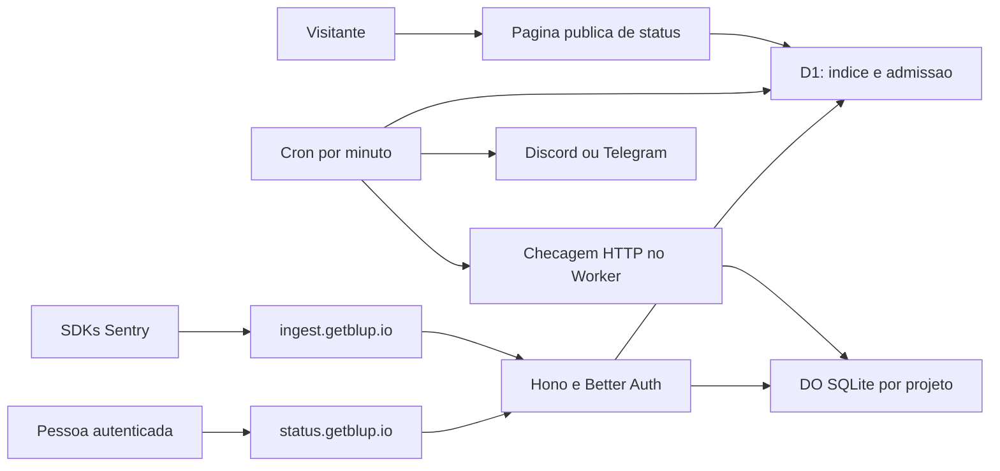

# Blup Status

Especificação de produto e proposta técnica, pesquisada em 02/11/2026. O produto foi aprovado; os contratos abaixo ainda precisam ser implementados e testados. Este documento não descreve um serviço já disponível. O escopo vem das decisões do dono; valores chamados de proposta técnica ainda podem ser ajustados. Exemplos usam marcadores, sem credenciais reais.

## 1. Produto e MVP

O Blup Status reúne erros de aplicações, monitores HTTP, páginas públicas de status e avisos por Discord e Telegram. Serve também para acompanhar Studio, Cloud, sites e futuros aplicativos móveis do próprio Blup.

O primeiro lançamento oferece quatro telas em `status.getblup.io`: Projetos, Monitores, Página de status e Avisos. Usa o mesmo login Better Auth e o backend Hono do Blup Cloud. A identidade visual usa o Blup verde-menta `turma-2` e favicon verde, reaproveitando os assets existentes.

A integração de erros usa SDKs oficiais do Sentry com um DSN do Blup. A promessa inicial é compatibilidade com envio de erros nas versões homologadas. Não significa reproduzir toda a plataforma Sentry, seus algoritmos de agrupamento ou sua API administrativa. Tracing, performance, replay, profiling, source maps, arquivos de símbolos, minidumps e anexos ficam fora do MVP. Também ficam fora avisos por e-mail/SMS, SDK próprio, equipes e consultas arbitrárias de logs.

## 2. Planos e limites

O Status não é vendido sozinho. O switch **+ Blup Status** escolhe uma variante completa do plano, com uma única assinatura por pessoa.

| Recurso | Max + Status | Ultra + Status |
| --- | --- | --- |
| Nome interno proposto | `max_status` | `ultra_status` |
| Direitos do Blup Cloud | Todos do Max | Todos do Ultra |
| Projetos | 3 | 10 |
| Erros aceitos por mês, total da conta | 50.000 | 250.000 |
| Retenção máxima de eventos e contadores | 30 dias | 90 dias |
| Monitores, total da conta | 10 | 50 |
| Menor intervalo de checagem | 5 minutos | 1 minuto |
| Páginas públicas de status | 1 | 3 |
| Domínio próprio nas páginas de status | Não incluído na proposta inicial | Incluído |
| Avisos | Discord e Telegram | Discord e Telegram |

As cotas de Status acima são a proposta ajustável do dono. Grátis, Pro, Max e Ultra sem o switch não incluem Status. Max continua com 5 GiB de notas, arquivos de até 50 MiB, 3 sites, 3 computadores, histórico de 365 dias, tempo real, domínio próprio, IA 2x e 50 lembretes por e-mail. Ultra continua com 10 GiB, arquivos de até 100 MiB e 10 sites, além dos demais direitos atuais. A [spec Cloud](blup-cloud-sync.md#planos-executados) detalha esses direitos.

O armazenamento de eventos é separado da cota de notas e sites. Página de status não consome um site Hugo do plano. Proposta para fechar o contrato: mês civil UTC, sem acumular saldo, sem cobrança automática por excedente e sem zerar uso ao trocar de plano ou recriar projeto. Um novo `event_id` aceito consome uma unidade, mesmo quando pertence a um problema já conhecido. Reenvio com o mesmo ID, dentro da janela de deduplicação, não consome outra unidade.

### Proteções técnicas propostas

| Proteção | Proposta inicial |
| --- | --- |
| Evento após descompressão, antes de tratar dados | Até 200 KiB, ou 204.800 bytes |
| Envelope inteiro | Até 1 MiB recebido e 1 MiB descomprimido |
| Itens por envelope | Até 100, com no máximo um `event` |
| Linha de cabeçalho do envelope/item | Até 8 KiB |
| Estrutura JSON | Até 32 níveis; strings/listas e quantidade de chaves limitadas |
| Ocorrências completas por problema | No máximo as últimas 100, já tratadas para privacidade |
| Banco por projeto, incluindo índices | Proposta: 256 MiB no Max + Status; 1 GiB no Ultra + Status |
| Pico de erros por projeto | Proposta: 60/minuto no Max + Status; 300/minuto no Ultra + Status |
| Pico de ingestão por IP | Fusível adicional, configurável e independente da cota paga |
| Histórico de checagens detalhadas | 7 dias; depois só resumo diário dentro da retenção do plano |

Esses são limites do Blup, menores que os do Sentry. Precisam constar nos exemplos de integração e passar na matriz de SDKs. Ao alcançar o teto de armazenamento, remover primeiro payloads antigos, preservando contadores dentro do prazo. Se não houver espaço seguro para novos índices/contadores, recusar a admissão e informar capacidade esgotada. Não prometer 100 amostras ou todos os eventos completos quando o teto por projeto já foi alcançado.

## 3. Arquitetura e fronteiras



O mesmo backend não exige servir o mesmo HTML nos três hosts. O roteamento por hostname precisa separar painel Status, painel Cloud e ingestão. O host de ingestão não serve páginas de login nem aceita cookies como autorização. Assets e fallback SPA devem corresponder ao painel pedido, sem capturar as rotas Sentry ou devolver `index.html` em uma falha de API.

D1 guarda identidade, configuração, índices de agendamento e metadados de admissão/entrega. Não recebe o JSON bruto dos erros ou stack traces. Cada projeto tem um Durable Object SQLite, identificado por mapeamento do servidor, que serializa eventos, agrupamento, deduplicação, limites locais e histórico de checagens. Não criar um DO por ocorrência nem por problema.

As esperas de rede dos monitores ocorrem no Worker, fora do DO. O resultado chega ao objeto em lote por projeto. Isso evita manter o DO ativo durante cada timeout HTTP. Alarmes cuidam de expiração e trabalho curto; notificações externas usam uma fila persistente de metadados e o despachante do cron.

SQLite em DO tem teto de 10 GB por objeto no Workers Paid; os tetos propostos do produto ficam abaixo disso. Usar uma nova classe SQLite e uma migração Workers `new_sqlite_classes`, sem alterar a classe `SyncLive`. O schema interno de cada objeto tem versão própria e migrações idempotentes. [Limites oficiais de DO](https://developers.cloudflare.com/durable-objects/platform/limits/), [API SQLite](https://developers.cloudflare.com/durable-objects/api/sqlite-storage-api/).

### Login entre subdomínios

Hoje [auth-options.ts](../../cloud/worker/auth-options.ts) usa `APP_URL` e `trustedOrigins` restrito ao Cloud. O Status exige uma mudança explícita, ainda não implementada. Proposta: manter a autenticação em `cloud.getblup.io`, habilitar `advanced.crossSubDomainCookies` com `domain: "getblup.io"` e listar exatamente Cloud e Status nas origens confiáveis. Os cookies de sessão devem continuar `HttpOnly`, `Secure` e com política SameSite adequada ao fluxo.

Se o painel Status chamar a API Cloud diretamente, usar `credentials: "include"`, CORS com origem exata e `Access-Control-Allow-Credentials: true`, nunca origem `*`. As passkeys continuam sendo criadas/usadas na origem de autenticação já configurada, preservando o `rpID`; compartilhar cookie não migra uma passkey para outra origem. Sair, revogar sessão, bloquear e excluir a conta devem valer nos dois painéis.

Um cookie no domínio pai alcança também outros subdomínios, inclusive o host de ingestão. Não o registrar nem utilizá-lo ali. Manter conteúdo de clientes em `getblup.site`, separado de `getblup.io`; não colocar páginas públicas de clientes sob o domínio que compartilha sessões. Testar a migração de cookies antigos restritos ao host, evitando cookies de mesmo nome com escopos conflitantes. [Cookies Better Auth](https://better-auth.com/docs/concepts/cookies), [segurança](https://better-auth.com/docs/reference/security), [passkeys](https://better-auth.com/docs/plugins/passkey).

## 4. Ingestão compatível com Sentry

### DSN e autenticação

Formato de apresentação, com marcadores:

```text
https://<CHAVE_PUBLICA>@ingest.getblup.io/<ID_NUMERICO_DO_PROJETO>
```

O identificador público é uma string decimal positiva, única, limitada a um intervalo compatível com os SDKs homologados. Não usar UUID na posição que SDKs possam exigir como ID numérico. A chave aleatória identifica a permissão de ingestão de um projeto, pode ser revogada/rotacionada e não autoriza ler problemas ou administrar a conta. Não incluir parte secreta no DSN.

Aceitar as três formas documentadas: `X-Sentry-Auth: Sentry sentry_version=7, sentry_key=<CHAVE_PUBLICA>`, parâmetros de query equivalentes e `dsn` no cabeçalho do envelope. Se houver mais de uma, conferir que chave, projeto e destino combinam. Chave ausente, desativada ou incompatível retorna 403, sem revelar se outro projeto existe. O protocolo é versão 7; o campo legado `sentry_secret` não concede poder adicional. [Autenticação Sentry](https://develop.sentry.dev/sdk/foundations/transport/authentication/).

O DSN de um navegador é público por natureza. Ele permite que outra pessoa tente enviar eventos e gastar a cota do projeto. Uma lista de origens ajuda o navegador, mas não autentica clientes nativos e não impede um atacante de forjar `Origin`. A defesa real combina revogação de chave, limites e admissão no servidor. Antes de admitir eventos, consultar o vínculo ativo e o direito da conta no D1; cache ou estado antigo no DO não pode autorizar projeto revogado, conta bloqueada ou assinatura encerrada. Falha nessa consulta não libera ingestão por padrão.

### Endpoints e parser

| Método e caminho em `ingest.getblup.io` | Corpo e resultado |
| --- | --- |
| `OPTIONS /api/:project/envelope/` e `/store/` | Preflight sem exigir sessão da conta |
| `POST /api/:project/envelope/` | Envelope Sentry; sucesso `200` com `{id}` para um evento aceito |
| `POST /api/:project/store/` | Um evento JSON, com o mesmo tratamento e agrupamento |

Envelope é uma sequência de bytes: uma linha JSON de cabeçalho e itens com cabeçalho próprio e payload. O parser deve respeitar `length` em bytes, consumir exatamente o payload e tolerar a ausência da última quebra de linha. Sem `length`, seguir a delimitação por linha definida pelo protocolo. Não usar `split("\n")` para interpretar payload binário, nem tratar envelope como um único JSON. Conferir IDs do envelope/evento e comprimento real, incluindo UTF-8 multibyte. Aceitar ID hexadecimal de 32 caracteres ou UUID com separadores, normalizando para 32; se ambos os locais omitirem o ID, gerar um. IDs presentes e conflitantes retornam 400. [Formato de envelopes](https://develop.sentry.dev/sdk/foundations/envelopes/).

Aceitar `application/x-sentry-envelope` ou ausência de Content-Type. Para compatibilidade do navegador, aceitar também os Content-Types simples documentados, como `text/plain`, sem trocar a interpretação dos bytes por um parser de formulário. `store` aceita o evento JSON, inclusive quando transportado comprimido. Variantes legadas fora dessa matriz só entram depois de uma fixture oficial e um teste de compatibilidade.

| Tipo de item | MVP |
| --- | --- |
| `event` de erro/mensagem | Aceitar campos reconhecidos e validar antes de persistir |
| `session`, `sessions`, `client_report` | Consumir e ignorar; não entram na cota de erros |
| `transaction`, `span`, perfis e métricas | Consumir e ignorar; sem performance ou tracing |
| `replay_event`, `replay_recording` | Consumir e ignorar; nunca armazenar gravações |
| `attachment`, inclusive payload nativo | Consumir e ignorar; sem anexos/minidumps |
| `user_report`, `feedback`, `check_in`, logs e tipos futuros | Ignorar se o enquadramento for válido; não criar recurso implícito |

Tipos de item não são as mesmas categorias usadas nos headers de rate limit. Dentro de `event`, o MVP aceita `type` ausente, `default` ou `error`; outros tipos de telemetria não viram erros só por estarem nesse item. Um envelope só com itens ignorados recebe `200 {}` depois de validado e limitado em bytes, sem incrementar contadores. Item ignorado continua sujeito ao teto do envelope. Enquadramento inválido retorna 400; não responder sucesso para bytes que não foram interpretados com segurança. A API não faz download de source maps, anexos ou URLs presentes no evento. [Tipos e restrições dos itens](https://develop.sentry.dev/sdk/foundations/envelopes/envelope-items/).

### Compressão, CORS e respostas

Suportar primeiro corpo sem compressão, `Content-Encoding: gzip` e `deflate` com estrutura zlib. A descompressão tem limite de saída e prazo antes de montar JSON. Medir bytes recebidos e descomprimidos mesmo sem `Content-Length`. Compressão desconhecida retorna 415; stream inválido retorna 400; excedente retorna 413. Não usar o tamanho comprimido como teto do evento.

O Sentry também documenta `br` e `zstd`. Workers oferece gzip/deflate nas Compression Streams e Brotli em `node:zlib`; isso não comprova suporte a todo decoder/SDK no ambiente escolhido. Se alguma versão homologada emitir outra compressão por padrão, suportá-la com API disponível ou retirar essa versão da promessa de trocar só o DSN. Não acrescentar biblioteca de compressão pouco conhecida para encobrir a diferença. [Compressão Sentry](https://develop.sentry.dev/sdk/foundations/transport/compression/), [Web APIs Workers](https://developers.cloudflare.com/workers/runtime-apis/web-standards/), [zlib Workers](https://developers.cloudflare.com/workers/runtime-apis/nodejs/zlib/).

Na ingestão pública, CORS pode permitir `*` sem credenciais. Expor `Retry-After`, `X-Sentry-Rate-Limits` e `X-Sentry-Error`; permitir os headers usados pelos SDKs, incluindo `Content-Type`, `Content-Encoding` e `X-Sentry-Auth`. Aplicar esses headers também em erros e 429. Separar essa política do CORS autenticado do painel.

| HTTP | Significado |
| --- | --- |
| 200 | Evento persistido, duplicado já conhecido ou apenas itens deliberadamente ignorados |
| 400 | Envelope, JSON, metadados ou autenticação em formato inválido |
| 403 | Chave inválida/revogada ou projeto sem direito de ingestão |
| 413 | Tamanho excedido |
| 415 | Compressão/formato não suportado |
| 429 | Pico, cota mensal ou capacidade de admissão esgotada; incluir espera |
| 503 | Falha transitória antes da confirmação de armazenamento |

Sucesso de erro devolve ID hexadecimal normalizado. Só confirmar depois da transação SQLite; se a resposta se perder, deduplicar o reenvio por projeto e `event_id`. JSON de falha pode incluir `detail` e `X-Sentry-Error` sanitizados, sem ecoar corpo, DSN ou detalhes internos. Os SDKs não garantem reenviar todo evento após falha; não anunciar entrega garantida. [Transporte e respostas Sentry](https://develop.sentry.dev/sdk/foundations/transport/).

### Rate limit que os SDKs entendem

Usar segundos em `Retry-After`, calculados até a liberação do pico ou o próximo mês UTC. Emitir também `X-Sentry-Rate-Limits`, por exemplo:

```http
HTTP/1.1 429 Too Many Requests
Retry-After: 60
X-Sentry-Rate-Limits: 60:error;default:project:blup_burst
```

O formato é `espera:categorias:escopo:motivo`, podendo ter campos adicionais. Categorias vazias significam todas; usar `error;default` para a cota de erros, preservando o entendimento de SDKs que classificam mensagens como `default`. SDKs dão preferência a `X-Sentry-Rate-Limits`; se ele não existir, usam `Retry-After` no 429. O header também pode antecipar bloqueio numa resposta 200. Validar o comportamento por SDK, sem confundir esses headers com os limites da API administrativa do Sentry. [Rate limiting de ingestão](https://develop.sentry.dev/sdk/foundations/transport/rate-limiting/).

Workers Rate Limiting é um fusível rápido, aproximado e por localização Cloudflare. Não serve como contador exato da assinatura. O DO aplica o pico global do projeto e sua admissão local. A cota mensal total precisa de coordenação entre projetos. [Limitação oficial da API de rate limit](https://developers.cloudflare.com/workers/runtime-apis/bindings/rate-limit/).

Proposta para evitar um UPDATE D1 por evento: reservar pequenos lotes, inicialmente 32 unidades, do orçamento mensal da conta. D1 grava concessões idempotentes por projeto/mês, com soma nunca superior ao plano; cada DO importa uma concessão uma só vez e consome os slots em transação com o evento. Lotes ainda não consumidos permanecem reservados até o fim do mês, inclusive se o projeto for apagado. Mostrar aceitos e reservados separadamente. Não liberar uma concessão após timeout sem comprovar que o DO não a adotou. Isso evita duplicar saldo em falhas entre D1 e DO.

## 5. Agrupamento e ciclo dos problemas

O campo Sentry `fingerprint` é uma lista de strings. Valores iguais agrupam ocorrências; `{{ default }}` insere a identidade calculada pelo servidor. O Blup deve aceitar esse mecanismo, mas seu agrupamento padrão será próprio e versionado. Não prometer que os mesmos eventos gerarão os mesmos grupos do serviço Sentry. [Fingerprinting oficial](https://docs.sentry.io/platforms/javascript/enriching-events/fingerprinting/).

Proposta `groupingVersion = 1`:

1. Tratar dados sensíveis antes de construir qualquer chave ou título.
2. Calcular uma base com plataforma, tipo da exceção e frames relevantes normalizados; sem stack, usar mensagem normalizada e limitada. Retirar caminhos pessoais, IDs variáveis e parâmetros de URL.
3. Com fingerprint explícito, preservar ordem e fronteiras dos elementos, expandindo `{{ default }}` com essa base. Limitar a 32 elementos e 256 caracteres por elemento.
4. Aplicar SHA-256 a uma representação canônica que inclua a versão do algoritmo. O DO do projeto separa os grupos entre clientes; ambiente e release são filtros, sem dividir o grupo por padrão.

O problema guarda primeiro/último recebimento, contagem, severidade, título tratado, ambientes/releases resumidos e estado `open`, `resolved` ou `ignored`. Resolver não apaga eventos. Um evento novo reabre um resolvido e pode gerar aviso de regressão; um ID duplicado não reabre. Ignorar mantém contadores, mas suprime avisos até a pessoa reabrir. Não fazer merge automático entre versões do algoritmo.

As últimas 100 ocorrências completas são o evento permitido pela política de privacidade, não uma cópia crua do pedido. Ocorrências adicionais continuam contando; amostras mais antigas saem. Preservar IDs de deduplicação dentro da retenção mesmo quando o payload foi descartado. Essa combinação é limitada também pelo espaço do projeto.

## 6. Modelo de dados proposto

As tabelas abaixo são desenho de schema, não migrações existentes. A próxima numeração D1 deve ser escolhida quando a implementação for feita, preservando a migração de idioma e o histórico atual.

| D1 geral | Campos e índices principais |
| --- | --- |
| `status_project` | ID público decimal, `owner_id`, nome, plataforma, ID interno do DO, ativo, versão de configuração, datas; índice por dono |
| `status_project_key` | Projeto, hash da chave, prefixo para exibição, ativo/revogado, datas; chave única e vínculo ao projeto |
| `status_usage_month`, `status_quota_grant` | Conta/mês, limite, reservado; concessões por projeto com ID único e quantidade; admissão condicional |
| `status_monitor` | Dono, projeto, nome público separado, URL privada, intervalo, ativo, próximo horário, claim e estado atual; índice por vencimento |
| `status_page`, `status_page_component` | Dono, slug único, título, componentes, projetos/monitores autorizados, visibilidade e domínio |
| `status_incident`, `status_incident_update` | Página, texto público, estado, impacto e datas; índice por página/data |
| `status_channel` | Dono, tipo, dados de destino protegidos, configuração, estado e último erro sanitizado |
| `status_channel_project`, `status_alert_outbox` | Vínculos e IDs de problema/monitor; deduplicação, próximo envio, tentativas e estado; índice da fila |
| `status_telegram_link` | Hash do código, dono, expiração, chat candidato, consumido; sem token do bot |
| `status_page_domain` | Página, hostname, prova de posse, estado/SSL e identificador do provedor; unicidade de hostname verificado |

Credenciais Discord não ficam em texto puro: cifrar com AES-GCM usando chave de serviço em Worker secret, nonce único, identificação de versão da chave e dados associados ao dono/canal. O servidor pode decifrar para enviar; isso não é cifra de ponta a ponta. Token do bot Telegram e segredo de verificação do webhook são secrets globais. DSNs são públicos para envio; guardar hash da chave e mostrar o valor completo na criação/rotação, com recuperação por rotação.

| SQLite de cada DO de projeto | Conteúdo |
| --- | --- |
| `meta` | Versão do schema, configuração, período e revisões aplicadas |
| `quota_grant`, `usage_month` | Concessões importadas e consumo local |
| `issue` | Fingerprint, versão, estado, título tratado, primeiro/último evento e contagem |
| `event_seen` | `event_id` único, grupo e recebimento, para deduplicar sem reter todo payload |
| `event_sample` | Grupo, evento tratado, tamanho e expiração; índice por grupo/data e por expiração |
| `issue_day` | Contadores diários, sem corpo do evento |
| `monitor_check` | Monitor, horário previsto/real, resultado e duração; índice por monitor/data |
| `monitor_day` | Sucessos, falhas, desconhecidos e resumo de latência por dia |
| `alert_pending` | Transições a entregar ao índice de avisos, com ID idempotente |

Contador, deduplicação, grupo e amostra entram na mesma transação SQLite. Não há transação distribuída entre D1 e DO: criação/exclusão usam estados intermediários recuperáveis e concessões idempotentes. Só habilitar ingestão depois do vínculo completo. Exclusão revoga primeiro no D1, depois apaga o objeto e os vínculos com retomada após falha.

### Retenção e limpeza

Usar o horário de recebimento no servidor para expiração, sem permitir que um timestamp futuro do SDK estenda o prazo. Amostras, IDs, contadores, incidentes e resumos operacionais têm expiração compatível com 30/90 dias; não manter histórico de ocorrências em contadores eternos. A contagem exibida representa a janela vigente e desconta os buckets diários expirados. Configuração ativa de projeto/monitor é outra classe de dado, mantida enquanto o recurso existir.

Checagens completas expiram em 7 dias, depois de contabilizadas no resumo diário. Alarmes processam lotes por índice de expiração; o próximo alarme é o menor prazo pendente. Há apenas um alarme por DO e ele pode executar mais de uma vez, então o trabalho deve ser idempotente. O cron diário revisita projetos para recuperar limpeza interrompida. [Alarmes oficiais](https://developers.cloudflare.com/durable-objects/api/alarms/).

Expirados deixam de aparecer nas consultas imediatamente. Atraso na remoção física é uma falha operacional a medir e corrigir, não uma extensão comercial da retenção. O teto de 90 dias não autoriza restaurar dados vencidos por backup: após restauração, reaplicar expiração antes de servir. O dono precisa fechar como o teto será apresentado diante de backups/recuperação do provedor; não afirmar destruição instantânea de todas as cópias.

## 7. Monitores HTTP e páginas de status

Proposta de monitor MVP: `GET` HTTPS em porta 443, nome, projeto, URL, intervalo do plano e ativo/pausado. Resposta 2xx é sucesso. Erro DNS/TLS, timeout e demais status são falha. Não seguir redirects no MVP; a pessoa informa a URL final. Não aceitar cookies, Authorization, headers arbitrários ou corpo de pedido nesta fase. Não armazenar corpo de resposta.

Aplicar timeout de 10 segundos, cancelar leitura e limitar bytes processados. Bloquear usuário/senha na URL, IP literal, localhost, redes privadas, link-local e destinos de metadados. A proteção deve valer na resolução e na conexão efetiva, incluindo DNS rebinding; só uma expressão regular de hostname não resolve SSRF. Homologar a estratégia de saída no runtime real antes de abrir monitores arbitrários, sem invocar produção durante os testes. [Fetch no Workers](https://developers.cloudflare.com/workers/runtime-apis/fetch/).

Um cron `* * * * *` seleciona monitores vencidos; Max só fica elegível a cada cinco minutos. Os horários são UTC. Índice por vencimento e claim com lease impedem execução concorrente do mesmo monitor/horário. Processar em lotes e com concorrência limitada, sem criar uma promessa de checagem no segundo exato. Não repetir milhares de checagens atrasadas para recuperar cron perdido: registrar lacuna e retomar o próximo horário. [Cron Triggers](https://developers.cloudflare.com/workers/configuration/cron-triggers/).

Proposta de estado: começar `unknown`, marcar `down` após três falhas consecutivas e `up` após duas respostas válidas. Avisar apenas transições confirmadas. Atraso da própria infraestrutura do Blup é `unknown`, não prova de indisponibilidade do destino. Mostrar horário da última checagem, lacunas e que o teste parte da infraestrutura Cloudflare, sem prometer múltiplas regiões ou SLA. Disponibilidade usa falhas/sucessos observados, exibindo também cobertura e intervalos sem observação.

A página pública mostra componentes escolhidos, estado atual, resumos diários e incidentes escritos manualmente. Estados do incidente: `investigating`, `identified`, `monitoring`, `resolved`; impacto público: operacional, degradado, interrupção parcial ou indisponível. Erros privados nunca viram incidentes públicos automaticamente. URL monitorada, DSN, stack trace, nomes privados e credenciais não entram no HTML/JSON público.

O endereço público padrão ainda depende do dono. Recomendação: um domínio separado de `getblup.io`, sem cookie da conta, com slug por página. Domínio próprio Ultra exige prova de posse, unicidade e TLS ativo pelo fluxo Cloudflare for SaaS; reutilizar o desenho de [domínio Cloud](publicacao.md#domínio-próprio-no-blup-cloud), com vínculo para página Status e sem consumir sites Hugo. A zona e o CNAME de serviço dependem da escolha do endereço padrão. Escapar texto de incidentes, sem HTML arbitrário, e limitar cache público para não esconder transições indefinidamente.

## 8. Avisos Discord e Telegram

Disparos iniciais: novo problema, regressão e mudança confirmada de monitor. Incidente manual pode ser anunciado por ação explícita. Repetições do mesmo problema são contadas, com cooldown proposto de 15 minutos por destino; não enviar uma mensagem por ocorrência. Proposta MVP: um Discord e um chat Telegram por projeto, sem automações arbitrárias.

`status_alert_outbox` registra apenas referência e estado de entrega. O despachante carrega um resumo já tratado, tenta no máximo cinco vezes com espera crescente e jitter, obedece à espera do provedor e expira avisos antigos. Proposta de validade: 24 horas. Se a mensagem foi aceita e a confirmação local se perdeu, pode haver duplicata; a interface não deve prometer entrega exatamente uma vez ou leitura pelo destinatário.

### Discord

Aceitar só webhook HTTPS de entrada em host/caminho oficial permitido; não fazer fetch em URL arbitrária colada como canal. Enviar com `wait=true`, `content` limitado a 2.000 caracteres e `allowed_mentions: {parse: []}`. Desativar menções e não anexar eventos crus. A URL contém uma credencial e aparece mascarada depois de salva.

Não fixar uma regra universal como cinco mensagens a cada dois segundos. Respeitar `X-RateLimit-Bucket`, `Remaining` e `Reset-After`; no 429, respeitar `Retry-After`/`retry_after`, inclusive valores fracionários e limites globais. Em 401/403/404 persistente, desativar o destino e pedir correção, evitando loops. [Execute Webhook](https://docs.discord.com/developers/resources/webhook#execute-webhook), [rate limits Discord](https://docs.discord.com/developers/topics/rate-limits).

### Telegram

O usuário precisa abrir/iniciar a conversa com o bot. A tela cria código aleatório base64url, de uso único, ligado à conta e com validade proposta de dez minutos; persiste apenas seu hash. O link `https://t.me/<BOT>?start=<CODIGO>` faz chegar `/start <CODIGO>`. O parâmetro aceita até 64 caracteres. Vincular primeiro um chat privado; grupos/canais exigem comprovação de permissão e ficam para uma fase posterior. [Deep linking oficial](https://core.telegram.org/bots/features#deep-linking).

O webhook do bot exige `X-Telegram-Bot-Api-Secret-Token` e validação do update. Deduplicar `update_id`; conferir expiração, uso único e remetente/chat; apresentar o chat candidato no painel e exigir confirmação autenticada antes de ativar. IDs de chat são inteiros seguros no protocolo, mas ficam como string decimal no banco/DTO de destino, preservando sinal e evitando conversões descuidadas.

Enviar por `sendMessage`, texto simples de até 4.096 caracteres, sem `parse_mode` para interpretar conteúdo do erro. Validar `ok`, resultado e parâmetros de erro. No 429, usar `parameters.retry_after`; não habilitar broadcasts pagos. Planejar menos de uma mensagem por segundo por chat e cerca de 30 por segundo por bot; grupos têm referência de 20 por minuto. Manter folga e seguir as respostas, pois os limites podem mudar. O token do bot fica em secret e nunca aparece em logs de URL. [Bot API](https://core.telegram.org/bots/api#sendmessage), [webhook](https://core.telegram.org/bots/api#setwebhook), [limites oficiais](https://core.telegram.org/bots/faq#my-bot-is-hitting-limits-how-do-i-avoid-this).

O limite global do bot precisa de coordenação entre contas. Proposta MVP: um despachante Telegram serializado por lease no D1, com contador global e envio conservador, separado dos DOs dos projetos. Se o volume exigir outro mecanismo, evoluir a fila antes de aumentar os limites comerciais.

## 9. API Hono tipada

Rotas propostas sob `/api/status`. Todas exigem sessão, dono e direito do plano, exceto leitura pública e webhooks com sua autenticação própria. IDs, query, body e cursores passam por Zod, com JSON de configuração estrito. O parser binário Sentry é separado do middleware JSON geral de 96 KiB do Cloud; precisa dos limites próprios desta spec. Metadados extras de SDK desconhecidos podem ser descartados com segurança, sem exigir que SDKs só emitam campos que o painel conhece.

Exportar rotas encadeadas como `StatusAppType`/parte de `AppType` e usar `hc` com respostas inferidas no painel. Reaproveitar a geração RPC existente, sem repetir DTOs manualmente. Exceções do transporte Sentry têm o formato compatível da seção 4; a API do painel mantém erro JSON com `code` estável e mensagem traduzida no cliente. [RPC Hono](https://hono.dev/docs/guides/rpc), [contratos do projeto](tipagem-e-contratos.md).

| Método e rota | Contrato resumido |
| --- | --- |
| `GET /api/status/usage` | Limites, aceitos/reservados do mês, espaço, recursos e datas; números finitos e inteiros quando aplicável |
| `GET/POST /api/status/projects` | Lista paginada; criação estrita `{name, platform}` e DSN na resposta de criação |
| `PATCH/DELETE /api/status/projects/:project` | Nome/ativo; exclusão revoga ingestão antes da purga |
| `POST /api/status/projects/:project/keys` | Rotaciona ou cria chave; valor completo só na emissão |
| `DELETE /api/status/projects/:project/keys/:key` | Revoga chave do projeto |
| `GET /api/status/projects/:project/issues` | Filtros `state`, `environment`, `release`, `q`, cursor e limite máximo 50 |
| `GET/PATCH /api/status/projects/:project/issues/:issue` | Detalhe; alteração estrita `{state}` |
| `GET /api/status/projects/:project/issues/:issue/events` | Amostras paginadas dentro da retenção |
| `GET/POST /api/status/monitors` | Lista; criação `{projectId, name, url, intervalMinutes}` |
| `PATCH/DELETE /api/status/monitors/:monitor` | Configuração permitida e pausa; índice recuperável |
| `GET /api/status/monitors/:monitor/checks` | Janela limitada e cursor; detalhe ou resumo diário conforme idade |
| `GET/POST /api/status/pages` | Lista; criação `{title, slug, componentIds}` com recursos do mesmo dono |
| `GET/PATCH/DELETE /api/status/pages/:page` | Configuração, publicação/retirada e componentes selecionados |
| `GET/POST /api/status/pages/:page/incidents` | Histórico limitado e criação de incidente manual |
| `POST /api/status/pages/:page/incidents/:incident/updates` | Atualização pública de texto e estado |
| `GET/POST/DELETE /api/status/pages/:page/domain` | Contrato de domínio no plano elegível; DELETE não tem body |
| `GET/POST /api/status/channels` | Lista mascarada; cadastro Discord com destino validado |
| `DELETE /api/status/channels/:channel` | Desliga canal e cancela pendências ainda não enviadas |
| `POST /api/status/channels/:channel/test` | Teste explícito, limitado, sem conteúdo privado |
| `PUT /api/status/projects/:project/channels` | Substitui lista estrita de IDs do mesmo dono |
| `POST /api/status/telegram/link` | Emite código/link temporário |
| `GET /api/status/telegram/link/:link` | Consulta estado do vínculo, sem expor código de novo |
| `POST /api/status/telegram/link/:link/confirm` | Confirma o chat proposto e cria o canal |
| `POST /api/status/telegram/webhook` | Update do Telegram autenticado por secret, sem sessão do painel |
| `GET /api/status/public/:slug` | Só DTO público; host final ainda a escolher |

Datas saem em ISO UTC; ausência explícita usa `null`, listas vazias usam `[]`. Um recurso de outra conta responde como não encontrado. Reservar slugs, limitar nomes/textos, validar cada vínculo de componentes/canais e usar idempotência nas operações que podem ser repetidas. Não aceitar owner, plano, limite ou nome de DO fornecidos pelo cliente como autoridade.

## 10. Telas do painel

| Tela | Conteúdo do MVP |
| --- | --- |
| Projetos | Uso/cota, criar projeto, copiar DSN, rotacionar/revogar chave e exemplos de SDK homologado; lista de problemas, filtros, amostras tratadas e resolver/ignorar |
| Monitores | URL privada, intervalo, estado, última checagem, lacunas e histórico; criar, pausar e apagar |
| Página de status | Título, endereço, componentes públicos, prévia, incidentes manuais e domínio próprio Ultra |
| Avisos | Discord mascarado, vínculo Telegram por código, projetos associados, teste explícito e resultado das entregas |

Sem Status na assinatura, mostrar explicação e link para a página de planos Cloud; não criar uma segunda área de cobrança. Reaproveitar idioma da conta/navegador, temas claro/escuro e componentes acessíveis do Cloud. Nenhum erro privado aparece na página pública sem ação explícita. O teste de canal nunca é disparado ao apenas abrir a tela.

## 11. Switch e cobrança Stripe

Proposta de catálogo, com preços definidos no Dashboard, não neste documento:

| Variante | Lookup key mensal | Lookup key anual |
| --- | --- | --- |
| `max_status` | `blup_max_status_mensal` | `blup_max_status_anual` |
| `ultra_status` | `blup_ultra_status_mensal` | `blup_ultra_status_anual` |

O switch altera a variante no seletor Max/Ultra e exibe o preço total daquela assinatura, não um adicional avulso com cobrança paralela. `max_status` herda todos os limites Max; `ultra_status`, todos Ultra. Modelar separadamente `basePlan` e direitos `status`, mesmo que o identificador comercial seja único. O domínio próprio dos sites Cloud e o das páginas Status são direitos distintos: `limits.customDomain` do Max não libera automaticamente `status.customDomain`. Adicionar os nomes aos enums, catálogos de idioma, validação de preços, metadados `blup_plan`, reconciliação e cálculos de downgrade, sem deixar variante desconhecida cair no Grátis.

Hoje [plans.ts](../../cloud/worker/plans.ts) conhece quatro nomes; [billing.ts](../../cloud/worker/billing.ts) reconhece lookup keys/metadados e o [cliente Stripe](../../cloud/worker/stripe-client.ts) fixa API `2026-10-28.endive`. Esses pontos precisam mudar juntos. `/plans` continua localizando textos e obtendo preços reais do Stripe; ausência de preço mantém a compra desabilitada. Não copiar valores de Max/Ultra para inventar o total com Status.

Ativar Status numa assinatura existente deve substituir o item recorrente da própria assinatura, com idempotência e serialização por conta. Fazer prévia da proporcionalidade com o mesmo instante aplicado na atualização, mostrar crédito/débito e exigir confirmação do total. Proposta: `proration_behavior=always_invoice` e `payment_behavior=pending_if_incomplete`, liberando Status somente depois de o Stripe aplicar a mudança paga. Tratar autenticação de pagamento e pendência, sem confiar no retorno visual de sucesso. [Proporcionalidade Stripe](https://docs.stripe.com/billing/subscriptions/prorations), [pending updates](https://docs.stripe.com/billing/subscriptions/pending-updates).

O plugin Better Auth oferece troca proporcional e agendamento no fim do período, mas seus padrões não comprovam a política de liberação condicionada a pagamento. Validar integração com o reconciliador próprio do Blup, mantendo os handlers webhook/success concorrentes do plugin desabilitados. A confirmação vem do webhook assinado e retrieve atual sob lease, como no Cloud. Impedir criar outro Checkout quando já existe assinatura aplicável ou troca pendente. [Stripe no Better Auth](https://better-auth.com/docs/plugins/stripe).

Recomendação para desligar o switch ou reduzir Ultra + Status para Max + Status: agendar no fim do período, preservando o que foi pago, sem prometer reembolso automático. Uma troca imediata com crédito proporcional pode ser oferecida se o dono aprovar essa política. Mudança de plano não reinicia o consumo mensal. Antes de reduzir, mostrar projetos/monitores/páginas excedentes e pedir os recursos retidos; não escolher silenciosamente o projeto com os erros mais recentes.

Ao terminar o direito de Status, pausar monitores e ingestão, sem novos gastos ou avisos. Proposta: dados privados ficam só para leitura por até 30 dias, respeitando expirações menores e o teto de 90 dias; páginas públicas mostram indisponibilidade do serviço, sem estado operacional antigo. Reativar não ressuscita dados vencidos. Exclusão de conta segue bloqueio imediato e purga do Cloud, incluindo DOs, canais e domínios Status. A duração de carências comerciais específicas ainda depende do dono.

## 12. Privacidade e aceite no Studio

Eventos de Status não são notas sincronizadas com cifra de ponta a ponta. O servidor precisa ler erro, frames tratados, versão e contadores para agrupar e avisar; Discord/Telegram recebem o resumo que for enviado. Separar essa explicação do [modelo de segurança do sync](../seguranca.md).

No Studio, o envio fica desligado por padrão. Exigir aceite específico, revogável, antes de iniciar SDK, instalar capturadores automáticos ou enviar qualquer evento. Não reaproveitar o aceite de IA. O monitoramento operacional do backend Cloud é outro fluxo, descrito na política de privacidade institucional.

O Studio usa lista fechada de campos: código estável de falha, componente, versão/build, sistema operacional e frames que não contenham caminhos pessoais. Não transmitir corpo/título de notas, nomes de arquivos/cofres, anexos, texto selecionado, prompts, terminal, URLs privadas, credenciais ou mensagens de erro que possam carregar esses valores. Não anexar minidump, screenshot, log ou estado inteiro do aplicativo. No Go, transformar falhas em códigos antes de capturá-las; `beforeSend` e filtro de breadcrumbs são defesa adicional, não autorização para enviar o erro cru.

Na ingestão geral, remover cookies, Authorization, tokens, senhas, query strings sensíveis, IP, dados de usuário e corpos HTTP por padrão. Limitar e tratar recursivamente contexto, breadcrumbs, tags e mensagens. Remover caminhos pessoais de stack e nunca buscar código remoto. SDK configurado com envio padrão de PII desligado ainda exige revisão dos demais campos; scrubbing genérico não detecta todo segredo em texto livre. Testes do Studio devem injetar notas/segredos sentinela e comprovar ausência antes da rede e depois do armazenamento. [Dados coletados em React Native](https://docs.sentry.io/platforms/react-native/data-management/data-collected/), [Flutter](https://docs.sentry.io/platforms/dart/guides/flutter/data-management/data-collected/).

Não registrar bodies de ingestão, URLs de webhook ou token do bot nos logs do Worker. A infraestrutura ainda pode observar IP e metadados de acesso; minimizar retenção e separar métricas agregadas de payload. Não enviar erros internos do próprio pipeline de ingestão para ele de forma recursiva.

## 13. SDKs e critérios de compatibilidade

Nenhum SDK está homologado só pela pesquisa desta spec. Na implementação, fixar versões e publicar a matriz real, com versão atual estável e pelo menos uma versão anterior que se pretenda suportar.

| SDK oficial | Primeiro teste | Limite da promessa |
| --- | --- | --- |
| [JavaScript browser](https://docs.sentry.io/platforms/javascript/) | `captureException`, mensagem, erro não tratado, CORS, fetch/Beacon e headers de bloqueio | Stack de bundle minificado continua minificada, sem source maps |
| [Node.js](https://docs.sentry.io/platforms/javascript/guides/node/) | Exceção, rejeição, mensagem, gzip e flush no encerramento | Sem tracing, logs ou perfis como produto implícito |
| [Go](https://docs.sentry.io/platforms/go/) | Erro/panic recuperado, mensagem, flush e filtragem antes do envio | Não prometer capturar todo encerramento fatal ou falha nativa |
| [React Native](https://docs.sentry.io/platforms/react-native/) | Erro JavaScript em Android/iOS reais ou simulados e transporte offline | Sem symbolication nativa, source maps, anexos ou minidumps; provar o caminho JSON antes de anunciar |
| [Flutter](https://docs.sentry.io/platforms/dart/guides/flutter/) | Exceção Dart e transporte em Android/iOS, inclusive após reconexão | Sem símbolos/obfuscação resolvidos ou processamento de crash nativo fora do JSON suportado |

No conjunto comum, testar fingerprint explícito e `{{ default }}`, `event_id` repetido, autenticação por header/query/envelope, itens extras ignorados, comprimentos binários, UTF-8, evento acima de 200 KiB, envelope acima do teto, gzip/deflate corrompido e bomba de descompressão. Confirmar com tráfego capturado localmente que 429 e os dois headers fazem o SDK suspender a categoria, inclusive no navegador.

Matriz também deve testar SDK sem tracing/replay e com defaults reais: ignorar um item não pode corromper o erro do mesmo envelope. Ferramentas de build que tentam enviar source maps/símbolos para APIs administrativas do Sentry não se tornam compatíveis por trocar o DSN; desabilitar esses uploads e explicar o limite. Não mostrar um selo geral de suporte mobile antes desses testes.

## 14. Custos estimados

Estimativas em USD para 30 dias, sem impostos, taxas Stripe, câmbio, domínio ou trabalho humano. Não são preço de venda nem medição. Os limites incluídos abaixo são da conta Cloudflare inteira e já são compartilhados com Blup Cloud.

Tarifas oficiais consultadas: Workers Paid tem base de US$5/mês, 10 milhões de requests e 30 milhões de ms de CPU incluídos; excedentes de US$0,30/milhão de requests e US$0,02/milhão de ms. Subrequests HTTP de checagem não são requests de entrada cobradas por unidade, mas continuam consumindo CPU e limites de execução. [Workers pricing](https://developers.cloudflare.com/workers/platform/pricing/).

DO Paid inclui 1 milhão de requests, 400.000 GB-s, 25 bilhões de linhas lidas, 50 milhões escritas e 5 GB-mês; excedentes de US$0,15/milhão de requests, US$12,50/milhão de GB-s, US$0,001/milhão de leituras, US$1/milhão de escritas e US$0,20/GB-mês. D1 tem franquias próprias de 25 bilhões de leituras, 50 milhões de escritas e 5 GB; excedentes SQL equivalentes, com armazenamento D1 a US$0,75/GB-mês. Índices e exclusões também pesam nas escritas. [DO pricing](https://developers.cloudflare.com/durable-objects/platform/pricing/), [D1 pricing](https://developers.cloudflare.com/d1/platform/pricing/).

Modelo de carga proposto: todas as cotas de erros/monitores usadas; um evento por envelope; concessões de 32 unidades, duas escritas D1 por concessão; duas escritas D1 e três SQLite por checagem; oito escritas SQLite por erro, incluindo manutenção média. Agrupar resultados por projeto/horário, sem chamar um DO por monitor individual. Essas quantidades precisam ser medidas, incluindo índices e poda, e não vêm de uma garantia da plataforma.

| Carga em 30 dias por conta | Max + Status | Ultra + Status |
| --- | --- | --- |
| Erros recebidos | 50.000 | 250.000 |
| Checagens HTTP | 86.400 | 2.160.000 |
| Requests DO aproximadas, sem painel/alarmes | 75.920 | 682.000 |
| Escritas D1 aproximadas | 175.926 | 4.335.626 |
| Escritas SQLite DO aproximadas | 659.200 | 8.480.000 |
| Custo variável de requests e escritas, sem descontar franquias | US$0,86 | US$12,99 |

O último valor soma requests de ingestão, requests DO e escritas dos dois bancos. Não inclui CPU, armazenamento, leituras, alarmes, avisos, acessos públicos e extras do painel. É uma conta conservadora sem franquias; os primeiros clientes podem caber nas franquias compartilhadas, e clientes adicionais passam a consumir excedentes. O Ultra precisa de margem compatível com monitoramento contínuo.

Com eventos únicos de 5 KiB e retenção completa, o corpo sozinho representa cerca de 0,256 GB no Max e 3,84 GB no Ultra após três meses de carga, antes dos índices. No pior caso de 200 KiB, o Ultra poderia receber 153,6 GB em 90 dias se nada fosse podado. As últimas 100 amostras por problema não evitam isso quando cada evento cria um grupo diferente. Tetos por projeto, retenção e poda são obrigatórios para o produto ser duradouro.

Com os tetos propostos de banco, o armazenamento total máximo seria 768 MiB no Max e 10 GiB no Ultra, antes de efeitos de recuperação/backups do provedor. Cobrar espaço dentro desses tetos e medir custos reais antes de fixar preços. Definir alertas de orçamento, limite de contas no piloto, volume da fila e um corte operacional para tráfego abusivo. Discord/Telegram comuns não exigem broadcasts pagos; manter recursos pagos do bot desativados.

## 15. Riscos e fases

| Gravidade | Risco | Condição de liberação |
| --- | --- | --- |
| Alto | Conteúdo de notas/credenciais escapar em erro, contexto ou breadcrumb | Aceite separado e teste de ausência de sentinelas antes da rede; tratamento no servidor |
| Alto | Monitores usados para SSRF ou atingir serviços internos | Saída restrita, defesa verificada contra DNS rebinding, timeout e limites |
| Alto | Variante Stripe cair no Grátis, cobrar duas assinaturas ou liberar antes do pagamento | Migração conjunta dos enums/reconciliador, lease por conta e testes de proporcionalidade/pendência |
| Alto | Chave pública ser usada para drenar cota ou criar grupos sem limite | Fusíveis, pico no DO, admissão mensal e teto físico por projeto |
| Médio | Cookies compartilhados ampliarem o impacto de outro subdomínio | Hosts confiáveis exatos, domínio público separado e testes de sessão/logout/CSRF |
| Médio | Falso alerta por atraso do cron ou mensagem duplicada | Estado desconhecido, confirmação por sequência, deduplicação e limites de retentativa |
| Médio | Promessa ampla de mobile/compressão sem suporte real | Matriz de SDKs com defaults e limites visíveis |
| Médio | Retenção nominal esconder atraso de limpeza ou backups | Expiração nas consultas, alarmes, reconciliação e política de recuperação explícita |

Fase 0: fechar cotas/preços, domínio público e políticas pendentes; produzir fixtures dos SDKs e ensaiar custo/SSRF sem dados reais.

Fase 1, MVP para piloto: ingestão de erros browser/Node/Go, DO/D1 e quotas, Projetos com resolver/ignorar, monitores HTTP, uma implementação simples das páginas e incidentes manuais, Discord/Telegram, aceite Studio e switch com uma assinatura. Os limites de cada variante continuam sendo os da tabela; o piloto pode limitar o número de contas para medir capacidade.

Fase 2: homologar os caminhos JSON de React Native/Flutter e o domínio próprio Ultra antes de anunciar esses recursos como disponíveis. O domínio próprio faz parte da oferta Ultra proposta; sua ausência durante piloto precisa estar clara, sem vender como entregue.

Performance, tracing, replay e source maps não entram automaticamente numa fase posterior: exigem nova decisão de produto, orçamento e spec.

Antes de produção, exigir testes de concorrência de quotas/concessões, deduplicação com resposta perdida, poda e exclusão retomável, alarme repetido, cron sobreposto, fila com 429, vínculo Telegram roubado/expirado, isolamento entre donos e ausência de dados privados no DTO público. Cobrança só em sandbox, provedores de aviso simulados nos testes. Rodar os gates de Cloud e dos módulos Go afetados; esta entrega documental não executa uma homologação inexistente.

## 16. Decisões ainda necessárias

1. Valores e moedas de `max_status` e `ultra_status`, mensal/anual, margem diante das checagens e limite de contas no piloto. Nenhum valor novo foi aprovado nesta spec.
2. Confirmar as cotas ajustáveis do dono, mês civil UTC, tetos de bytes por projeto, pico, cooldown e quantidade de destinos propostos.
3. Endereço público padrão das páginas de status, zona/CNAME para domínio próprio Ultra e quando esse domínio entra na oferta pública. Recomendação: separar do domínio que compartilha cookies de login.
4. Desligamento do switch e reduções no fim do período, ou troca imediata com crédito proporcional; carência, seleção de recursos retidos e duração da leitura após perda do direito.
5. Nome público do bot Telegram e responsável operacional pelo token, canal de suporte e recuperação de destinos inválidos.
6. Se a cortesia Ultra do dono inclui Status. Hoje a cortesia é `ultra`; não inferir que concede uma variante nova ou cota ilimitada para monitorar o próprio Blup.
7. Texto do aceite de erros do Studio e atualização das páginas institucionais de privacidade/termos, incluindo Discord/Telegram e a política de backups/recuperação diante do teto de 90 dias.
8. Escopo exato da promessa mobile no lançamento. Sem symbolication/minidump, anunciar só os erros JSON realmente homologados.

Essas pendências não impedem revisar a arquitetura, produzir fixtures e implementar o núcleo em ambiente isolado. Impedem tratar preços, domínio público e compatibilidade ampla como compromissos já entregues.
